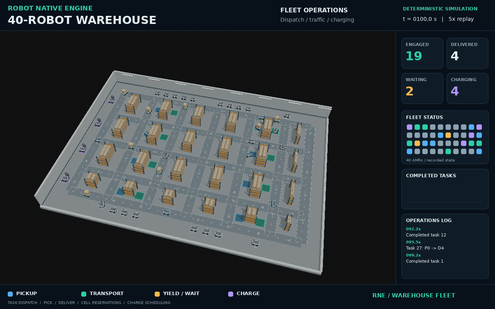
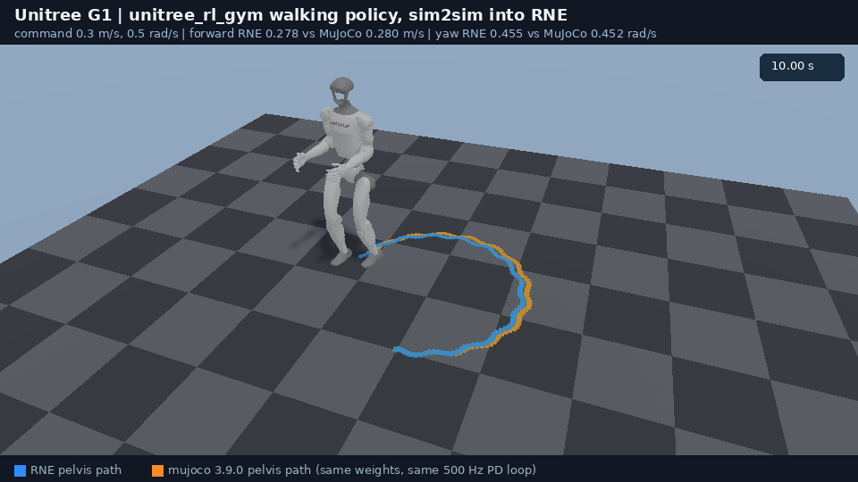
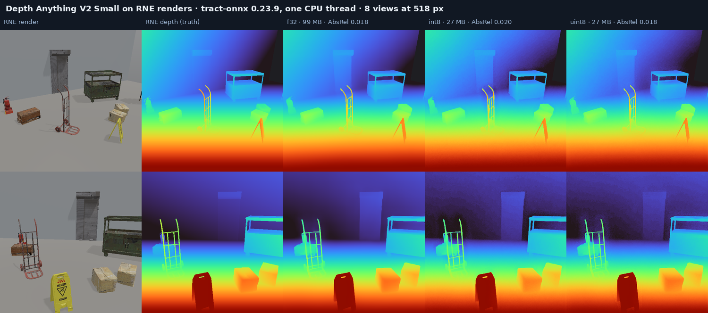

# More demos

The README front page keeps the flagship showcase and the vehicle
dynamics / navigation / G1 locomotion highlights. This page holds the rest of
the demo write-ups: full captions, GIFs, and commands for the pieces that
used to live under the README's "Selected demos" section.

## Forty-AMR warehouse fleet

<p align="center">
  <picture>
    <source media="(prefers-reduced-motion: reduce)" srcset="media/warehouse-fleet.png">
    
  </picture>
</p>

Example 140 records 40 AMRs under seeded dispatch and non-preemptive RNE
traffic reservations. The 5× replay shows real task, waiting, and charging
states with a temporary aisle closure; the HUD reads the recorded telemetry.
The 240-second run completes 16 deliveries, while the captured 100–220 second
interval increases the delivery counter from 4 to 15. Four robots begin at
chargers, and R36 reaches its assigned charger at 212.3 seconds.

Headless validation checks exact full-state replay, swept robot separation,
rack clearance, bounded translation/rotation/acceleration, and closure
occupancy. A same-seed control without the closure traverses the affected
corridor. The directed planner, dispatcher, and scenario battery model are
local to the example; wheel traction, contact forces, physical pickup,
sensing errors, and hardware operation are not modelled.

```bash
cargo run --release --locked -p warehouse_fleet --example 140_warehouse_fleet
```

[Source and regeneration](../examples/140_warehouse_fleet/README.md) ·
[metadata](media/warehouse-fleet.json).
The scenario was inspired by [WareTwin](https://github.com/WayneChou-bot/WareTwin);
the code, meshes, and media are original.

Physical URDF fleets can use `spawn_urdf_robot_with_owned_collisions` or its
document equivalent with `UrdfSpawnConfig { self_collisions: false, ..Default::default() }`.
Each robot then excludes contacts only within its own generational owner group,
while contacts with other owners or unmarked environment colliders remain
eligible under their independent masks. This avoids assigning one mask bit per
robot, including beyond 32 robots. Native and Rapier implement the pair filter;
MuJoCo binds solid-pair exclusions when compiling the model and rejects
owner-marked sensors. The legacy spawn APIs still use their
shared mask. See [the ownership policy and validation scope](architecture/016_contact_dynamics.md#per-robot-self-collision-exclusion).

## Office AGV delivery

<p align="center">
  <picture>
    <source media="(prefers-reduced-motion: reduce)" srcset="media/showcase-office.png">
    
  </picture>
</p>

The tote is a dynamic body moved only by contact: the dock's pusher slides it
onto the AGV's deck, friction carries it (8 mm of slip), and the AGV's own
pusher slides it onto the tray at the desk. On the way the AGV waits at the
yield line while the oncoming AGV comes through the single-lane section, which
is drawn, not collided with. This was a README front-page showcase until the
Go2 door took its place. [metadata](media/showcase-office.json) ·
[source](../examples/90_showcase_captures/office.rs)

```bash
cargo run --release --locked -p showcase_captures --example 90_showcase_captures -- --capture --environment office
```

## Two trucks, one lift

<p align="center">
  
</p>

A truck on each floor and the lift as the conveyor between them. The
ground-floor truck sets the case on a stand inside the car and backs out; the
car goes up with only the case; the upper-floor truck forks it out and
delivers it. A light-curtain check holds the doors while anything is in the
doorway, and the case moves 6 mm and 1.5 mm on the two trucks' tines. Driving
and turning are commanded; the wheels are not modelled.
[source](../examples/125_warehouse_relay/main.rs)

## Camera-based localization with visloc-rs

<p align="center">
  <picture>
    <source media="(prefers-reduced-motion: reduce)" srcset="media/triple_demo.png">
    
  </picture>
  <br>
  <sub>A URDF mobile base with a stereo camera drives a U-shaped route through the real-capture Dr Johnson 3DGS interior. Top: third-person view. Bottom-left: first-person (the exported cameras). Bottom-right: the prebuilt COLMAP map, ground truth (black), and the localized trail (red). Stereo + IMU VIO reaches 0.029 m ATE; map matching relocalizes 377/400 frames at 0.058 m.</sub>
</p>

Example 113 runs a deterministic diff-drive episode in a photo-derived 3DGS
interior and exports an EuRoC-format stereo + IMU dataset (cameras at 20 Hz,
IMU at 60 Hz, ground truth, Double-Sphere calibration). The RNE side owns the
scene, the robot, and the sensors; [visloc-rs](https://github.com/rsasaki0109/visloc-rs)
consumes the export for VIO and map-matching relocalization against a map built
from a separate episode.

```bash
cargo run -p drjohnson_euroc_export --example 113_drjohnson_euroc_export -- target/drjohnson_euroc
```

Details: [navigation integration plan](VISLOC_NAVIGATION_PLAN.md),
[source](../examples/113_drjohnson_euroc_export/main.rs).

## PLATEAU city and sensors

<p align="center">
  <picture>
    <source media="(prefers-reduced-motion: reduce)" srcset="media/plateau-car.png">
    
  </picture>
  <br>
  <sub>PLATEAU city import: official tile, traffic signals, kinematic vehicles, and sensor overlay.</sub>
</p>

Example 46 imports a bounded official PLATEAU Sanjo City tile once, then renders
both the deterministic 100-actor traffic capture and a bounded, controlled
quadrotor flight through the same detailed streetscape. Example 47 replays the
traffic runtime headlessly. The hero vehicle carries physics-aware LiDAR and
RGB-D sensors with seeded noise, material response, timing, and replayable output.

```bash
cargo run -p plateau_drone_gif --example 46_plateau_drone_gif
cargo run -p traffic_city_replay --example 47_traffic_city_replay
```

Details: [PLATEAU import](PLATEAU_IMPORT.md),
[traffic runtime](TRAFFIC_RUNTIME.md),
[LiDAR](LIDAR_SIMULATION.md), and [camera](CAMERA_SIMULATION.md).

## Go2 learning boundary

The shared `LocomotionPolicy` contract supports seeded Go2/G1 batches,
checkpoints, replay digests, CEM smoke tests, and a Python PPO smoke path.

```bash
cargo run --release -p go2_pure_torque --example 64_go2_pure_torque
cargo run --release -p go2_velocity_terrain --example 65_go2_velocity_terrain
cargo run --release -p locomotion_vectorized --example 66_locomotion_vectorized
```

See [GO2_LOCOMOTION.md](GO2_LOCOMOTION.md) and [ROADMAP.md](ROADMAP.md).

## Manipulation learning

Example 27's `train_clutter.py --smoke` learns bounded IK tracking scales and
gripper speed in a fixed-base friction-grasp episode. It checks reward
improvement, actual grasp, exact observed replay, and failed open-gripper/stopped-arm
controls; placement is reported separately. See the
[RL example](../examples/27_mobile_manipulator_rl/README.md) for setup and the learning scope.

## G1 manipulation and deformables

<p align="center">
  <picture>
    <source media="(prefers-reduced-motion: reduce)" srcset="media/unitree-g1-dex3.png">
    
  </picture>
  <picture>
    <source media="(prefers-reduced-motion: reduce)" srcset="media/unitree-g1-cloth.png">
    
  </picture>
</p>

```bash
# Two-contact Dex3 grasp, lift, carry, and release
cargo run -p unitree_g1_dex3_pick_place --example 42_unitree_g1_dex3_pick_place

# G1 hand handling live XPBD cloth
cargo run --release -p unitree_g1_cloth_handling --example 45_unitree_g1_cloth_handling

# Deterministic cable and cloth rollouts
cargo run -p deformable_cable --example 43_deformable_cable
cargo run -p deformable_cloth --example 44_deformable_cloth
```

## Native motion planning

`rne_planning` is a deterministic, MoveIt-inspired joint-space planning layer
built on the generic `rne_robot` kinematic model and collision checker: planning
scene and SRDF groups, goal and path constraints, a planner registry and
pipeline, PTP/LIN/CIRC motions, RRT-Connect, RRT*, informed RRT*, PRM,
BIT\*-style, CHOMP and STOMP trajectory optimization, hybrid planning, and
request adapters with velocity- and acceleration-limited time parameterization.
No MoveIt or ROS dependency is added to core.

<p align="center">
  <picture>
    <source media="(prefers-reduced-motion: reduce)" srcset="media/motion-planning.png">
    
  </picture>
  <br>
  <sub>The checked-in RNE-converted <b>OpenArm v2 left arm</b> (7-DOF, GLB meshes), planned by RRT-Connect and rendered by the real wgpu renderer. A collision object blocks straight joint interpolation; the cyan trail traces the collision-free end-effector detour. <a href="../examples/102_motion_planning_media/main.rs">capture source</a> · <a href="architecture/011_joint_motion_planning.md">architecture</a></sub>
</p>

```bash
cargo run -p motion_planning --example 101_motion_planning
cargo run --release -p motion_planning_media --example 102_motion_planning_media
cargo run -p motion_planning_media --example 102_motion_planning_media -- --smoke
```

See [joint-space motion planning](architecture/011_joint_motion_planning.md).

## Native articulated dynamics

`rne_dynamics` is the backend-neutral, deterministic articulated-body dynamics
layer that model-based legged and mobile-manipulation control builds on: spatial
algebra, the composite-rigid-body mass matrix, recursive Newton-Euler inverse
dynamics with gravity and velocity bias, deterministic forward dynamics, the
center of mass, and the center-of-mass Jacobian. Fixed- and floating-base trees
are supported, and the Go2 diagnostics example checks the equation of motion on
a real 18-DoF quadruped.

```bash
cargo run -p dynamics_diagnostics --example 103_dynamics_diagnostics
```

See [articulated-body dynamics](architecture/012_dynamics.md).

## Hard-contact time stepping on fractal terrain

`rne_dynamics::contact_step` advances an articulated model with unilateral
contacts and the exact Coulomb cone, solved per contact with bisection in the
style of RaiSim, and integrates joint PD implicitly so stiff gains stay stable.
`rne_physics::FractalTerrain` generates seeded RaiSim-style height maps. Example
133 drops the Go2 onto such terrain, lets it stand on its four feet with
stand-pose PD only, checks that the contacts carry its weight, and replays the
run to confirm it is bit-for-bit deterministic.

```bash
cargo run -p go2_contact_terrain --example 133_go2_contact_terrain
```

Example 134 trots the Go2 across generated terrain on the same step: an
open-loop diagonal trot on implicit PD inside the Go2's declared actuator effort
limits, covering about 2.8 m in 8 s with roll and pitch under 0.15 rad.

```bash
cargo run -p go2_terrain_trot --example 134_go2_terrain_trot
```

Example 135 drives the Go2 with the feedback trot of `rne_locomotion` over
rougher terrain: it tracks 0.4 m/s, turns 2 rad on command, and is level again
a second after a 250 N lateral push, with example 134's open-loop gait run on
the same course for comparison.

```bash
cargo run --release -p go2_feedback_trot --example 135_go2_feedback_trot
```

Example 136 batches 32 Go2 terrain episodes — each with its own terrain,
heading, and command — and steps them in parallel with
`VectorizedEpisode::step_parallel`, the raisimGym pattern, checking that the
parallel batch replays the serial one bit for bit.

```bash
cargo run --release -p go2_parallel_rl --example 136_go2_parallel_rl
```

Example 137 builds the Go2 the way the asset loader does and drives it through
the backend-neutral `PhysicsBackend` loop on `rne_physics_native`, the native
backend built on the same step, and on Rapier for comparison. It then drops the
Go2 onto a free crate beside a free tower of boxes, where the robot, the crate,
the tower, and the ground share one contact solve. On both backends it casts a
ray down onto the standing robot's base and a grid of rays onto the terrain.

```bash
cargo run --release -p go2_native_backend --example 137_go2_native_backend
```

Example 138 grips, lifts, and holds 5, 20, and 50 kg cubes with a two-finger
multibody gripper — a palm on a prismatic lift and two pads squeezing with a
constant effort — on the native backend and on Rapier through the same
`PhysicsBackend` loop. Squeezed with a 25 % margin over what friction needs,
every cube rises with the palm; squeezed 35 % short, every cube stays on the
floor. The native run must hold with no slip and no twist and replay bit for
bit.

```bash
cargo run --release -p heavy_grasp --example 138_heavy_grasp
```

Example 138 also supports `--benchmark-json native|rapier|mujoco`, with
MuJoCo behind the optional `mujoco` feature. See the
[heavy-grasp comparison](HEAVY_GRASP_COMPARISON.md) for runtime setup, repeated
measurements, strict task thresholds, and the retained failed cases.

See [hard-contact time stepping](architecture/016_contact_dynamics.md).

Example 139 records Go2/G1 recovery under a common 40 N·s, 80 ms lateral
half-sine body wrench at 1 kHz. Dedicated URDF-derived plants use declared
masses/COM/inertias, joint-origin rotations, welded fixed children and complete
foot collision geometry. ForceBased PD respects authored effort caps and
rate-limited joint targets; Go2 adds IMU leg-length feedback and contact-load
stance regulation with hip abduction ±0.45 rad, and G1 uses a ±0.24 rad
stance with COM/DCM/IMU ankle/hip feedback and outward-arm reactions.
Controllers react to current state without reading the impact schedule. Physical recovery and exact observed replay gate capture.

The optional comparison renderer uses a CC0 skinned human with weight
transfer, forward knee flexion and a planted support foot. The human is a
visual actor; its foot does not produce simulated collision impulses.
The measured envelope is lateral recovery, not hardware qualification or
all-direction resistance. The impulse is 67% above the earlier README capture.
The same 40 N·s nominal probe toppled both earlier controllers; the wider-stance controllers
recover without changing mass, inertia, effort ceilings, friction or recovery
thresholds. The G1 hip-attitude gain is 0.5, preserving support margin in the
late-onset and 500 Hz cases where the 1.0-gain prototype fell. G1 recovers
at 32 N·s nominally and falls at 48 N·s. Stronger and directional probes
retain their outcomes rather than define maximum hardware ratings.
All 12 required 40 N·s recovery cases pass with exact observed replay;
the full 18-case report retains both front-impact failures and G1's oblique failure.

```bash
cargo run --release -p kick_comparison --example 139_kick_comparison -- --headless
cargo run --release -p kick_comparison --example 139_kick_comparison -- \
  --validate-recovery --output target/rne-kick-validation
```

The broader validation retains zero-force, rate, onset, reverse-direction,
matched feedback-ablation and front/oblique limit cases with exact replay.
A feedback-off case can still recover through joint PD and its stance; both
plants are measured against a matched zero-force baseline. GIF encoding
requires the complete report with all 12 required cases passing.
Successful recovery at both rates does not establish
full-trajectory numerical convergence.
`--physical-kick` replaces the prescribed wrench for the Go2 with a simulated
kicking leg derived from the rendered human (bone lengths, hip-abduction axis,
shoe box and trouser radii), Dempster/Winter segment masses for an assumed
70 kg adult, and torque caps of 120-200 N·m. The shoe reaches the robot
through physics contact. The nominal kick arrives at 5.2 m/s and delivers a
measured 28 N·s normal impulse with a 1.4 kN peak averaged over 10 ms, and the
Go2 recovers. An extension-speed sweep from 2.0 to 7.0 m/s shoe speed recovers
in every case with exact replay. `--strength 2 --kick-speed 3.5
--follow-through 0.3` reaches the roughly 10 m/s of trained front kicks. On
the default floor it slides the Go2 about a metre. With `--floor-friction 0.9`
it flips the robot onto its back. `--robot g1` kicks the G1 with the mid kick,
through convex hulls of its collision meshes. Its hanging left arm takes most
of a nominal kick, which it recovers from. A 10 m/s trained-strength kick to
the hip knocks it over. The kicker's torso is kinematic and the contact is
rigid; see
[the method and limits](../examples/139_kick_comparison/README.md#simulated-kicking-leg).

```bash
cargo run --release -p kick_comparison --example 139_kick_comparison -- \
  --physical-kick --render --output target/rne-kick-physical
```

The separate `--observation-probe` diagnostic measures sampled, delayed and
deterministically perturbed synthetic state estimates. It keeps physics and
outer-control evaluation at 1 kHz, reads only arrived DataBus frames, and retains
failed settlement and recovery cases. These are declared sensitivity bounds,
not measured hardware sensor specifications. The inner position PD continues
to use instantaneous simulated joints; the probe does not qualify a new GIF.
In the fixed-seed eight-profile matrix, Go2 recovered in all eight conditions.
G1 recovered in five and fell in the 5 ms latency, 20 ms latency and bounded-error
conditions. Both plants' combined zero-input baselines stayed upright. All 16
plant and observation/control recordings matched fresh replay. These outcomes
do not establish a monotone latency/error tolerance or hardware robustness.
The source-bound results are retained in
[the observation study](media/kick-observation-study.json).

```bash
cargo run --release -p kick_comparison --example 139_kick_comparison -- \
  --observation-probe --output target/rne-kick-observations
```

See [capture, physical models, validation, and regeneration](../examples/139_kick_comparison/README.md).

The separate `--g1-observation-diagnosis` mode pairs four G1 observation
profiles with zero input and the unchanged 40 N·s wrench. It streams every
control tick, including settlement, with arrived estimates, evaluator-only
truth and original bounded joint decisions. Fresh replay and logging-on/off
comparisons check that the diagnostic itself does not alter behavior. Matched
zero-input cases distinguish standing instability from a kick-dependent
failure without changing the controller or recovery predicate.

```bash
cargo run --locked --release -p kick_comparison --example 139_kick_comparison -- \
  --g1-observation-diagnosis --output target/rne-g1-observation-diagnosis
```

All four matched zero-input cases recover; the same 40 N·s wrench reproduces
the three delayed/bounded-error falls while the ideal reference recovers.
See the [complete diagnostic evidence](media/g1-observation-diagnosis.json)
for the eight measured outcomes and replay/compatibility proofs.

`--g1-orientation-age-experiment` adds an explicit comparison between raw
feedback and orientation projected from an arrived frame's capture age and
world gyro. Its 16 cases hold gains, physics and recovery criteria fixed.
Zero-age feedback is unchanged; all other channels retain captured values.
The primary test is recovery under 5 ms delay and the same 40 N·s wrench.
All failed cases remain in this headless experiment's evidence, which is
separate from public GIF qualification.

```bash
cargo run --locked --release -p kick_comparison --example 139_kick_comparison -- \
  --g1-orientation-age-experiment --output target/rne-g1-orientation-age
```

In the complete fixed-seed matrix, projection restores full-predicate recovery
for the 5 ms delayed 40 N·s kick, reducing peak tilt from 1.638381 to
0.309082 rad. The 20 ms delayed and bounded-error kicks still fail, while all
eight zero-input runs recover. Default feedback remains raw. See the
[16 measured outcomes and source-bound proofs](media/g1-orientation-age-experiment.json)
for the full comparison and literal replay scope.

`--g1-lateral-gyro-experiment` compares that orientation policy with a fixed
5 ms EMA on positive-age world gyro X. Orientation still uses the original
captured gyro; capture spacing drives EMA updates. Held/missing frames leave
history unchanged, and zero-age payloads retain their original bits. Its
16 cases keep plant, gains, actuator caps and recovery criteria fixed.

```bash
cargo run --locked --release -p kick_comparison --example 139_kick_comparison -- \
  --g1-lateral-gyro-experiment --output target/rne-g1-lateral-gyro
```

The primary gate is complete recovery under 20 ms delay and 40 N·s, together
with preserved standing, 5 ms recovery, replay and compatibility. Failed
settlement/recovery remain outcomes. Default feedback remains raw; the
candidate stays opt-in and cannot qualify public GIF evidence. The study
does not establish hardware reliability. See the
[method and selectors](../examples/139_kick_comparison/README.md#fixed-lateral-gyro-experiment).

The completed matrix fails candidate advancement: the 20 ms kicked case still
falls, and the EMA loses the earlier 5 ms kicked recovery (peak tilt
0.309082 -> 1.638850 rad). All eight zero-input runs recover, with zero-age
equality and the bounded-error negative control preserved. Replay and
compatibility checks pass independently of these failed recovery outcomes.
The candidate is not promoted; see the
[16 measured outcomes and compact proofs](media/g1-lateral-gyro-experiment.json).

Example 139 also offers private completed-motor evidence without changing its
controllers or public GIF:

```bash
cargo run --locked --release -p kick_comparison --example 139_kick_comparison \
  --features position-motor-diagnostics -- --headless --g1-lateral-gyro-experiment \
  --motor-effort-diagnostics --output target/rne-g1-motor-effort
```

The default-off feature is forwarded through AI to the Rapier backend. Separate
motor JSONL/report data contain signed impulse, actual solver-time interval means,
effective ceilings, availability/coverage, and FINAL positive-finite-bound
exposure. Three fresh worlds retain existing replay/outcomes and compare readback
ON repeats against a backend-OFF legacy comparison. All 23 G1 joints are reported
in fixed consumer windows; high slice-bound occupancy is distinct from an
interval-mean torque peak and does not identify hardware saturation or a fall
cause. Diagnostics are headless-only and rejected by render/encoder admission.

The 16 fixed cases/48 fresh worlds retain 11 recoveries and five failed outcomes;
this adds observation, not a new recovery policy. All 23 joint records are
available and full-step-qualified in the 131,200 first-ON rows, with measured
zeros retained. See [all cases/joints and source-bound proofs](media/g1-motor-effort-diagnostics.json)
and [method and output scope](../examples/139_kick_comparison/README.md#completed-position-motor-diagnostics).

## Contact and motor stage collection

Example 142 records one unchanged held-grasp Rapier case from example 138 at
500 Hz. It retains all 1250 settle/lift/hold steps, native row and velocity
words, ordered solver boundaries, exact native entity checkpoints and ECS words.

```bash
cargo run --locked --release -p contact_motor_stages \
  --example 142_contact_motor_stages -- \
  --mass-kg 5 --observer on --label baseline-m5-on \
  --output /tmp/baseline-m5-on.jsonl.gz
```

All flags are mandatory and existing output is never overwritten. Choose mass
`5`, `20` or `50` and observer `on` or `off`. The final `collection: ok` means
the stream completed and gzip finalized; physical acceptance, replay and motor
accuracy require separate assessment. See the
[record layout and failure contract](../examples/142_contact_motor_stages/README.md).
The first fixed eighteen-world collection completed, but its frozen palm-only
numerical reader rejects additional native finger rows. This failed qualification
and both late metadata repairs are retained in the
[study evidence](evidence/contact-motor-stages/README.md); collection is not a
contact-reopening or solver-improvement result.

The [generation 5 cohort](evidence/contact-motor-stages-generation5/README.md)
preregisters palm and both zero-authority finger roles before eighteen new runs.
Captured-state replay and source-ordered normal/zero arithmetic pass all six
build/mass profiles. The historical failed gates, rejected candidate and scalar
0/4 accuracy result remain unchanged. Its six whole derived detail streams are
retained outside Git; public download verification is pending upload credentials.
All eighteen compressed streams reproduce the original raw checksums, allowing
the exact approved TAR to be reconstructed under persistent storage.

A separate [baseline coupled-contact diagnostic](evidence/coupled-contact-v1/README.md)
uses nine new processes: 5/20/50 kg, each ON/fresh ON/OFF, with unchanged
example-142 defaults. All original exits and the one frozen reader exit are
zero; captured-state replay and source-domain checks cover all three internal
motor rows, including the zero-cap finger pair. It retains 135,000 motor visits,
45,000 rebuilt diagonals and 270,000 contact-row intervals. No strict reopening
is counted; contact stages change defects that are already nonzero. This is no
accuracy, convergence or historical example-138 cause claim. The complete
external archive is locally verified; the proposed download location is pending
upload authentication recovery and public byte verification; publication has
already been approved. Collection commands above
are individual examples, not permission to rerun the completed cohort.

## Isolated position-motor calibration

Example 141 compares a contact-free one-DOF sphere motor with an independent
first-slice fixed point. The fixed 24 conditions use the unchanged G1 gain pairs,
small signed/zero targets, one/32 small steps, and one/two PGS passes. Each condition
executes two fresh readback-ON worlds and one OFF world for exact replay checks.

```bash
cargo run --locked --release -p position_motor_calibration \
  --example 141_position_motor_calibration -- \
  --output target/position-motor-calibration.json --require-calibration
```

The command retains every condition before returning a failing exit if the
predeclared numerical requirement is unmet. Collection completeness, exact replay
and calibration accuracy have separate outcomes. Existing output is never
overwritten. Checking the retained report executes no new worlds:

```bash
cargo run --locked -p position_motor_calibration \
  --example 141_position_motor_calibration -- \
  --verify-report docs/media/position-motor-calibration-motor-construction-source.json
```

See [the fixed protocol and output contract](../examples/141_position_motor_calibration/README.md)
and [all current-source conditions](media/position-motor-calibration-motor-construction-source.json). The retained
run completes 72/72 worlds with exact ON/fresh/OFF state replay and 8/8 motionless
zero targets. Its four primary N32/PGS1 nonzero conditions all fail the predeclared
accuracy requirement; `--require-calibration` therefore exits 2. Loaded-report
verification exits 0 while printing `primary_calibration=FAIL`. This fixture changes
no production solver or control settings and makes no kick-recovery or hardware claim.

Example 143 separately records actual motor-construction inputs and the velocity
used immediately before coordinate integration. Six fixed sign/ON/fresh/OFF
processes pass captured-state replay and 128 construction plus 128 coordinate
checks. Final writeback velocity remains distinct from integration input;
these diagnostics do not turn the scalar accuracy failure into a pass.
See [the collector and fixed fixture](../examples/143_motor_construction/README.md)
and [whole retained data and provenance](evidence/motor-construction-v1/README.md).

A separate external visitation study derived from example 143 compares public
PGS/stabilization counts 1/2, 1/0 and 3/0 in eighteen fixed sign/ON/fresh/OFF
processes. All original exits and the one frozen audit pass, with exact captured
replay and 384 constructor, 384 coordinate and 896 motor-visit checks without
arithmetic exclusions. Both first-slice discriminators remain inconclusive.
For the positive target at the last slice, the 1/2 profile integrates at
0.0243901238 rad/s and writes back 0.0312500075 rad/s. The 1/0 profile preserves
the captured coordinate with both velocities at 0.0243901238 rad/s; the 3/0
profile changes the coordinate endpoint and has both velocities at 0.0312500075
rad/s. This external prototype adds no workspace CLI or production setting.
See [the whole retained study](evidence/motor-visit-placement-v1/README.md).

A separate external physical diagnostic uses two source-copy builds and twenty
fixed contact-free ForceBased inertia/time/cap conditions. All 120 original
processes and the one frozen reader complete with source/state fidelity checks
passing. Inactive-cap cases meet the independently declared nominal-SI allowances
in 0/8 baseline and 8/8 candidate cases; saturated and zero controls meet them in
both builds. These are one-interval diagnostics with integration/final velocity
kept distinct, not a new workspace example or production setting. The earlier
global inverse-(w+g) rejection and four-primary calibration failure are unchanged.
See [the full physical diagnostic](evidence/motor-physical20-v1/README.md).

The scalar 0/4 failure and rejected inverse-diagonal candidate remain unchanged;
these observations establish no motor-accuracy or hardware improvement.

The schema-2 reports use postcard 1.1.3. The
[original schema-1 report](media/position-motor-calibration-bincode-generation-1.json)
and [codec migration receipt](media/position-motor-calibration-codec-migration.json)
retain the failed results from both 72-world generations. Exposed IEEE state and
ordered telemetry match exactly; the current verifier rejects old schemas and
stale source bindings. The migration adds no dependency-policy exception.

The [rejected inverse-diagonal experiment](evidence/position-motor-diagonal-experiment/README.md)
adds a separate historical 72-world report: its four primary calibration cases
pass, but example 138's Rapier grasp numbers change and fail the preregistered
compatibility gate. All candidate code is rolled back, and a new release run
restores examples 133–138's complete physical outputs. This historical report
has a different source binding and is intentionally rejected by the current
example 141 verifier. Its rejected admission and the default calibration FAIL
remain unchanged; no G1 or hardware recovery is established.

Strict vendored Rapier lint cleanup later changes lifetime spelling, a malformed
documentation link and ineffective annotations in two selected source files. The
[original schema-2 report](media/position-motor-calibration.json) remains
byte-identical historical evidence. A new fixed 72-world current-source run
allows only those two source hashes to differ and requires every other report
byte to match; CI verifies this new report through the unchanged verifier.
See the [source-transition and strict validation receipts](evidence/rapier-strict-validation/README.md).

## G1 sim2sim: pretrained walking policy



unitree_rl_gym's pretrained G1 walking policy (an LSTM actor trained in Isaac
Gym) runs on RNE's Rapier backend with Unitree's MuJoCo deployment loop: PD
torque every 2 ms clamped to the URDF effort limits, policy at 50 Hz. The
weights are a float32 blob copied out of the TorchScript archive without
executing it, and the Rust policy reproduces MuJoCo's actions within 1e-4.
Across 0.5, 0, 0.3 + 0.5 rad/s and 0.8 m/s commands, RNE's forward speed is
within 0.02 m/s of MuJoCo's, its turn rate within 0.007 rad/s and its mean
pelvis height within 2 mm. Armature, joint friction and floor friction change
forward speed by under 0.01 m/s. Four inertia-less sensor frames that RNE's
importer weighted at 1 kg each made the first port crouch 19 mm low; the
12-DoF model now merges its fixed upper body into the pelvis, as the MJCF
does, and is pinned at 32.107 kg. One G1 runs at 5.1× real time with four
solver iterations and 12.9× with one; MuJoCo steps the same model at 20×.
`--robot h1` runs unitree_rl_gym's H1 policy on the H1, whose feet are convex
hulls of its ankle meshes: no fall, pelvis height within 2 mm, and forward
speed 0.02–0.03 m/s above MuJoCo's at every command.
The browser playground's Physics walking mode runs the same G1 policy and
physics as WebAssembly in real time: in headless Chromium without a GPU the
real-time factor held 0.99–1.01 with physics and policy using under a third of
each simulated second.

```bash
cargo run --release -p g1_sim2sim --example 144_g1_sim2sim
cargo run --release -p g1_sim2sim --example 144_g1_sim2sim -- --timing
```

See [the method, results and limits](../examples/144_g1_sim2sim/README.md) and
[the browser mode](../web/rne_web_viewer/README.md#physics-walking).

## Pretrained models on the CPU: depth from RNE renders



`tools/onnx_eval` fetches pretrained ONNX models pinned by revision and
SHA-256, runs them on the CPU with tract, and scores them against what RNE
knows exactly. Depth Anything V2 Small, on eight renders of a warehouse corner
at 518 px, reaches AbsRel 0.018 and δ1 0.997 after the usual scale-and-shift
alignment. The publisher's int8 quantizations are 3.6× smaller (27 MB against
99 MB) and stay within about 1% of float32, but on x86 tract runs them slower:
5.4 s against 4.8 s on one thread, and 4.3 s against 2.3 s on four. RNE's
ground truth also shows where the model is wrong: every variant pulls a flat
roller shutter out of its wall. The same runtime runs the G1 walking policy
rebuilt as a standard ONNX graph: its actions match MuJoCo's recording within
8.3e-7 at 14–23 µs per step. The tool keeps its own lockfile outside the
workspace because tract would add twelve duplicated crate names.

```bash
python3 tools/onnx_eval/fetch_models.py
cargo run --release --manifest-path tools/onnx_eval/Cargo.toml -- --threads 4
```

See [the method, results and limits](../tools/onnx_eval/README.md).

## Native legged walking templates

`rne_legged` is the deterministic, backend-free template layer for legged
walking: the Linear Inverted Pendulum Model, Divergent Component of Motion and
capture point, closed-form capture-point foot placement, Kajita-style ZMP
preview control, footstep plans with smooth double-support transitions, and a
full center-of-mass walking pattern. It turns a footstep request into a
replayable trajectory without a physics backend or renderer.

```bash
cargo run -p legged_pattern --example 104_legged_pattern
```

See [legged walking templates](architecture/013_legged_templates.md).

The same crate adds a classical **centroidal layer** for dynamic maneuvers: a
single-rigid-body contact-force distribution with a Coulomb friction cone,
Raibert foot placement, and a minimal-jerk swing trajectory, following the
open-source `cajun` and `go2-convex-mpc` centroidal controllers. This is the
reduced-order abstraction a push-off / flight / landing controller needs.

## Native whole-body control

`rne_wbc` realizes task-space objectives as joint torques on a floating-base
articulated model: a deterministic weighted inverse-dynamics solve over joint
accelerations and contact wrenches, with the floating-base equations of motion
and contact no-slip rows, friction-cone projection, and torque recovery from
`rne_dynamics`. The Go2 example supports the exact body weight through four foot
contacts with a base-residual below `1e-8`.

```bash
cargo run -p whole_body_control --example 105_whole_body_control
```

See [whole-body control](architecture/014_whole_body_control.md).

## Native optimal control

`rne_oc` is the native Crocoddyl-style layer for generating agile maneuvers:
a discrete shooting problem solved by **DDP** with Levenberg-Marquardt
regularization and a backtracking line search, central-difference dynamics
derivatives, quadratic running/terminal costs, and an `ArticulatedDynamics`
adapter that integrates `rne_dynamics` forward dynamics. A pendulum swings up
from hanging to upright under the solver, deterministically and without any
external optimal-control library.

See [native optimal control](architecture/015_native_optimal_control.md).

Example 109 plans a Go2 **crouch–push–flight jump** with the FDDP solver and
executes it with the whole-body controller.

<p align="center">
    <source media="(prefers-reduced-motion: reduce)" srcset="media/go2-jump.png">
    
  <br>
  <sub>Crouch–push–flight jump planned by the native FDDP solver, executed by the whole-body controller with torque feed-forward and low-gain tracking. The body rises 0.107 m, the feet clear 44 mm, and the peak lean is 0.33 rad (0.73 rad before the feed-forward). <a href="../examples/109_go2_jump_sim/main.rs">source</a></sub>
</p>

```bash
cargo run --release -p go2_jump_sim --example 109_go2_jump_sim -- --wbc-stance
```
