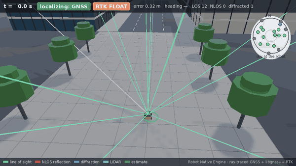

# Ray-traced GNSS, libgnss++ RTK, and GNSS / LiDAR localization

`rne_gnss` simulates what GNSS receivers measure among buildings by ray
tracing every satellite's signal through the scene, on two frequencies and
with carrier phase. [libgnss++](https://github.com/rsasaki0109/gnssplusplus-library)
solves single-point, RTK and moving-baseline RTK positions from those
observations through `adapters/gnsspp/rne_adapter_gnsspp`. `rne_slam`'s
`HybridLocalizer` uses the GNSS solutions outdoors and LiDAR Monte Carlo
localization indoors. The simulation is deterministic, ROS-free and
renderer-free; libgnss++ stays in the adapter.

[Example 149](../examples/149_gnss_lidar_navigation/README.md) drives a robot
with two antennas through a downtown street grid (signalised intersections,
traffic that obeys the signals) from a plaza along the main street into an
office and back, with an RTK base station on a rooftop.



## What the simulation models

| Stage | Model |
|-------|-------|
| Time, geodesy | GPS week / time of week; exact WGS-84 geodetic ↔ ECEF ↔ local ENU. |
| Satellites | Keplerian orbits; the nominal 24-slot GPS constellation and a Galileo Walker 24/3/1 (48 satellites). Exported as broadcast ephemerides (`NavigationMessage`) that reproduce the simulated orbits to 0.1 mm with the IS-GPS-200 algorithm. |
| Signal flight | Satellite position at transmission (light-time iteration) and the Sagnac rotation. |
| Scene | Axis-aligned boxes with a reflection loss per material (concrete 8 dB, glass 4 dB, metal 2 dB; `ABSORBER` for poles and trunks, which block but are not traced as reflectors), a ground plane (12 dB), and foliage volumes that attenuate every path by its length inside them (dB/m). Surfaces beyond `max_interaction_distance_m` are not traced. |
| Direct path | A ray toward each satellite; any box blocks it. |
| Reflections | Up to `max_reflections` (default 2) specular bounces off walls and the ground by the image method: the look direction is the satellite direction mirrored through the facet sequence, and the ray is traced forward through every facet, bounds and occluders included. Excess path `Σ|Pᵢ − Pᵢ₋₁| − (Pk − A)·u`. |
| Diffraction | For blocked satellites, the point on each box edge minimising the path (Keller's law for a plane wave), when both legs are clear. Loss is the ITU-R P.526 knife-edge `J(ν)` with `ν = 2√(Δ/λ)`, so it depends on frequency. |
| Signals | GPS L1 C/A and L2C, Galileo E1 and E5a: frequency, chip length, relative power, iono scaling. |
| Tracking | The direct path when LOS, else the strongest indirect path (NLOS or diffracted). Later replicas within a chip distort the code (narrow-correlator envelope) and carrier (phasor sum), and fade the C/N0. |
| Pseudorange | Geometric range + receiver clock + satellite orbit/clock error (shared by all receivers) + true ionosphere (Klobuchar × truth scale, `(f₁/f)²`) + true troposphere (Saastamoinen × truth scale) + excess path + code multipath + DLL noise from C/N0. |
| Carrier phase | The same with the ionosphere sign reversed, carrier multipath, PLL noise, and an integer ambiguity per lock arc. Lock needs `phase_lock_threshold_dbhz`; slips occur at random near it, and whenever the tracked path changes by more than a quarter wavelength (its phase jumps by the path change). A new arc sets the loss-of-lock flag. |
| Doppler | Rate of the tracked range plus clock between epochs, with noise; absent after a slip. |
| Receivers | Clock bias with a drift random walk. `AntennaRig` mounts several antennas at body-frame lever arms, each with its own receiver; a base station is a receiver at a fixed point. |
| Built-in fix | Weighted least squares with the broadcast Klobuchar and Saastamoinen corrections, DOP, RAIM exclusion, and a sigma scaled by `χ²/dof`. |

Not modelled: multi-bounce paths combined with diffraction, diffraction while
the direct path is clear, polarisation beyond a per-bounce loss, receiver
acquisition time, and non-box geometry.

### Sensor behavior

* **Timestamp** — an epoch is measured at the simulation time passed to
  `GnssReceiver::step` / `observe` (GPS time `epoch + time_s`), with the
  antenna where the caller put it. No wall-clock time is read.
* **Latency** — the built-in fix of an epoch measured at `t` is released at
  `t + latency_s`; epochs fire at `update_rate_hz` (defaults 5 Hz, 50 ms).
* **Noise** — all draws come from `DeterministicRng`: a fixed number per
  satellite and signal in satellite-id order (so one satellite's visibility
  never shifts another's noise); satellite errors seeded by satellite id and
  `satellite_error_seed`; ambiguities seeded by satellite, signal and arc.
  Replays are bit-identical (`tests/determinism/tests/gnss.rs`).

## libgnss++ adapter

`rne_adapter_gnsspp` compiles a C ABI shim against a libgnss++ build and
exposes:

* `Navigation::new(&NavigationMessage)` — ephemerides and Klobuchar
  coefficients.
* `Spp` — libgnss++ single-point positioning.
* `Rtk` (`RtkMode::Kinematic`, `Static`, `MovingBase`) with `RtkConfig`
  (elevation mask, ratio threshold, libgnss++ presets such as `low-cost` or
  `moving-base`, ambiguity reset after consecutive non-fixed epochs) and
  `diagnostics()` (libgnss++'s AR telemetry).

Build libgnss++ once (needs git, CMake, a C++20 compiler and Eigen 3):

```bash
scripts/build_gnsspp.sh
```

It checks out a pinned revision into `target/gnsspp/src`, where the adapter's
`build.rs` finds it; `RNE_GNSSPP_DIR` points at another checkout. Without
libgnss++ the adapter builds as a stub whose constructors return
`GnssppError::Unavailable`, so the workspace never requires a C++ toolchain
(`RNE_GNSSPP_DISABLE=1` forces the stub).

On simulated open-sky data libgnss++ fixes kinematic RTK to centimetres and
a 1 m moving baseline to under 0.02 rad
(`adapters/gnsspp/rne_adapter_gnsspp/tests/rtk.rs`).

## GNSS outdoors, LiDAR indoors

`HybridLocalizer` keeps one `EkfFusion` driven by wheel speed and a gyro yaw
rate and decides which absolute source corrects it:

1. **GNSS** — a fix (`AbsolutePositionFix`, with a `FixKind` of single,
   float or fixed) is healthy if it uses enough satellites, its HDOP and
   reported sigma are small, it is RAIM-consistent with few exclusions, and
   it passes a 99 % Mahalanobis gate. Its variance has a floor per kind.
   Moving-baseline headings (`AbsoluteHeadingFix`) are fused, gated, while
   GNSS is in charge.
2. **Hand-over** — after `leave_gnss_epochs` unhealthy epochs the source drops
   to dead reckoning. Inside the prior occupancy map, each scan runs a wide
   correlative scan match sized by the EKF covariance; a good match seeds an
   `Amcl` particle filter.
3. **LiDAR** — each AMCL update is refined by a local scan match, and the
   refined pose and yaw are fused. An optional gate
   (`lidar_gate_chi_square`, off by default, 99 % in example 149) treats
   matches that disagree with the EKF (a scan sliding along a facade, a
   parked car taken for a wall) as poor matches; too many in a row end
   LiDAR control. It protects an RTK-grade estimate but would also keep
   LiDAR from correcting an estimate a wrong fix left off.
4. **Back outside** — `enter_gnss_epochs` consecutive healthy fixes of at
   least `enter_gnss_min_kind` give GNSS control again. A gate reset after
   `gate_reset_epochs` of disagreement needs an RTK fixed solution or an EKF
   that is already uncertain, so a sustained NLOS or float bias cannot drag
   a well-localized estimate.

### Results of example 149

A delivery robot walks 370 m along the sidewalk of a 4-lane main street
between city blocks, crossing two side streets on the pedestrian signal,
into an office and back. Position RMSE / max in meters:

| Zone | Hybrid | EKF fusing every solution | Odometry only |
|------|--------|---------------------------|---------------|
| Plaza | 0.01 / 0.09 | 0.02 / 0.09 | 17.47 / 27.16 |
| Main street (sidewalk) | 0.02 / 0.11 | 0.37 / 4.94 | 8.47 / 23.25 |
| Office forecourt | 0.04 / 0.13 | 7.08 / 24.04 | 9.33 / 10.28 |
| Indoor office | 0.05 / 0.19 | 0.76 / 1.13 | 10.38 / 10.79 |

Withholding the satellites a buildings-only city model predicts are NLOS
keeps the street RTK fixed 99 % of the time (75 %, with many wrong fixes,
without it); trees and vehicles, absent from the model, still cause some
wrong fixes, which the gate rejects. The longest dead-reckoning stretch is
1.8 s. Without the map-aided exclusion the robot has to stop for 132 s in
the street; without it and without an outdoor LiDAR map it never
relocalizes. See the
[example's README](../examples/149_gnss_lidar_navigation/README.md#what-each-part-contributes).

## Limits

* The scene is axis-aligned boxes; arbitrary meshes (for example a PLATEAU
  city model) would need a BVH and triangle intersection.
* libgnss++ RTK covariances are not used as reported (they come back
  constant); the example floors the variance per solution type instead.
* The hybrid arbiter is a rule-based switch with hysteresis, not a factor
  graph, and does not use 3D-map-aided GNSS (shadow matching) to correct NLOS.
