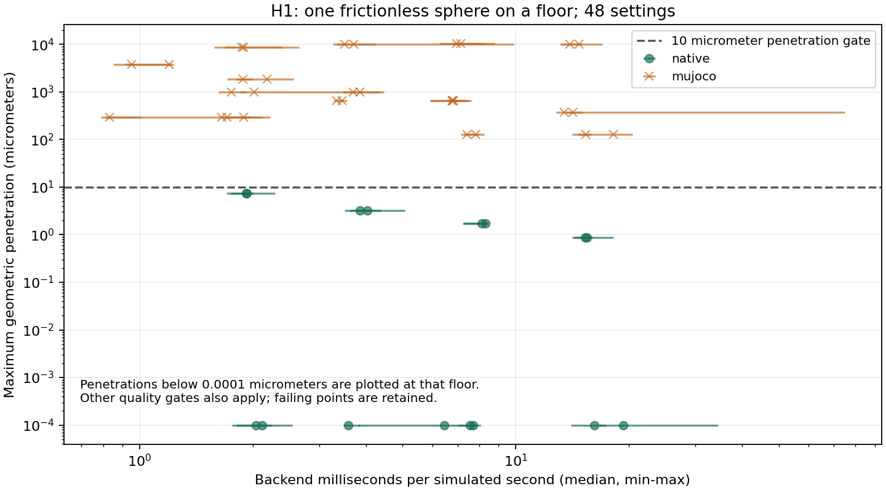

# H1：球落下で非貫通品質と費用を測る

2026-10-30。[開発計画](HARD_CONTACT_QUALITY_COST.md)の最初のベンチマークを実装した。
対象はRNE独自バックエンドとMuJoCo 3.9.0。ソルバ本体の変更は行っていない。

## 測定結果

半径5 cm、質量1 kgの球を床面から10 cm落とし、2秒間計測した。
無摩擦・無反発を目標とする設定で、刻み0.25／0.5／1／2 msと接触設定を比較。
最大侵入10 µm、静止速度1 mm/s、力積誤差1%等の品質ゲートを使用した。

| 対象 | 基準ケースの合格 | 今回分かったこと |
| --- | ---: | --- |
| RNE Native | 16 / 16設定 | 正則化ゼロは数値丸め程度の侵入。既定の微小正則化も基準ケースでは10 µm以内 |
| MuJoCo | 0 / 32設定 | 最小でも約127 µm侵入。今回の刻み・接触設定の探索範囲では品質ゲート未達 |

これはMuJoCoがこの品質を達成できないという結論ではない。
さらに小さい刻みや接触設定は今回の探索に含めていない。
双方とも単一接触の並進運動であり、多点接触・摩擦・把持の優位性も示していない。

横軸は物理時間1秒を進めるバックエンド計算時間。点は5回の中央値、横棒は最小〜最大。
縦軸は全ステップの最大幾何学侵入量。両軸とも対数で、表示下限未満は下限に置いた。
この図は基準ケースのみ。下記の追加条件の失敗を含めた総合合格図ではない。

正則化ゼロ・20反復上限・2 ms刻みのRNEは、約**2.04 ms / 物理時間1秒**
（5回の範囲1.76〜2.54 ms）。同じモデルを多数並列にした性能やECS・制御を含む総時間ではない。
品質未達のMuJoCo設定には約0.83 msのものもあり、素の処理速度だけでRNEが全面的に勝ったわけではない。
**MuJoCo側の合格設定がないため、同品質での速度比はまだ算出しない。**

## 基準ケースの最速設定は、そのまま一般化しなかった

今回、基準ケースで合格した設定のうち測定上最速だったのは、RNEの
正則化0.001・20反復上限・2 ms（中央値約1.92 ms / 物理時間1秒）。
これを固定し、質量0.1／10 kg × 落下距離0.01／0.5 mの4条件に適用した。

| 落下距離 | 質量0.1 kg | 質量10 kg |
| --- | --- | --- |
| 0.01 m | 合格、侵入約2.21 µm | 合格、侵入約2.21 µm |
| 0.5 m | **不合格、侵入約14.39 µm** | **不合格、侵入約14.39 µm** |

基準ケースの合格と最速選択だけでは十分ではない。失敗した最速設定を選び直して合格扱いにはしていない。
`--require-native-pass`付きの記録実行は、この2件の失敗により意図どおり非ゼロ終了した。
全結果・失敗軌跡は[保存記録](evidence/hard-contact-drop/h1-v1.json.gz)に含む。

一方、固定した正則化ゼロ・20反復上限・2 msの独立した回帰試験は、基準ケースと同じ4条件をすべて通った。
CIはこちらの固定条件を品質基準にする。実測最速設定の選択はタイミングのばらつきに左右されるため、
性能探索の結果と固定条件の回帰テストを分ける。1.92 msと2.04 msの測定範囲は重なっており、
わずかな速度差の確実性も主張しない。

## 実装と検証

- [Nativeランナー](../crates/rne_physics_native/examples/contact_drop.rs)：共通形状・質量・慣性で実行。
  更新後の球位置からgapを再計算し、接触マニフォールドの更新前gapを流用しない。
- [比較ドライバ](../scripts/contact_benchmark/drop.py)：48設定と選択設定の4追加条件を記録。
  各ケースの軌跡を同一バックエンドで完全再生し、タイミング専用走行との最終状態一致も確認。
  MuJoCoの警告や内部時刻リセットは品質失敗として扱う。
- [仕様・実行手順](../scripts/contact_benchmark/README.md)：接触時刻はステップ区間で評価する等、
  品質ゲートの定義と計測区間を明記。CPUを1つに固定し、モデル生成・JSON・プロセス間通信・軌跡収集を時間比較から除外。
- 監査・統合テスト6件と独自バックエンドのreleaseテスト49件が成功。
  CIは固定品質基準をテストし、各ホストで測り直した全結果を成果物として保存する。

## 次の開発判断

1. 今回のH1 v1を固定したまま、別版でMuJoCoの刻みをさらに小さくする探索を追加し、
   品質合格までに必要な計算費用を測る。ここで初めて同品質の速度比較を行う。
2. 正則化ゼロの経路を箱の落下・積み重ね・2指把持へ広げる。
   荷重分配の偏り、ねじれ、摩擦の滑りが出れば、法線コンプライアンスに頼らず安定させる方法を調べる。
3. このランナーではまだ得られない求解反復数・未収束・工程別時間を計測し、最適化対象を特定する。

計測する物理品質と計算費用の土台ができた段階であり、「hard contactでMuJoCoを超えた」という完成宣言ではない。
