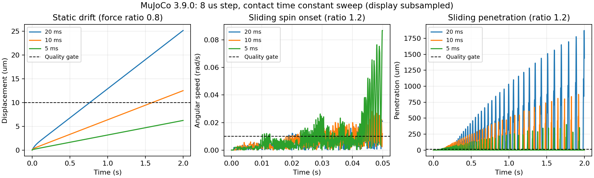

# 実外力摩擦：接触時定数の拡張

2026-10-30。[前回の刻み・減衰較正](HARD_CONTACT_FORCE_FRICTION_CALIBRATION.md)から
時定数を広げたが、今回も静止・滑走を両方通過する設定は得られなかった。
未使用条件の検証・計時は実行せず、同品質の速度比は算出していない。
これは探索した設定範囲での結果であり、MuJoCoの最良設定や性能限界を示すものではない。

## 固定した探索範囲

刻み8 µs、5 µsの順に、各刻みで `solref=[0.02,1]`, `[0.01,1]`, `[0.005,1]`
の順に調べた。時定数は20・10・5 msで、今回は全て刻みの2倍より大きい。
MuJoCoの既定安全制約は有効なまま。箱・床・慣性・摩擦・外力・初期状態・
solimp・solver・品質ゲートは前回から変更していない。

較正は摩擦係数0.5で、質量0.3 kg／荷重比+0.8と、3 kg／+1.2の2条件。
各設定で2秒間を2回実行し、全トレースが完全一致することを確認する。
静止・滑走の両方に合格した最初の設定だけを採用する手順とした。
較正に失敗したため、予約済みの質量1/5 kg・摩擦係数0.35の4条件は今回も未使用。

## 結果

| 刻み | 時定数 | 静止移動（µm、上限10） | 滑走最大めり込み（µm、上限10） | 滑走最大回転速度（rad/s、上限0.01） |
| --- | ---: | ---: | ---: | ---: |
| 8 µs | 20 ms | 25.158 | 1874.163 | 8.250 |
| 8 µs | 10 ms | 12.499 | 923.228 | 8.570 |
| 8 µs | 5 ms | 6.230 | 402.373 | 9.110 |
| 5 µs | 20 ms | 25.040 | 1808.499 | 7.930 |
| 5 µs | 10 ms | 12.440 | 944.396 | 8.953 |
| 5 µs | 5 ms | 6.200 | 436.797 | 9.598 |

静止条件は時定数5 msのみ全品質ゲートに合格した。滑走は6設定とも失格。
時定数を大きくすると、前回の硬い設定より最大回転速度は小さくなるが、
めり込みが増える。いずれも要求品質を満たさず、この範囲では刻みを細かくする
だけでも解決しなかった。



図は8 µs刻みの結果。表示は間引いているが、指標は全ステップから計算した。
滑走の回転速度が0.01 rad/sを初めて超える時刻は、時定数20 msで18.944 ms、
10 msで18.616 ms、5 msで10.208 ms。静止移動の蓄積と滑走時の回転増加は
別の失敗として追う必要がある。図だけから物理的・数値的な原因を断定していない。

## 再現・証拠

```bash
python scripts/contact_benchmark/force_friction_time_constant.py \
  target/release/examples/friction_threshold /tmp/force-friction-time-constant
python scripts/contact_benchmark/force_friction_time_constant.py \
  target/release/examples/friction_threshold /tmp/force-friction-time-constant --verify
MPLCONFIGDIR=/tmp/rne-matplotlib XDG_CACHE_HOME=/tmp/rne-cache \
  python scripts/contact_benchmark/plot_force_friction_time_constant.py \
  /tmp/force-friction-time-constant /tmp/force-friction-time-constant.png
```

MuJoCo 3.9.0、NumPy、図の生成にはMatplotlibが必要。
今回の探索は別プロトコルとして追加し、以前の較正スクリプトとソースハッシュを
変更していない。共通の検証器にプロトコルを明示的に渡し、以前の8件も引き続き検証できる。

[集約レポート](evidence/force-friction-time-constant-summary.json)に12件の指標、
初期ステップ判定、設定、各ファイルのハッシュを保存した。生トレースは
`/workspace/artifacts/force-friction-time-constant-v1` にあり、NPZ合計298,824,742 bytes。
永続公開URLはなく、ADR 034に従ってGitには追加していない。集約JSONだけでは
トレースからの独立再計算はできない。

## 次の調査

時定数と刻みの総当たりを一旦止め、最初の50 msの接触点数・法線力・接線力・
重心まわりのモーメントを記録する。回転の発生が、支持点の切り替わり、摩擦力の
配分、接触拘束の残差とどう対応するかをNativeとMuJoCoで比較する。
原因が分かってから調整対象を絞り、同品質の速度比較へ戻る。

検証：Python 51テスト合格、新レポート12件と旧レポート8件の再検証に合格。
依存境界・差分チェックも合格。Rust本体の変更はない。全workspaceのCIは今回
再実行しておらず、マージ前の確認が必要。
