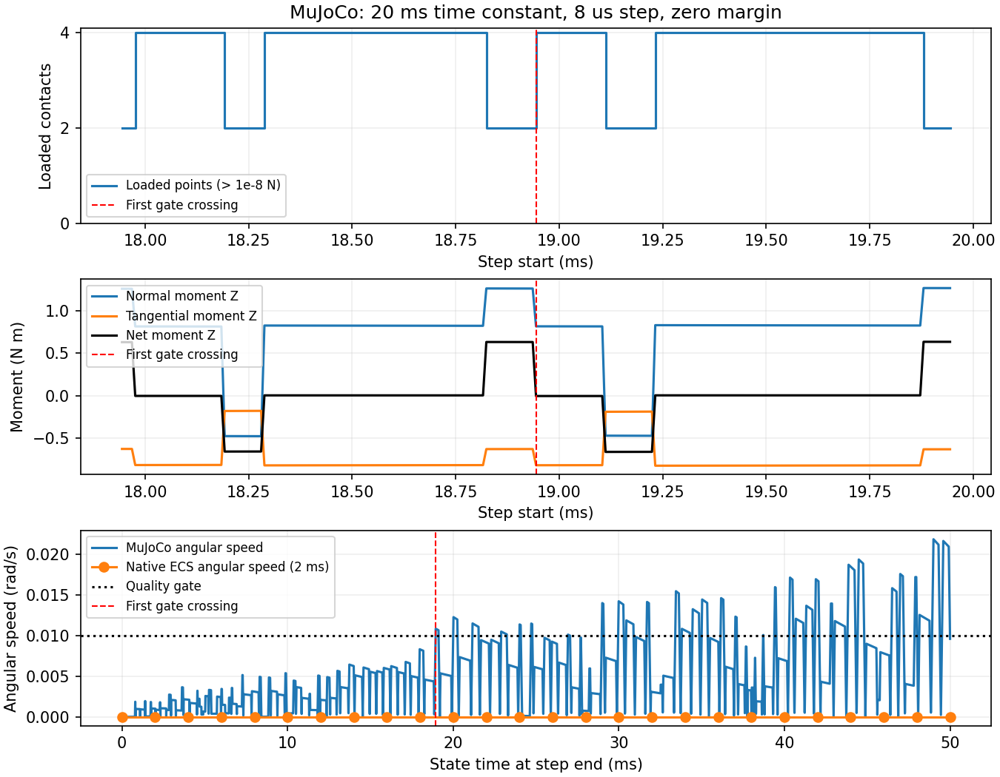

# 滑走の回転増加：接触力とモーメントの診断

2026-10-30。MuJoCoの滑走失敗を最初の50 msまで分解した。
回転速度が基準を超えるステップでは、支持が進行方向の端の2点に偏り、法線力と
摩擦力のモーメント差が角加速度を生んでいた。接触力の座標変換・符号・合計は
MuJoCoの拘束力と運動方程式に一致した。

これは回転を生む局所的な力学を特定した結果であり、支持点の切り替わりが増幅する
根本原因を確定したものではない。接触判定と力の配分の相互作用を次の調査対象に絞る。
性能の優劣や、同品質での速度差は今回評価していない。

## 観測方法

前回と同じ3 kgの一辺0.1 mの箱、摩擦係数0.5、荷重比1.2、水平外力17.658 N。
MuJoCo 3.9.0、8 µs刻みで50 ms（6,250ステップ）を追跡する。
各接触点について位置・法線・距離・世界座標の法線／接線力・重心まわりの
モーメント・積分前の相対速度と接触力の仕事率を保存する。

`mj_step` 後に残る接触点・力・拘束力・加速度は積分前の姿勢に対応する。
その姿勢を保存して `frame.T @ local_force` で世界座標に変換し、箱に作用する
向きへ符号を揃える。モーメントは `Σ((point - COM) × force)`。
`condim=3` なので自由な接触トルクはない。
速度の観測値は積分後の姿勢で世界座標に変換する。

以下を全ステップで照合した。

- 接触点ごとの力・モーメントの合計と `qfrc_constraint`。
- `ΣF_contact + F_external + mg = m a`。
- `Στ_contact = I α`（この箱は等方慣性、I=0.005 kg m²）。
- 力の法線・接線への分解と、荷重を持つ接触点数（法線力 > 1e-8 N）。

全5設定の最大誤差は、並進の力の釣り合いが1e-9 N未満、回転が3e-10 N m未満。
摩擦円錐からの数値的な超過も2e-13 N未満だった。
これらはソルバー収束残差の測定ではなく、出力された力と運動方程式の整合確認である。

## 回転基準を超える瞬間

| solref | margin | 最初の回転基準超過 | そのステップの支持点数 | 合モーメントZ |
| --- | ---: | ---: | ---: | ---: |
| [0.02, 1] | 0 | 18.944 ms | 2 | +0.6330 N m |
| [0.005, 1] | 0 | 10.208 ms | 2 | +0.6750 N m |
| [2e-6, 10] | 0 | 1.376 ms | 2 | +7.6461 N m |
| [0.02, 1] | 10 nm | 27.136 ms | 2 | +0.6507 N m |
| [0.02, 1] | 100 nm | 2.816 ms | 2 | +0.5927 N m |

基準は角速度の大きさ0.01 rad/s。20 ms時定数・margin=0では、18.936–18.944 msの
ステップで法線力25.321 Nの作用位置が重心からX方向に約50 mm偏る。
法線モーメント+1.2660 N m、接線モーメント−0.6330 N mが残差+0.6330 N mとなり、
角加速度約126.605 rad/s²を生む。平らな姿勢で同じ摩擦力に対して無回転を保つには、
支持力の作用位置は約25 mmの偏りで釣り合う。



上2段はステップ開始時刻に対応する接触・力、下段はステップ終了時刻の速度。
赤線は初めて基準を超えた終了時刻なので、その直前の8 µsの力に対応する。
4点支持の区間では法線・接線モーメントがほぼ相殺し、2点支持の区間で正負の
合モーメントが現れる。接触を生成した点数と荷重を持つ点数は別々に記録している。

marginだけを10/100 nmに変える対照実験では、超過時刻が非単調に変化した。
接触判定への感度は確認できたが、marginを増やせば解決するとは言えない。
正のmarginは接触が作用し始める距離も変えるため、同一物理条件の改善結果とは扱わない。
対照実験は50 msのみであり、従来の2秒の品質合格を主張しない。

## Nativeとの比較範囲

同じ箱・荷重でNativeの2 ms刻みの最初の25ステップを取得し、完全再現を確認した。
この区間でECSの角速度はゼロ、そこから復元した合接触モーメントもゼロだった。
並進合力は `m Δv/Δt − F_external − mg`、回転は `I Δω/Δt` から復元した。

Nativeの公開 `ContactEvent` はペアごとの法線インパルスの合計であり、接線力や
各点の作用位置を提供しない。従って今回のNative側は速度差分からの推定であり、
MuJoCoのような接触点ごとの直接観測ではない。刻みも異なるため、力の瞬時値を
一対一に比較したり、Native内部の接触点数が常に4点だと結論づけたりはしない。

## 再現・証拠

```bash
python scripts/contact_benchmark/friction_contact_diagnostics.py \
  target/release/examples/friction_threshold /tmp/friction-contact-diagnostics
python scripts/contact_benchmark/friction_contact_diagnostics.py \
  target/release/examples/friction_threshold /tmp/friction-contact-diagnostics --verify
MPLCONFIGDIR=/tmp/rne-matplotlib XDG_CACHE_HOME=/tmp/rne-cache \
  python scripts/contact_benchmark/plot_friction_contact_diagnostics.py \
  /tmp/friction-contact-diagnostics /tmp/friction-contact-diagnostics.png
```

MuJoCo 3.9.0、NumPy、図の生成にMatplotlibが必要。
[集約レポート](evidence/friction-contact-diagnostics-summary.json)に設定・指標・列定義・
ソース／バイナリ／トレースのハッシュとNativeの50 msの参照データを保存。
生データは `/workspace/artifacts/friction-contact-diagnostics-v4` に保存した
（NPZ合計10,675,094 bytes）。永続公開URLはなく、ADR 034に従いGitに追加していない。

全設定の点別データと集計値の完全再現を確認し、検証器で再計算した。
57件のPythonテストが合格。力の符号・モーメント腕・接触点の欠落・荷重点数・
拘束力の改変を検出するテストを含む。Rust本体の変更なし。全workspaceのCIは
再実行しておらず、マージ前の確認が必要。

## 次の実装

Nativeの内部接触レコードから、任意で点ごとの位置・法線／接線インパルスを
取得できる診断経路を追加する。通常のベンチマークでは無効にし、観測による
コスト変化を混ぜない。その後、接触候補の保持と拘束残差を比較し、支持点の
切り替わりを引き起こす条件を特定する。
