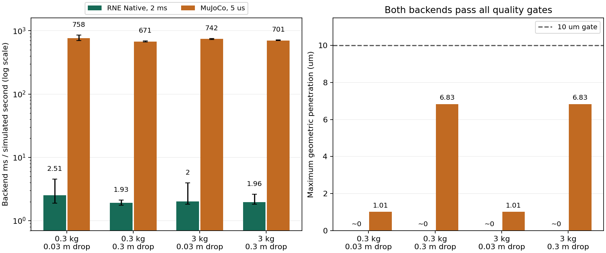

# H1：品質ゲートを満たす設定同士の計算費用

2026-10-30。単一球の落下で、RNE NativeとMuJoCo 3.9.0の双方が品質ゲートを満たす設定を得た。
設定選択に使わなかった4条件でも両方が合格し、物理時間1秒あたりの計算費用は
**今回選んだ設定間でRNEがMuJoCoの約1/342**だった。

これは無摩擦の単一接触、特定の精度基準と探索範囲での結果。
MuJoCo全設定に対する最適性、多点接触・把持・学習環境での優位性はまだ示していない。

## 比較した条件

半径5 cm、球の明示的慣性、床の箱形状、重力、2秒の物理時間は[H1 v1](HARD_CONTACT_DROP_RESULTS.md)と共通。
最大侵入10 µm、最後0.5秒の速度1 mm/s、衝突力積誤差1%、跳ね返り10 µm、
初期エネルギー超過等のゲートを変更していない。
接触時刻のチェックは各刻みの区間幅に依存するため、全指標が同一の絶対精度という意味ではない。
今回、接触時刻だけが原因で設定選択から除外された候補はなかった。

| 項目 | RNE Native | MuJoCo |
| --- | --- | --- |
| 時間刻み | 2 ms | 5 µs |
| 接触設定 | 正則化0、反復上限20 | Newton/Euler、反復上限20、solref `[0.000002, 10]` |
| 物理時間1秒のステップ数 | 500 | 200,000 |
| 検証4条件の計算費用：中央値の平均 | 2.10 ms | 717.84 ms |
| 1ステップあたりの費用：上記から算出 | 4.20 µs | 3.59 µs |

MuJoCoのref-safeは有効であり、要求time constant 2 µsは5 µs刻みでは10 µsへ制限される。
設定の全体と実際のMJCFは記録に保存している。
大きな費用差は、RNEが品質ゲートを満たすのに必要なステップ数の少なさによる。
1ステップの処理自体が342倍速いという結果ではない。

## 設定選択と独立した検証

前回失敗した50 cm落下は既知の条件なので、今回は10 cmとともに質量1 kgの**設定選択用**にした。
ここを未知条件での汎化成功とは扱わない。

H1 v2は刻み250〜2.5 µsと臨界減衰系の3設定を段階的に探索した。
MuJoCoの48ケースに合格設定はなかった。細かい刻みでは侵入量を抑えられても、跳ね返り等で失敗した。
この結果を[失敗を含むv2記録](evidence/hard-contact-drop/h1-v2/report.json)として固定した。

H1 v3は別の事前定義した探索として、減衰比10／20、刻み31.25／15.625／10／5／2.5 µsを用意した。
各段階の全設定を測り、10 cm・50 cmの両方で合格する設定が初めて得られた段階で止める。
その段階の合格候補から、2条件の平均計算費用が最小のものを選ぶ。後続のより細かい刻みは未探索。
RNEは前回の固定参照設定（正則化0・2 ms）を使い、双方を同じホストで測り直した。

選択後、設定を固定して質量0.3／3 kg × 落下距離0.03／0.3 mの4条件を検証した。
検証結果からの再選択は行っていない。

| 質量 / 落下距離 | RNEの最大侵入 | MuJoCoの最大侵入 | RNE計算費用 | MuJoCo計算費用 | 費用比 MuJoCo/RNE |
| --- | ---: | ---: | ---: | ---: | ---: |
| 0.3 kg / 0.03 m | 数値丸め程度 | 1.01 µm | 2.51 ms | 758.14 ms | 302 |
| 0.3 kg / 0.3 m | 数値丸め程度 | 6.83 µm | 1.93 ms | 670.50 ms | 348 |
| 3 kg / 0.03 m | 数値丸め程度 | 1.01 µm | 2.00 ms | 742.17 ms | 371 |
| 3 kg / 0.3 m | 数値丸め程度 | 6.83 µm | 1.96 ms | 700.56 ms | 357 |

計算費用は物理時間1秒あたり。全8ケースが全品質ゲートに合格した。
約342は4条件を等重みとした中央値の平均の比で、最速の1試行の比ではない。



各設定でウォームアップ1回と、新しい世界を作る5回の測定を実施。
CPUは同じ論理CPUに固定し、検証条件ごとにバックエンドの実行順を交互にした。
図のエラーバーは観測最小〜最大であり、統計的な信頼区間ではない。
生成・JSON・IPC・軌跡収集・ECS同期は時間比較から除外している。
ロボット制御まで含む全経路や、複数環境の性能は別の測定が必要。

## 証跡・再現・制限

[v3の全設定・品質指標・計算費用](evidence/hard-contact-drop/h1-v3/report.json)とv2の記録をGitに保存した。
合計76ケースで、各バックエンド内の全軌跡完全再生と、監査／時間測定モードの最終状態一致を確認した。
全軌跡はfloat64の`.npy.gz`で別保存し、各記録にファイル名・形状・SHA-256を含める。
細かい刻みの全軌跡は大容量なのでGitには入れない。

このローカル測定の原本は作業領域の`contact-drop-h1-v2.tar.gz`／`contact-drop-h1-v3.tar.gz`に保存した。
永続的な外部保管URLはまだない。CIは別途測定し、対応するreportと全軌跡を同じ成果物に保存する。
CIの時間値・原本と、このローカル記録を混同しない。検証には必ず同じ実行のreportと軌跡を組み合わせる。

```sh
# 依存関係とreleaseビルドはH1 READMEを参照
.venv-contact/bin/python scripts/contact_benchmark/matched.py \
  target/release/examples/contact_drop /tmp/h1-v3 --overdamped
.venv-contact/bin/python scripts/contact_benchmark/verify_matched.py \
  /tmp/h1-v3/report.json --require-comparison
# 保存済みのレポートに別の軌跡ディレクトリを対応させる場合
.venv-contact/bin/python scripts/contact_benchmark/verify_matched.py \
  docs/evidence/hard-contact-drop/h1-v3/report.json --traces /path/to/contact-drop-h1-v3 \
  --require-comparison
```

`--overdamped`を省略するとv2の探索を再実行する。出力先は未使用のディレクトリを指定する。
既存v1の品質評価器を共有し、ゲート、全軌跡のハッシュ、品質指標と費用比を再検証する。
境界・整合性テストは、設定選択の失敗除外、検証失敗時の速度比抑止、原本改変検出を含む。

次はH2の箱落下・積み重ねへ進む。落下高さを連続に変えた接触タイミングの位相網羅や、高速時のすり抜け検証も未実施。
今回の球では接触点が1つで、
正則化ゼロの問題になり得る冗長な接触、荷重偏り、摩擦、接触点の切り替わりをまだ試していない。
