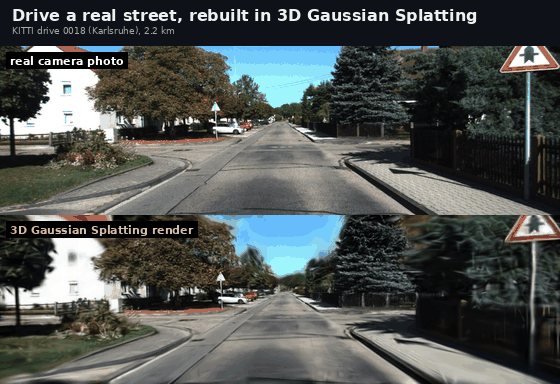

# KITTI splat drive and visual-localization closed loop

Examples 160 and 161 (`examples/160_kitti_splat_drive`, package `kitti_splat_drive`) drive an
Ackermann car (`rne_robot::ackermann_kinematics`, pure pursuit) through a 3D Gaussian Splatting
reconstruction of KITTI raw drive 0018. The splat is trained with visloc-rs `gsplat_train` on
camera poses from LiDAR SLAM (lidar_slam), so it is metric and gravity-aligned; its manifest
rotates the z-up SLAM frame -90 deg about X into RNE's y-up frame. The car follows the road
height of the SLAM path.

- **160** renders the car's front camera (KITTI `image_02` pinhole, principal point at the
  centre) and a chase view with the car drawn as a box.
- **161** steers on the car's *estimated* pose: dead reckoning from wheel speed and steering
  (2 % scale error, 0.003 rad/s yaw-rate bias) between visual fixes; every 0.5 s the front
  camera is rendered at the true pose (`--manifest`: RNE's renderer; otherwise visloc-rs
  `gsplat_render_server`) and localized by visloc-rs `basalt_euroc_localize_demo` against a
  map built from splat renders at the SLAM camera poses. Fixes more than 3 m from the
  estimate are rejected (3 m, growing by 0.5 m per second without a fix, so the car can
  recover after a gap). The car starts at a known pose.

**Long routes.** One splat of the whole 2.2 km drive does not fit a CPU renderer's 128 MiB
storage-binding limit, so the route is trained as overlapping stretches (about 400 KITTI
frames each). Both examples take `--segments LIST` instead of `--manifest`: one line per
stretch, `start_frame, manifest[, map_dir]` (relative paths from the list's directory). The
path CSV's sixth column is the KITTI frame; the splat switches when the car's path progress
crosses a segment's start frame. In 161 the splat follows the true pose (it is the world the
camera sees) and the localization map follows the car's own estimate. The parsing lives in the
package's library (`lib.rs`) with unit tests.

**Maps the car can recognise.** A localization map built from `gsplat_render_server` renders
does not match what RNE's renderer shows the car closely enough on stretches b-g (KITTI frames
380-2761): on segment b, 22 of 81 fixes with server-built maps against 34 of 81 with maps whose
colour comes from RNE's own renders. `161 --render-poses TUM --manifest SPLAT --out DIR` renders
the RNE camera at the SLAM camera poses for that; the maps take depth from the server and are
built with `tum_rgbd_save_map --track-keyframes 8 --match-radius-px 12`, which tracks each
landmark over more keyframes (segment d, midpoint queries: 39/39 against 22/39). On repetitive
residential stretches the localizer also needs `--loc-args "--ratio 0.9 --min-inliers 12"`.

Inputs (PLY, path CSV, visloc map) are not in the repository; see lidar_slam
`tools/rne_kitti_splat_drive`.

## Traffic: moving splat actors (example 162)

`rne_render_3dgs` can put movable splats ("actors": a car, a bus, a pedestrian) into a splat
background. `GaussianSplatBackground::from_environment_with_actors(device, environment, actors)`
appends each actor's Gaussians to the background's GPU buffer, hidden at first;
`set_actor_pose(queue, index, Some(&world_from_actor))` rewrites only that actor's range of
the buffer. Because the actor shares the scene's buffer, the viewer depth-sorts its Gaussians
together with the scene's, so it occludes and is occluded by the street correctly. Motion is
rigid with uniform scale; view-dependent colour (spherical harmonics above degree 0) is dropped
for actors, as the harmonics would have to rotate with them. `load_splat_actor(path)` reads an
actor PLY authored in the actor's own frame. Proxy depth (`splat_proxy_depth_from_ply`) does
not include actors.


The GIF opens at KITTI frame 160: the inset holds the real camera photo, and the main view is
the splat with two actor cars that are not in the photo. At frame 186 the photo stays paused
while the splat, rendered from the same camera pose, turns up to 30 degrees left and right
about the vertical. The cars are three splats cut from the scene (`--actor` silver, `--cut-in-actor` black,
`--ego-actor` blue).

`162_kitti_splat_traffic` uses this for car following. A car cut out of the KITTI 0018 splat
(the Gaussians inside an oriented box around a parked car, about 1000) drives ahead of the ego
car on the SLAM path: it cruises, stops and pulls away; the ego follows with the Intelligent
Driver Model (`kitti_splat_drive::Idm`) and its front camera is rendered with the lead car in
the street.

```text
162_kitti_splat_traffic --manifest SPLAT.toml|--segments LIST --actor CAR.ply --path PATH.csv --out DIR
  [--render-every 0.2] [--duration 40] [--lead-start 22] [--stop-at 14] [--cut-in S]
```

With `--cut-in S` a second copy of the car is parked 2.4 m right of the path at arc length `S`
and pulls out into the lane (2.5 s, smoothstep, heading along its motion) when the ego comes
within 20 m; once it is within 1.3 m of the lane centre it becomes the ego's leader.
`--cut-in-actor PLY` gives the cut-in car its own splat. `--ego-actor PLY` draws the ego car as a splat as well, and `--chase BACK,UP,PITCH` adds a
third-person view from `BACK` m behind the ego along the path (`UP` m above the camera height,
pitched down `PITCH` degrees). Because that camera stays on the recorded path near the recorded
height, the street renders as well as from the front camera; views from higher up do not (the
splat was trained from street level only).

With `--segments` the route can span several splats; each switch reloads the next splat with
the same actors, so the cars carry on across it.

The actor frame is +x forward, +y left, +z up with the origin at the bottom centre; the
example turns it into RNE's y-up car frame. `cut_actor.py` (in the example directory) cuts the Gaussians inside an oriented box out of a
splat PLY into an actor PLY; `--largest-cluster R` keeps only the largest group of Gaussians
linked within `R` m, dropping bins or poles caught in the box. A cut-out car was only ever seen
from the road, so
it looks right from behind and from its kerb-side flank, not from the front.

## Splat colour pass fixes

- `rne_render_3dgs` draws the splat through a non-sRGB view of the hybrid target: splat colours
  are display-referred sRGB and were encoded a second time (washed out).
- `third_party/wgpu-3dgs-viewer` (vendored 0.2.0, see its `RNE_PATCH.md`): the shader used 2f as
  the focal length for the 2D covariance and an `exp(-|q|^2)` falloff, drawing every splat
  sqrt(2) too wide. It now follows the Inria EWA splatting (focal f, +0.3 px^2 low-pass, 3-sigma
  quads, `exp(-0.5 q^T Sigma^-1 q)`). Synthetic isotropic splats at 10 m measure 1.52 / 3.58 /
  7.17 px against 1.52 / 3.58 / 7.09 px expected (upstream: 2.04 px for the first).

## Results (KITTI 0018, first 290 m, 7 m/s, CPU lavapipe)

| | visual fixes | cross-track mean / max | estimate error mean / max |
|---|---|---|---|
| odometry only | - | 5.55 / 17.17 m | 5.97 / 17.37 m |
| closed loop, visloc-rs renderer | 65 / 86 | 0.07 / 0.71 m | 0.13 / 0.82 m |
| closed loop, RNE renderer (sqrt(2) workaround) | 52 / 86 | 0.10 / 0.80 m | 0.16 / 0.98 m |
| closed loop, RNE renderer (shader fix) | 59 / 86 | 0.11 / 0.85 m | 0.18 / 0.96 m |

Open-loop localization of 172 RNE front-camera frames: none before the footprint fix,
115 (median 5.2 cm) with a 1/sqrt(2) size workaround, 128 (median 6.2 cm) with the shader fix.



First the real KITTI photo above the splat render from the same pose; then the drive, the car's
front camera (RNE render) above the LiDAR map with the car steering by visual fixes (orange) and
the same car on wheel odometry only (red); halfway, the car stops and the camera sways 1.5 m
off the recorded path to show the street is 3D. KITTI is CC BY-NC-SA 3.0.

## Results (KITTI 0018, whole drive 2.2 km, seven splats, 7 m/s, CPU lavapipe)

| | visual fixes | cross-track mean / max | estimate error mean / max |
|---|---|---|---|
| odometry only | - | 34.99 / 227.19 m | 115.81 / 388.67 m |
| server-colour maps | 127 / 626 | 6.92 / 66.34 m | 21.04 / 134.44 m |
| RNE-colour maps, 8-keyframe tracks | 412 / 655 | 2.73 / 33.75 m | 3.45 / 31.78 m |
| + ratio 0.9, 12 inliers | 580 / 633 | 0.11 / 0.84 m | 0.25 / 2.54 m |
