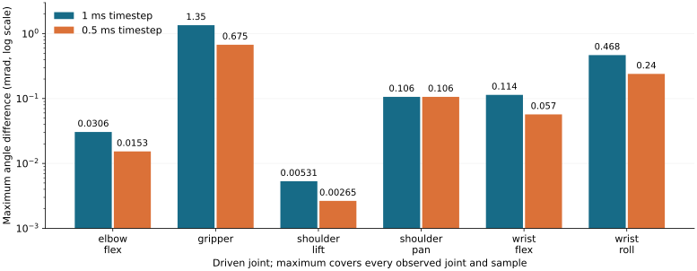
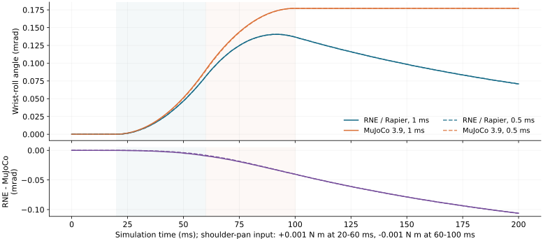

# LeKiwiとSO-101でMuJoCoを超えるための開発計画

2026年10月29日。対象は実機を使わないシミュレーション開発。

**追記：肩旋回の残差は比較ランナーに残った既定減衰が主因と判明し、修正した。**
[修正前後の測定と再現手順](SO101_ZERO_LOSS_DIAGNOSIS.md)を参照。
以下の図・数値・PDFは修正前の調査時点の記録。重力付き14条件と振り子の解析解テストも追加した
（[測定資料](SO101_GRAVITY_COMPARISON.md)）。次はBの残りの関節制限比較。

**目標は、接触を伴うトルク制御学習で、必要な物理品質を満たしたまま目標成功率に早く到達すること。**
現在は独立した学習環境、外力からの回復検証、MuJoCoとの共通モデル比較まで実装した。
次は肩旋回への小トルク入力で残る応答差を切り分ける。その後、接触・並列性能・学習時間の順に評価を広げる。

共有用の[6ページPDF](presentations/lekiwi-mujoco-brief.pdf)と[ブラウザ版](presentations/lekiwi-mujoco-brief.html)も用意している。
実行手順の詳細は[Robot workbench](ROBOT_WORKBENCH.md#so-101-torque-response-against-mujoco)を参照。

## 1. 現在できること

| 項目 | 実装・計測した内容 | この結果が示す範囲 |
| --- | --- | --- |
| 接触・トルク制御 | LeKiwi＋SO-101の接触世界、直接トルク指令、物理リンクへの外力 | WorkbenchのRNE/Rapier経路。実機同定済みモデルではない |
| 独立した学習環境 | 環境ごとの物理世界、並列実行、選択的リセット、Gymnasium接続 | 複数ロボットの協調ではなく、独立した学習試行が主目的 |
| 継続保持 | 3関節が角度誤差0.05 rad未満・速度0.1 rad/s未満を480 tick連続で満たす | 約2秒の保持。瞬間的に目標を通過しただけでは成功しない |
| 外力回復 | 6方向×2強度×8目標＝96試行で回復。無外力の比較側も96試行成功 | 手首リンクへの2 N／4 N、約0.1秒の外力。衝突物体による打撃ではない |
| MuJoCo比較 | 無入力と6関節への入力を2種類の刻みで計測、計14条件 | 固定台座・無重力・接触なしの慣性応答 |
| 再現性 | 保存した外力96試行と比較14条件を、それぞれ完全再生 | 同じ実行環境の同一バックエンド内。異なるソルバ間の完全一致は要求しない |

外力回復では制御器の再学習も目標姿勢の選び直しも行っていない。
96件は「独立に無作為抽出した96種類の状況」ではなく、既存8目標に12条件を掛けた試行である。
保持を崩した後に全件回復したが、制御器の限界荷重や未知姿勢への汎化性能はまだ測っていない。

## 2. MuJoCo比較の共通条件

比較対象は **RNE/Rapier と MuJoCo 3.9.0**。RNE独自の `rne_physics_native` は今回の比較に含めていない。
RNE製品としての実行経路の比較と、独自物理ソルバの比較を区別する。

- 同じSO-101 URDFのリンク配置・質量・重心・慣性を使用。
- 台座固定、初期関節位置・速度ゼロ、重力ゼロ。
- 接触形状、関節ストッパー、受動摩擦・減衰を両方から除外。
- 入力は1関節ずつ、20〜60 msに+0.001 N·m、60〜100 msに−0.001 N·m。その後200 msまで無入力。
- 1 msと0.5 msの時間刻みで実行。MuJoCoはEuler、Rapierは既定の積分設定。
- 全関節の位置・速度を名前で対応付け、入力配列、全軌跡、最大差、RMSE、モデルと実行ファイルのハッシュを保存。

これは接触問題を避けて勝敗を決めるための試験ではなく、接触を加える前のモデルと力学の基礎確認である。

### 解析解を用いたモデル変換の確認

1軸ローターでは、慣性0.02 kg·m²に0.01 N·mを加えたときの加速度0.5 rad/s²と、解除後の等速運動を確認した。
慣性座標を回転し、重心を軸からずらした別の試験では、平行軸の定理から得られる0.05 kg·m²を基準にした。

後者でMuJoCo 3.9.0の直接URDF取り込みに、期待する慣性座標の解釈との差を検出した。
共通モデルの段階で慣性テンソルをリンク座標に変換し、慣性原点の回転をゼロにすると、両エンジンが解析解の試験を満たした。
この処理は物理的な慣性を保つ座標変換であり、一方の軌跡に合わせて質量を調整する処理ではない。
再現用の試験は[解析解テスト](../examples/116_robot_workbench/python/test_benchmark_mujoco.py)に残している。

## 3. 比較結果と残る差



グラフの単位は **mrad＝0.001 rad**。縦軸は対数。
各棒は、その入力条件における全観測関節・全時刻の最大角度差であり、入力した関節だけの誤差ではない。

| 指標 | 1 ms | 0.5 ms |
| --- | ---: | ---: |
| 全条件の最大角度差 | 0.00134896 rad | 0.00067494 rad |
| shoulder_pan入力時の最大角度差 | 0.00010621 rad | 0.00010621 rad |
| 無入力時の最大角度差 | 約5.96×10⁻⁸ rad | 約5.96×10⁻⁸ rad |

多くの条件は刻みを半分にすると差もおおむね半減する。一方、shoulder_pan入力の残差は縮まらない。
最大差が現れる観測関節はwrist_rollである。



この残差の原因は未特定。座標変換、実効慣性、数値精度、微小入力への処理、積分方法を切り分ける。
**異なるエンジン間の差は、どちらか一方の「正解からの誤差」とは限らない。**
解析解や保存則と照合して原因を判断する。

計測済みの `runner_loop_s` は指令設定・状態取得を含み、RNE側ではECS同期も含む。
モデル生成・起動は含まず、RustとPythonの実行経路も異なる。単発の値から物理カーネルの速度順位は付けない。

## 4. 「超える」を判定する基準

以下は**今後の評価計画**。現在の達成値ではない。
まず物理品質を合格条件とし、その条件を満たす設定どうしで性能と学習時間を比較する。

| 評価軸 | 共通にする条件 | 測定・判定方法 |
| --- | --- | --- |
| 力学の妥当性 | 質量・慣性・座標・初期状態・入力・時間刻み | 解析解との誤差、保存則、刻み依存性。許容誤差は実行結果を見る前に定義 |
| 接触の品質 | 形状・摩擦・反発・接触設定の対応を明記 | 接触侵入量、法線力積、滑り、エネルギー変化。落下・斜面・押し動作から始める |
| 並列性能 | 同一ホスト、CPU割当、スレッド数、環境数1／4／8／16 | ウォームアップ後に5回以上測定。steps/sの中央値・ばらつき、メモリ、リセット時間 |
| 学習効率 | 観測、報酬、行動周期、アルゴリズム、探索予算、停止条件 | 事前に定めた成功率までの実時間。複数seedと未学習の評価条件を使用 |
| 再現・診断 | 同じモデル・設定・入力と障害条件 | 失敗時の入力・状態・バージョンを保存し、原因を再調査できること |

並列性能は「物理ステップ」「環境ステップ」「Python接続込み」の時間を分ける。
学習では最終報酬だけを比較せず、同じ成功条件を満たすまでに必要だった時間と試行数を報告する。
品質を落として得た速度向上、接触を省いた設定、都合のよいseedだけの成功は優位性の根拠にしない。

## 5. 開発順序と完了条件

| 順序 | 開発項目 | 完了条件 |
| --- | --- | --- |
| A | 小トルク応答の残差を切り分ける | 再現条件を最小化し、初期加速度・モデル値・刻み依存を照合。原因または未解消範囲を証拠付きで説明 |
| B | 重力と関節制限を戻す | 静止保持、自由振動、制限到達を共通入力で比較。解析可能な問題の回帰試験を通す |
| C | 接触の共通試験を追加 | 落下、斜面滑り、箱押しで接触設定と誤差を記録。定めた品質基準を両方が満たす |
| D | 独立並列環境を比較 | 1／4／8／16環境の性能曲線を同一条件で取得。起動・リセット・状態取得を分離 |
| E | 同じ接触課題を学習 | 同じ学習器と予算で成功率到達時間を比較し、未学習条件でも評価 |
| F | RNE独自バックエンドを同じ試験へ接続 | モデル・入力・評価器を再利用し、Rapier経路と別系列で品質・性能を報告 |

各段階の結果が次の実装対象を決める。接触品質に問題があればソルバを改善し、品質が十分で転送が支配的なら実行経路を改善する。
対象課題で優位性が確認できるまでは、MuJoCo全般に対する優位とは表現しない。

### 次の実装単位

**shoulder_pan入力で生じるwrist_roll残差の診断を1つのPRにする。**

1. 現在のSO-101モデルと入力を固定し、入力振幅0.001／0.01 N·mと時間刻み1／0.5／0.25 msを比較する。
2. 入力開始直後の加速度と全関節の結合応答を出力する。必要なら同一姿勢の実効慣性を調べる診断出力を追加する。
3. 小さい回転・小さい速度に対する処理や精度を調査する。これらは原因の仮説であり、現時点の結論ではない。
4. 原因が特定できた場合だけ修正し、解析解試験と既存のトルク・外力回復試験を回す。
5. 原因が残る場合も、測定範囲と残差を明示して記録する。閾値を緩めて解消扱いにしない。

## 6. 再現と参照

```sh
cargo build -p robot_workbench --no-default-features
python -m venv .venv-gym
.venv-gym/bin/pip install \
  -r examples/116_robot_workbench/python/requirements.txt \
  -r examples/116_robot_workbench/python/requirements-mujoco.txt
.venv-gym/bin/python examples/116_robot_workbench/python/benchmark_mujoco.py \
  target/debug/rne-workbench assets/robots/so101/so101.urdf /tmp/so101-cross-sim.json.gz
.venv-gym/bin/python examples/116_robot_workbench/python/benchmark_mujoco.py \
  target/debug/rne-workbench /tmp/so101-cross-sim.json.gz --replay
```

出力先には未使用のパスを指定する。MuJoCo比較の完全再生は、同じ実行環境で生成した記録を使う。
実行時間は再現比較から除外する。図は `python scripts/plot_so101_cross_sim.py` で保存済みの測定値からSVG・PNGを再生成できる（matplotlibが必要）。
PDFは `python scripts/render_lekiwi_brief.py` でブラウザ版HTMLから生成する（reportlabとbeautifulsoup4が必要）。

| 根拠 | 場所 |
| --- | --- |
| 外力回復の96試行 | [arm_force_sweep.json](../examples/116_robot_workbench/python/results/arm_force_sweep.json) |
| MuJoCo比較の14条件・全軌跡 | [so101_cross_sim.json.gz](../examples/116_robot_workbench/python/results/so101_cross_sim.json.gz) |
| 共通モデルと比較器 | [benchmark_mujoco.py](../examples/116_robot_workbench/python/benchmark_mujoco.py) |
| RNEのトルク応答ランナー | [torque_benchmark.rs](../examples/116_robot_workbench/torque_benchmark.rs) |
| 実装とCIの状態 | [外力回復 PR #456](https://github.com/rsasaki0109/RobotNativeEngine/pull/456)、[MuJoCo比較 PR #457](https://github.com/rsasaki0109/RobotNativeEngine/pull/457) |
| 既存MuJoCoバックエンドの範囲 | [MuJoCo backend](PLAN_MUJOCO_SPIKE.md) |

測定値の基準は比較実装 `dbc85644`。ローカルではRust 53件、Python 26件、ワークスペースClippyと14条件の完全再生が成功した。
この資料に含む実装のマージ状況・最新の全体チェック結果は各PRを参照する。
