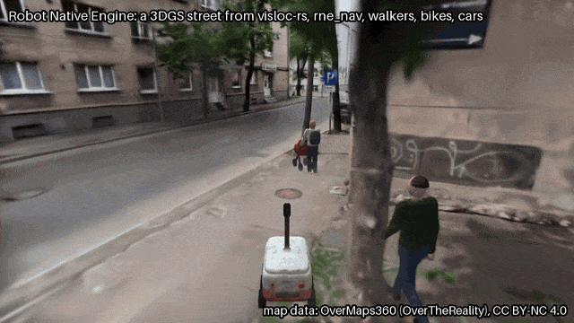

# Street splat navigation (example 163)

Example 163 (`examples/163_street_splat_nav`, package `street_splat_nav`) drives a delivery
robot along a real street rebuilt from a 360-degree video. The street comes from visloc-rs
`real2sim.py`: SfM, a metric, levelled 3D Gaussian Splatting reconstruction, the walk the
video was taken on, Nav2's lane map and the kerbs where the walk crosses a street. visloc-rs
writes all of it once as a *street bundle* (`ros2/visloc-ros2/gs/rne_bundle.py`, or
`real2sim.py --export-rne DIR`); this example loads the bundle and simulates.

```text
cargo run --release -p street_splat_nav --example 163_street_splat_nav -- \
  --street BUNDLE --out DIR [--render-every 0.5] [--max-frames N]
```

`--render-every 0` drives headless. A bundle holds:

| File | What |
| --- | --- |
| `street.rne.splat.toml` | the splat manifest; `rotation_xyzw` turns the z-up street into RNE's y-up world |
| `street.json` | start, goals, walk, kerbs, camera height, robot radius, credit |
| `solid.rne.map` | solid cells (walls, posts, trunks), `rne_nav` map JSON |
| `lane.rne.map` | the lane map: free on the lane, 0.90 off it, walls occupied |
| `ground.f32` | ground height grid (shape in `street.json`) |

The bundle's coordinates are the visloc-rs map frame (z up); `map_to_rne` gives RNE's
`(x, z, -y)`, so a pose compares directly with the ROS 2 / Nav2 runs in visloc-rs.



The robot on ground truth with the crowd (seed 0), from the chase camera, two stretches of
the drive (the full run: [media/street-splat-nav.mp4](media/street-splat-nav.mp4), twice
real time). Map data: OverMaps360 (OverTheReality), CC BY-NC 4.0, credited in every frame.

## How it drives

- **Plan.** A* (`rne_nav::plan_path`) on a costmap of the lane map with the solid cells added
  (what the robot's scan would show). Walls and posts are lethal, inflated for a 0.45 m
  footprint (the robot drawn is 0.87 x 0.70 m) plus 0.25 m. Off the lane costs 234 of 252:
  costly but not lethal, as in the Nav2 runs.
- **Follow.** Pure pursuit (`rne_nav::pure_pursuit_follow`), 0.5 m/s, on ground truth.
- **Kerbs.** The road between two kerbs is 10 cm lower. The robot's height and pitch come
  from its front and rear wheels (0.5 m apart), and it crawls at 0.12 m/s while a wheel is
  on a kerb edge.
- **Contacts.** A step that would put the robot's 0.2 m collision circle on a solid cell is
  not taken and counts as a contact.

## Results (OverMaps360 street, 4 goals over 111 m)

| | goals | contacts | time | on kerbs | nearest solid cell | from the walk, median / max |
| --- | --- | --- | --- | --- | --- | --- |
| RNE, ground truth | 4/4 | 0 | 284 s | 9.9 s at <= 0.12 m/s | 0.61 m | 0.30 / 1.03 m |
| RNE, camera only (visloc-rs fixes) | 4/4 | 0 | 286 s | 9.8 s at <= 0.12 m/s | 0.60 m | 0.30 / 1.07 m |

For reference, the visloc-rs ROS 2 simulator with Nav2 on visloc localization reached 4/4
goals with no contacts and spent 9.8 s on the kerbs (its thirteenth run, with people and
cars). Headless, the RNE drive takes about 2 s of wall time. With a front camera and a chase
view every simulated second, 285 frames, it takes 7 minutes on CPU lavapipe. The trajectory
hash is the same with and without rendering.

The bundle is not in the repository: the footage is OverMaps360 (OverTheReality),
CC BY-NC 4.0. The library's tests use a synthetic street (a lane, a post, a kerb crossing).

## Camera-only localization

With `--localizer BIN` the robot steers on its own estimate, not on ground truth:

- **Odometry.** Wheel odometry with the visloc-rs simulator's errors: 2 % speed scale,
  3 % yaw-rate scale and a 0.002 rad/s yaw-rate bias while moving.
- **Fixes.** Every 0.5 s the front camera is rendered at the true pose and localized
  against the bundle's visloc-rs map, with the estimate as the prior. The localizer is
  `visloc_map_localize_server` (visloc-rs `ros2/visloc-ros2`), `visloc_map_localize_node`'s
  core behind stdin and stdout, so the map is loaded once for the whole drive.
- **Gating.** A fix further than 0.25 m (plus 0.1 m per second since the last accepted fix)
  from the estimate is rejected. An accepted one moves the estimate halfway to it, so one
  wrong fix that passes the gate cannot throw the estimate far.
- **Log.** `fixes.csv` logs each attempt next to the truth.

```text
... --localizer visloc-rs/ros2/visloc-ros2/target/release/visloc_map_localize_server \
    [--map DIR] [--loc-args "--max_hamming 90 --reprojection_threshold 5 --min_inliers 20 --projection_radius 40"]
```

| | fixes | pose error RMSE / median / max |
| --- | --- | --- |
| RNE, fixes replace the estimate, 0.5 m gate | 573 of 629 (13 gated) | 15.8 / 2.7 / 73 cm |
| RNE, half-way blend, 0.25 m gate (default) | 529 of 572 (23 gated) | 8.6 / 2.0 / 48 cm |
| the same, run again | 538 of 575 (18 gated) | 5.5 / 2.0 / 31 cm |
| visloc-rs Nav2 run (thirteenth, with people) | 719 of 800 images | 8.9 / 2.3 / 72 cm |

The map was built from visloc-rs `gsplat_render_server` renders and the fixes come from
RNE's renders, yet with the prior 97 % of the frames localize (2.4 cm median error). The
wrong fixes that remain (0.3 to 1.2 m off, 25 to 36 inliers) come in short runs, and the
gate and the blend absorb them. Runs with fixes are not bit-for-bit repeatable: the
localizer gives the same answers for the same images, but RNE's splat renders on CPU
lavapipe differ slightly from run to run, and the two runs above part at the second fix.
Runs on ground truth repeat exactly. Headless with localization the drive takes 6 minutes on
CPU (about 570 front-camera renders and fixes).

## The crowd (`--crowd`)

The street's walkers, cyclists, dog walkers, strollers and cars, and a zebra crossing with a
traffic light, are a port of the visloc-rs simulator's crowd (`people.Crowd`, in
`crowd.rs`).

- **Start.** visloc-rs `rne_crowd.py` writes the bundle's `crowd.json`: who starts where,
  how fast and which way, from its crowd built with the run's seed.
- **Looks.** It also writes `crowd/*.ply`: every agent's gaussians at 12 gait phases (a
  car's wheel turn and shadow, padded to one count per agent), and the crossing at each
  light state.
- **Behaviour.** People move along the route at a side offset from the walk.
  - They step aside, follow or stop short of whoever is ahead, so footprints never overlap
    by more than 2 cm.
  - They keep inside the pavement's edge except on the crossing, and within 0.9 m of the
    walk between kerbs.
  - Now and then they stand still or drift across, and they turn back after 8 s stuck.
  - Walkers who reach the crossing on red mostly cross it and come back.
  - Cars keep right, brake for the light and for whoever is ahead, and U-turn in a half
    circle at the road's ends.
  - The behaviour's randomness is seeded (`--seed`).
- **Drawing.** Each agent is a splat actor. Its gait phase is swapped in with
  `GaussianSplatBackground::replace_actor_asset` (new: same count, rewritten in place), so
  the 11 agents add 41,000 gaussians rather than one actor per phase.
- **The robot.** People keep 0.6 m from the robot's centre. The robot bends its pure-pursuit
  command round them with `rne_nav::avoid_velocities`: their footprints, as seen from where
  it is and put round its estimate, with a 0.2 m margin. The margin shrinks to 0.05 m after
  3 s held up and to 0 after 6 s, so it does not deadlock with someone who cannot pass.

Ground truth, OverMaps360 street, 4 walkers, 2 cyclists, a dog walker, a stroller, 3 cars:

| seed | goals | contacts (walls / people) | time | people on the road | nearest to the robot's body | nearest to a car | longest still |
| --- | --- | --- | --- | --- | --- | --- | --- |
| 0 | 4/4 | 0 / 0 | 367 s | 0 | 6 cm clear | 1.53 m | 19 s |
| 1 | 4/4 | 0 / 0 | 435 s | 0 | 5 cm into a corner | 1.75 m | 24 s |
| 2 | 4/4 | 0 / 0 | 556 s | 0 | 7 cm into a corner | 1.20 m | 113 s |
| 3 | 4/4 | 0 / 0 | 431 s | 0 | 4 cm into a corner | 1.31 m | 19 s |

"People on the road" counts footprint samples within 3.2 m of the road's centre line, off the
crossing. Headless, each run takes about 2 s. With a front camera and a chase view each
simulated second, 200 frames, it takes 6.5 minutes.

**When people hold the robot up.** The robot keeps a 0.2 m margin round people, which
matches the 0.6 m they keep from its centre. Held up for 3 s it narrows the margin to
0.05 m, and after 6 s to 0, as people squeeze past each other.

- The held-up time used to restart whenever the narrower margin let the robot creep a few
  centimetres, so the margin widened again every 3 s and held it once more: stops of 6 to
  15 s, once 45 s, and drives of 470 to 536 s. Now the time counts while the robot gets
  under half the speed it wants, and drains slowly. The cost is that people now brush the
  corners of the robot's drawn body (up to 7 cm), where they kept 6 to 10 cm clear before.
- A floor of 0.05 m on the margin deadlocked 3 of 4 seeds (3/4 goals).
- Backing up 0.3 m after 5 s held up was worse: with people all round, the robot backed into
  them (0.33 m into its body), and one run deadlocked for 522 s at 2/4 goals.
- Planning again with the people in the way as obstacles (`--replan-after S`, off by
  default) made two of four seeds miss goals: the plans round people left the lane by posts
  and ended in deadlocks.

**With camera-only localization** (`--crowd --localizer`), the people are in the front
camera's images too:

| seed | behaviour | goals | contacts | time | fixes accepted | pose error RMSE / median / max |
| --- | --- | --- | --- | --- | --- | --- |
| 0 | before the held-up fix | 4/4 | 0 / 0 | 648 s | 1250 of 1296 | 6.4 / 1.7 / 50 cm |
| 1 | before the held-up fix | 4/4 | 0 / 0 | 920 s | 1780 of 1841 | 3.4 / 1.6 / 24 cm |
| 0 | with it | 4/4 | 0 / 0 | 688 s | 1285 of 1376 | 10.0 / 2.1 / 75 cm |
| 1 | with it | 4/4 | 0 / 0 | 451 s | 847 of 902 | 10.4 / 2.5 / 69 cm |

The people do not stop the localization: 93 to 97 % of fixes are accepted, and the median
error stays at 2 cm. Squeezing past people closer puts more of them in the camera's view,
so more fixes are gated out (49 and 33 against 16 and 14) and the error grows. Runs with
fixes vary from run to run (see above), so two seeds say little more than that.

The chase view draws the delivery robot from the bundle's `robot.ply` (visloc-rs
`rne_bundle.py` turns its robot model into gaussians). It is left out of the front camera,
which sits in its mast.

## A second street

The same flow on another OverMaps360 walk, 3886d218: a concrete pavement between lawns
beside a suburban road, 300 frames, 70 m. `real2sim.py --export-rne` took 1 h 40 min on
4 CPU cores (SfM 39 min, 3DGS 34 min, map 17 min). `rne_crowd.py` added the crowd. Nothing
was tuned for it.

Two things the first street had hidden came up:

- **The ground.** `make_gs_scene.py --terrain` took the ground as the capture camera's
  height less the robot's camera height (1.2 m). OverMaps360 carries the camera on a pole
  2.3 to 2.5 m up, so the ground came out about 1.2 m high, and the road search, which
  looks near the ground, found no road. The ground is now the densest layer of the splat
  under each camera.
- **The road and pavement** now come from the splat in the export itself (`rne_bundle.py`),
  as no ROS 2 run of this street exists.

| | goals | contacts (walls / people) | time | fixes accepted | pose error RMSE / median / max |
| --- | --- | --- | --- | --- | --- |
| ground truth | 4/4 | 0 | 198 s | - | - |
| crowd, 4 seeds | 4/4 each | 0 / 0 | 276 to 542 s | - | - |
| camera only | 3/4 | 0 | 207 s | 175 of 415 | 16 / 7 / 61 cm |
| camera only, crowd (seed 1) | 4/4 | 0 / 0 | 307 s | 310 of 614 | 11 / 6.5 / 40 cm |
| camera only, `--min_inliers 12` | 4/4 | 0 | 218 s | 238 of 436 | 23 / 12 / 78 cm |

The road is found on 3 of the 4 stretches, about 10 m right of the walk, with the
crossing at 17 m. Nobody walks on it, and people keep at least 4.5 m from the cars.

Localization is the weak part here. Even with the true pose as the prior, half the front
camera's frames localize (25 of 50, 7 cm median). The renders are clean, but most of what
the camera sees is lawn, sky and plain concrete: few features, against the brick facades of
the first street (97 % with the prior).

Lowering the localizer's inlier floor from 20 to 12 (`--loc-args`) brings 39 of the 50
frames to a fix, and the drive reaches all 4 goals, but the extra fixes are poorer: the
pose error is twice as large, and the 0.25 m gate turns away 120 of them. The fewer, better
fixes of the default are kept.

## Next

- A recovery that keeps people off the robot's body while it squeezes past.
- Localization on low-texture streets (lawns, plain pavement).
