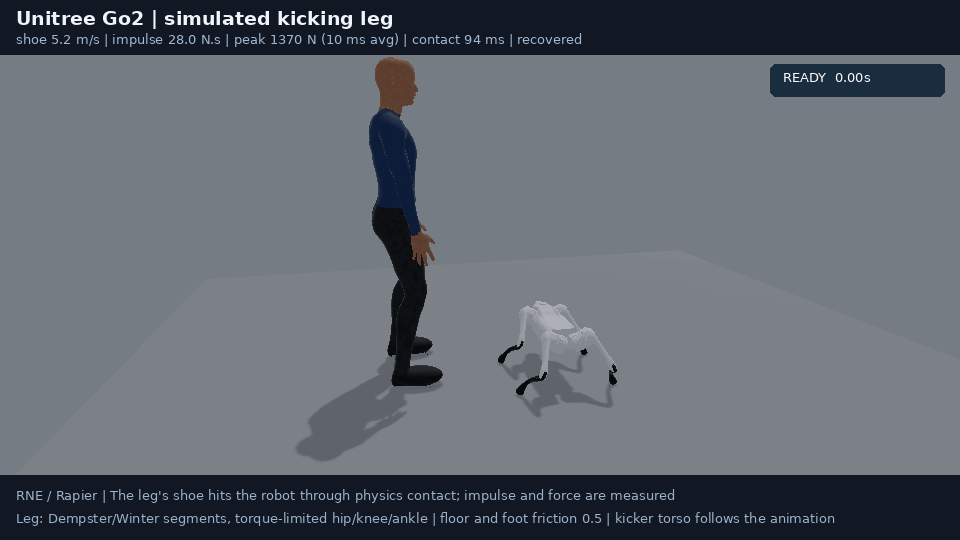
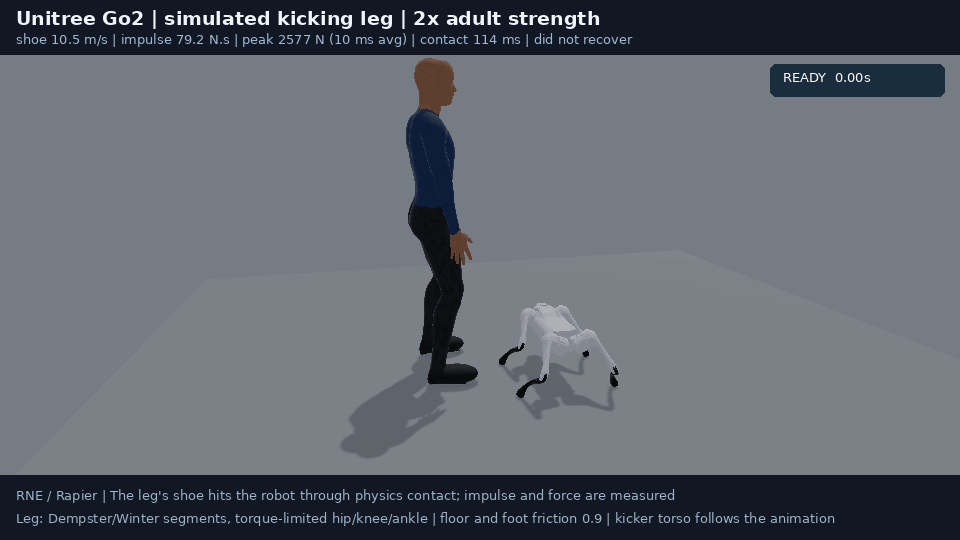

# Go2/G1 lateral impact recovery

This example drives dynamic Go2 and G1 Rapier articulations with bounded
sensor-feedback control under the same lateral disturbance: a 40 N·s impulse
over 80 ms. The force follows a midpoint-sampled half-sine, normalized so its
commanded `sum(force * dt)` preserves the impulse when the physics rate changes.
The default plant runs at 1 kHz with 32 solver iterations. The animated human
visualizes the impact; robot motion comes from the physical simulation.

The disturbance acts in world +Z at the robot root position plus 0.06 m along
world Y. It is a prescribed body wrench with its physical moment arm, rather
than a simulated human-foot collision. This is a bounded lateral recovery
experiment. It does not establish real Unitree hardware kick resistance or
recovery from arbitrary directions and strengths.

## Physical models and control

The dedicated `go2.rne.scene.toml` and `g1.rne.scene.toml` use derived URDFs
with the source positive masses, COM offsets and complete inertia tensors.
They opt into joint-origin rotations, welded fixed children and preservation
of compound collision parts. Go2's attached feet participate in the
articulation, and G1 keeps all four collision spheres on each sole.
Rapier contact-point reporting includes each compound child's pose, so the
recorded sole support points and point-relative velocities use world frames.

| Plant | Declared total mass, including numerical markers | Standing control |
| --- | --- | --- |
| Go2 | 16.087000011 kg | Joint PD, COM-based contact-load regulation, IMU leg-length feedback; hip abduction ±0.45 rad |
| G1 | 34.133857284 kg | Joint PD, COM/DCM/IMU ankle and hip feedback, and outward arm reactions; hip roll ±0.24 rad |

Frame-only links with absent or zero inertials receive 1e-9 kg and diagonal
1e-12 kg·m² inertias to keep numerical articulated-body operations defined.
These are numerical markers, not inferred robot hardware. Go2's initial stance
also uses an equivalent coordinate shift: `q_physical = q_sim + offset`, with
joint-origin rotations and position limits shifted together. Geometry, physical
joint limits and source positive inertials are preserved. The offsets, source
hashes and derived-model hashes are recorded in [models.json](models.json).
Regenerate those fixtures with `python3 examples/139_kick_comparison/prepare_models.py`.

Go2 additionally low-pass filters angular rate and foot normal loads. It
adjusts small individual leg-length biases toward COM-based load shares in
a rectangle approximated from the measured front/rear and left/right foot
means; it is not a general contact-wrench optimizer. The correction uses
a zero-sum bias and a ±0.03 rad calf bound. These gains and filter time
constants are explicit controller design parameters, not identified hardware
parameters. Direct contact-force observations are ideal simulator signals;
hardware would require suitable sensors or estimators.

Both controllers use unit-bearing ForceBased implicit PD with the individual
URDF effort ceilings. Joint targets stay within position limits and change at
at most 6 rad/s, or the lower authored velocity limit. Go2 uses measured roll,
angular velocity and ideal contact loads;
G1 uses mass-weighted COM position and velocity, the
horizontal capture point `com + velocity / sqrt(g / height)`, and body attitude.
Controllers receive the current simulated state and never the disturbance
schedule, future force or animation pose. They apply joint commands; recovery
comes through contact with the ground. Robot poses and velocities are never
corrected directly, and controllers do not apply stabilizing body wrenches.

Default observations are ideal simulator state. The opt-in observation probe
below introduces synthetic estimate errors and timing separately. The model
omits an actual sensor-fusion estimator, actuator thermal and power limits,
detailed transmissions and robot
self-collision. Floor friction and primitive contact proxies are simulator
assumptions, not measured hardware contact properties. The recorded effort ceilings are enforced by the solver;
default captures do not read motor impulse or interval effort back. The opt-in
evaluator below adds post-step readback. This controller is not Unitree firmware
or a hardware-qualified whole-body controller.

## Headless checks

```bash
cargo run --locked --release -p kick_comparison --example 139_kick_comparison -- \
  --headless --output target/rne-kick-comparison
```

This checks both human animation clips at keys and 120 Hz subframes without a
GPU. It validates the physical plant, runs each robot twice and requires
literal equality of its ordered observed floating-point states throughout
settlement and recovery. Link poses/scales, body COM linear and angular
velocities, joint state and foot impulses participate. Hidden backend solver
caches are outside this replay assertion. The trace stores the observed-state
hash and word count, model and servo configuration, force history and feedback.
It also records SHA-256 hashes of the controller, capture, renderer and plant inputs
embedded at compilation. The encoder rejects a recording whose compiled
inputs differ from the current files; encoding-time source hashes are
recorded separately.

The command writes `go2-trace.json`, `g1-trace.json` and `summary.json`.
Recovery requires upright final height, residual tilt below 0.20 rad, COM speed
below 0.10 m/s and a mean normal load above 0.5 N at every foot over the
last 0.5 seconds. The instantaneous contact count is recorded separately:
Go2's instantaneous loaded-foot count varies while all four carry load
over that window. A fall, positive-impulse non-foot ground contact or a
broken fixed attachment fails the gate. Failed captures retain
their traces. Presentation uses 187 frames at approximately 30 Hz over
6.23 seconds, with the first sampled force frame at index 61.

Run the broader replay and recovery matrix separately:

```bash
cargo run --locked --release -p kick_comparison --example 139_kick_comparison -- \
  --validate-recovery --output target/rne-kick-validation
```

This repeats every case with exact observed-state comparison: nominal lateral
impact, zero force, an earlier opposite-side impact, later onset, 500 Hz,
matched balance-feedback-off cases and front/oblique limit probes. It writes
per-case traces and `recovery-validation.json`. `--validation-robot go2` or
`--validation-robot g1` can repeat only one plant; the report lists its scope.
Public GIF encoding requires the complete two-plant validation report.
At the default 40 N·s, all 12 required recovery cases pass with exact observed
replay. Front impacts topple both robots, and the oblique impact topples G1;
those three failures remain in the full 18-case report as limit observations.

`--impulse-ns J` selects a finite positive common impulse for capture and
validation. To measure a selected strength without requiring it to recover,
use `--impulse-probe --impulse-ns J`; zero is permitted for this diagnostic.
`--impulse-sweep` probes 24, 32, 40, 48 and 64 N·s with exact replay and retains
failed recoveries. Both diagnostics accept the same `--validation-robot` filter.
Their reports are observations of the recovery limit, not public capture gates.

```bash
cargo run --locked --release -p kick_comparison --example 139_kick_comparison -- \
  --impulse-sweep --output target/rne-kick-severity
python3 -m unittest discover -s examples/139_kick_comparison -p test_encode.py -v
```

Balance-feedback ablations
retain the same stance, joint PD gains, effort caps and target-rate limit;
encoder feedback inside the PD motor remains enabled. For Go2, the ablation
disables the IMU opposing-leg reflex while retaining contact-load stance
regulation; for G1, it disables the additional DCM/IMU ankle, hip and arm loops. A disabled balance
loop need not fail every disturbance: report the measured case, including its
zero-force baseline, rather than assuming that it must fall.

The complete report must pass all 12 required cases before public GIF encoding.
Front/oblique directions and balance-off cases remain measured envelope and
ablation observations; their outcomes appear in the generated metadata.
Passing recovery at 500/1,000 Hz does not establish convergence of the full
trajectory. Final values are in the generated summary and
[README capture metadata](../../docs/media/kick-comparison.json).

## Synthetic observation sensitivity

`--observation-probe` runs a separate headless sensitivity matrix for the same
40 N·s, 80 ms lateral wrench. It changes the observations available to the
outer balance controller. Physics, target slew, filters and controller evaluation
remain at 1 kHz; a 250 Hz capture profile holds a sample for four control ticks.
This differs from `rate_500hz` in the existing recovery matrix, which changes
the physics step itself.

One captured state estimate contains attitude/rates, COM position and velocity,
foot positions and Go2 normal loads from the same completed physics tick.
The controller reads only arrived timestamped frames from the DataBus. Pending
frames cannot supply feedback. A held frame retains its sample identity and
error draw. Before the first arrival, bounded nominal stance targets apply
without a current-truth fallback. Capture timing continues through settlement
and the disturbance.

The profiles are declared before measurement:

| Profile | Capture period | Arrival latency | Bounded synthetic errors |
| --- | --- | --- | --- |
| `ideal_reference` | 1 ms | 0 ms | none |
| `sample_500hz` | 2 ms | 0 ms | none |
| `sample_250hz` | 4 ms | 0 ms | none |
| `delay_5ms` | 1 ms | 5 ms | none |
| `delay_20ms_limit` | 1 ms | 20 ms | none |
| `bounded_error` | 1 ms | 0 ms | enabled |
| `combined` | 4 ms | 5 ms | enabled |
| `combined_zero_input` | 4 ms | 5 ms | enabled, zero disturbance |

Attitude error is a pair of world-X/world-Z rotations bounded by ±0.01 rad
each, applied to the captured orientation. Body axes, roll/pitch and gyro
projection use that same perturbed orientation; derived roll/pitch error is
not independently bounded by those rotation amplitudes. Other amplitudes are
±0.02 rad/s world angular rate, ±0.005 m COM/foot position and ±0.02 m/s
COM velocity per world-axis component, plus ±2 N Go2 foot load.
Independent signed-uniform draws use each scene's explicit WorldRandom seed
(Go2: 2003, G1: 2002), fixed domains and ordered channels;
loads saturate at zero with saturation recorded. These amplitudes are engineering
sensitivity bounds, not measured Unitree specifications or Gaussian standard
deviations. One fixed-seed result does not establish probabilistic reliability.

```bash
cargo run --locked --release -p kick_comparison --example 139_kick_comparison -- \
  --observation-probe --output target/rne-kick-observations
```

Use `--validation-robot go2` or `g1` and `--observation-profile combined`
to repeat a selected plant/profile. The report declares its selected scope.
The diagnostic uses the fixed 40 N·s matrix (including its zero-input profile)
and does not combine with rendering, impulse overrides or the qualification matrix.

Each profile is replayed from a fresh seeded plant. The diagnostic retains
failed recoveries and pre-impact settlement failures in its separate report,
including whether the disturbance was applied. Ground-truth evaluation uses
the unchanged recovery predicate. Observation timing, held/startup decisions,
and controller/pipeline words are checked separately from the ordered plant
state. Observation capture, arrival and consumer timestamps are absolute
simulation ticks, including settlement; recovery `time_s` is relative to the end
of settlement. The diagnostic does not qualify a new public GIF or expand the existing
12-case ideal-observation recovery claim.

The implicit position-PD actuator still uses instantaneous simulated joint
state. The probe degrades the outer state estimate, not that inner motor loop.
It contains no raw IMU/encoder fusion, identified sensor statistics, physical
human-foot collision or real-hardware validation. The published GIF retains
its recorded ideal-observation source revision; probe evidence belongs to its
own compiled input and trace hashes.

The fixed-seed matrix produced these results. Each row completed settlement;
each plant and observation/control recording matched its independent fresh replay.
Maximum observation age includes zero-order hold. Peak tilt is measured over
the post-settlement trajectory, including the zero-input baseline.

| Profile | Maximum observation age (ms) | Go2 recovered / peak tilt (rad) | G1 recovered / peak tilt (rad) |
| --- | --- | --- | --- |
| `ideal_reference` | 0 | yes / 0.069500 | yes / 0.289060 |
| `sample_500hz` | 1 | yes / 0.067894 | yes / 0.306257 |
| `sample_250hz` | 3 | yes / 0.066754 | yes / 0.325069 |
| `delay_5ms` | 5 | yes / 0.064574 | no / 1.638381 |
| `delay_20ms_limit` | 20 | yes / 0.072170 | no / 1.639157 |
| `bounded_error` | 0 | yes / 0.069215 | no / 1.646449 |
| `combined` | 8 | yes / 0.072912 | yes / 0.305127 |
| `combined_zero_input` | 8 | yes / 0.020220 | yes / 0.009499 |

G1's three failed profiles retain the measured fall, nonfoot contact and fixed
attachment errors. The combined profile's success alongside those failures
shows that this small fixed-seed matrix is not a monotone tolerance search;
it establishes no maximum safe latency or sensor-error bound.

Across all 18 existing ideal-observation qualification cases, serialization-only
old/new runs matched every ordered plant word and original controller decision,
including settlement: 139,400 completed physics steps and 109,916,900 plant words.
This checks compatibility separately from fresh replay. Hidden solver caches and newly
introduced pipeline state are outside the old/new equality assertion.
The normal binary also passes all 12 required recoveries and exact plant/control
replay across the original 18-case matrix. Source/configuration hashes, all 16
measured summaries and compact compatibility/qualification proofs are retained
in [the observation study](../../docs/media/kick-observation-study.json).

## Matched G1 observation diagnosis

`--g1-observation-diagnosis` isolates the three failed observation profiles
with matched zero-input runs. The fixed matrix crosses `ideal_reference`,
`delay_5ms`, `delay_20ms_limit`, and `bounded_error` with 0 and 40 N·s. Each
pair uses the same G1 plant, seed 2002, capture schedule and error sequence.
Physics and outer-control evaluation remain at 1 kHz, with the same two-second
settlement, 6.2-second recording, 80 ms pulse and complete recovery predicate.
Controller gains and joint, effort and target-slew limits are unchanged.

```bash
cargo run --locked --release -p kick_comparison --example 139_kick_comparison -- \
  --g1-observation-diagnosis --output target/rne-g1-observation-diagnosis
```

Use `--observation-profile delay_5ms` to select a paired profile, or additionally
`--diagnosis-input zero` or `kick` to reproduce one input condition. This
diagnostic is separate from rendering, the impulse sweep and the original
observation probe. Completion retains failed settlement and recovery rather
than requiring every diagnostic case to recover.

Every control tick, including settlement, emits a bounded JSONL record of
capture, arrival and consumer times, the arrived estimate, separately labelled
evaluator-only current truth, and the original controller feedback and
requested/limited/issued joint targets. A separate evaluator truth channel at
the delivered frame's capture tick separates injected error from staleness.
Contact-force evidence describes the last completed physics step separately
from the current pre-step pose. Foot samples include all contact counterparts;
ground-pair impulses are a separate, canonically ordered aggregate.
Evaluator truth is never supplied to the balance controller. The controller
continues to consume only arrived frames; the inner position PD still uses
instantaneous simulated joint feedback.
JSONL is streamed with limits of 8,200 rows and 64 KiB per row, while capture
truth uses a 21-row history. Each row describes 23 joints and two feet.

Each case compares two fresh logging-on runs and one logging-off run. Ordered
plant and observation/controller words and original decision fields must agree
literally, and the two diagnostic streams must agree byte for byte. Matched
zero/kick pairs compare 4,000 pre-input steps: decisions through absolute
3.999 s and completed states through 4.000 s, including settlement. The first
force-bearing step completes at 4.001 s. These checks exclude
hidden solver caches and do not assert cross-platform reproducibility.

The complete fixed-seed matrix settles upright in all eight cases. Every
zero-input case recovers over the full recording; applying the wrench retains
the three earlier failures:

| Observation profile | 0 N·s recovery | Peak tilt (rad) | 40 N·s recovery | Peak tilt (rad) |
| --- | --- | ---: | --- | ---: |
| `ideal_reference` | pass | 0.006694 | pass | 0.289060 |
| `delay_5ms` | pass | 0.007569 | fail | 1.638381 |
| `delay_20ms_limit` | pass | 0.011861 | fail | 1.639157 |
| `bounded_error` | pass | 0.007516 | fail | 1.646449 |

All eight cases pass fresh plant/control/decision replay, logging-on/off
equality and byte-identical JSONL replay. Within each of the four pairs,
zero/kick pre-input prefixes match exactly. The four kicked outcomes and the
ideal zero-input outcome also match the corresponding retained earlier trace
values. The original
18-case qualification retains its state/control hashes and trace values,
with all 12 required recoveries still passing. Exact measured values, source
bindings and compact audit proofs are in
[the diagnostic evidence](../../docs/media/g1-observation-diagnosis.json).
Position and target-speed limiting also occur in successful runs; their counts
alone do not identify a failure mechanism. The evidence includes descriptive
counts and signed correction peaks over the same fixed time windows for every
case.

The comparison asks whether each profile destabilizes standing over the full
recording or fails only when the wrench is applied. It is a fixed-seed synthetic
diagnosis, not an identified physical sensor model or a hardware tolerance
claim. Its evidence is separate from the existing GIF and observation study.

## Known-age orientation experiment

`--g1-orientation-age-experiment` compares `raw_reference` with
`orientation_known_age` over the same four profiles and two input doses:
16 fixed-seed cases. The default controller and the earlier eight-case
diagnosis keep raw feedback. The candidate uses only an arrived frame's
capture timestamp and captured world angular velocity. At positive ages up
to 20 ms, it computes `delta_q * captured_q`, where `delta_q` represents
`age_s * captured_angular_velocity_world`. World-frame rates require this
left product. It updates orientation and its derived axes, roll and pitch;
rates, COM, feet, loads and joint observations remain captured values.

Zero age and zero angular rotation preserve the original payload exactly.
Future timestamps and ages above 20 ms are errors. Each decision starts from
the original arrived payload, including during settlement; a held sample is
never projected twice. Missing observations retain bounded nominal stance.
Raw delivered estimates and effective orientation feedback have separate
telemetry and time scopes. Projected orientation is an estimate, not another
measurement. Evaluator truth, contact evidence and the prescribed input do
not enter the policy; the inner position PD retains instantaneous joints.

```bash
cargo run --locked --release -p kick_comparison --example 139_kick_comparison -- \
  --g1-orientation-age-experiment --output target/rne-g1-orientation-age
```

Use `--feedback-policy raw_reference` or `orientation_known_age` to select
one policy, and the existing profile/input filters to reproduce a case.
The fixed primary comparison is full-predicate recovery under 5 ms delay
and 40 N·s, not a reduction in estimated pose error. Plant parameters,
control gains, horizons, actuator bounds and recovery criteria stay fixed.
All outcomes remain in the report, including failed recovery. Each case
has two fresh logging-on worlds and one logging-off world with literal
plant/control/decision comparison and byte-identical diagnostic replay.
Each policy/profile also compares the 4,000-step zero/kick prefix.
Zero-age profiles compare actual cross-policy words through canonical
binary sidecars rather than relying solely on matching hashes.
The experiment cannot qualify public GIF encoding.

The completed fixed-seed matrix passes the primary gate: under 5 ms delay and
40 N·s, raw feedback falls while orientation projection recovers. Every case
settles upright and all eight zero-input runs recover. Each cell below shows
full-predicate recovery and peak tilt in radians:

| Observation profile | Raw, 0 N·s | Projected, 0 N·s | Raw, 40 N·s | Projected, 40 N·s |
| --- | --- | --- | --- | --- |
| `ideal_reference` | pass; 0.006694 | pass; 0.006694 | pass; 0.289060 | pass; 0.289060 |
| `delay_5ms` | pass; 0.007569 | pass; 0.007666 | fail; 1.638381 | pass; 0.309082 |
| `delay_20ms_limit` | pass; 0.011861 | pass; 0.011404 | fail; 1.639157 | fail; 1.639460 |
| `bounded_error` | pass; 0.007516 | pass; 0.007516 | fail; 1.646449 | fail; 1.646449 |

Projection still fails the 20 ms kicked case. The zero-age bounded-error
negative control retains its earlier failure. The four zero-age conditions
match literal plant/control/old-decision words across policies for their full
trajectories, including settlement. All 16 cases pass fresh replay,
logging-on/off equality and byte-identical JSONL replay; all eight zero/kick
prefixes match through the 4,000 pre-input steps. The original 18-case
qualification and all 12 required recoveries also pass.
Exact outcomes, source bindings and compact audit proofs are retained in
[the orientation experiment evidence](../../docs/media/g1-orientation-age-experiment.json).
The default remains raw and the candidate remains explicit opt-in. These
fixed-seed software results establish no maximum safe latency, measured
hardware sensor model or cross-platform reproducibility.

## Fixed lateral-gyro experiment

`--g1-lateral-gyro-experiment` compares `orientation_known_age` with
`orientation_known_age_lateral_gyro_ema_5ms`. Both policies cross
`ideal_reference`, `delay_5ms`, `delay_20ms_limit`, and `bounded_error` with
0 and 40 N·s: 16 fixed cases using G1 seed 2002. Physics and outer control
remain at 1 kHz, with 2 s settlement and a requested 6.2 s recording horizon.
The input remains the prescribed 80 ms lateral body wrench.

```bash
cargo run --locked --release -p kick_comparison --example 139_kick_comparison -- \
  --g1-lateral-gyro-experiment --output target/rne-g1-lateral-gyro
```

Use `--feedback-policy orientation_known_age` or
`orientation_known_age_lateral_gyro_ema_5ms` to select a policy,
`--observation-profile` to select a profile, and `--diagnosis-input zero` or
`kick` to select an input. This fixed headless mode is separate from rendering
and the earlier raw-versus-orientation experiment. Default feedback remains raw.

Both policies project orientation using the original arrived quaternion and
`rotation_vector_quaternion(captured_world_gyro * capture_age_s) * captured_q`.
The candidate never substitutes filtered gyro into this projection. Only
controller-facing world angular velocity X is filtered at positive supported
capture age. Gyro Y/Z, captured roll rate, CoM, feet, loads, mass and joint
observations retain their captured values; inner position PD retains
instantaneous simulated joints. Plant parameters, gains, actuator caps,
horizons and the complete recovery predicate stay fixed.

The EMA time constant is predeclared as 0.005 s. The first positive-age capture
initializes filtered X to raw X exactly. Each later new capture uses
`alpha = 1 - exp(-capture_spacing_s / 0.005)` and
`filtered_x += alpha * (raw_x - filtered_x)`. Spacing comes from successive
capture timestamps, not the number of control evaluations or current age.
A held capture reuses cached filtered X and reprojects its original payload
without another EMA update. Missing frames leave history unchanged and retain
bounded nominal stance. Zero-age feedback borrows the original payload without
projection, filtering or history updates.

The estimator has constant-size state owned by one controller/source stream.
Future/not-yet-arrived frames, ages above 20 ms, inconsistent identities,
modified held payloads and invalid arithmetic fail without state mutation.
Uninitialized state adds zero replay words; initialized state adds exactly
20 words covering identity, raw fingerprint, raw/filtered X, previous capture
time, spacing and alpha. Raw estimates, effective feedback and evaluator truth
have separate telemetry. Control uses arrived estimates only; evaluator truth,
input dose and future frames do not feed the policy. Filtered gyro is an
estimate over past captures, not a current gyro measurement.

Each case uses two fresh logging-on worlds and one logging-off world. The
checks compare literal plant/control/original typed decisions, repeated JSONL
bytes and the actual filter replay suffix. Ideal and bounded-error profiles
require full-run literal cross-policy equality because capture age is zero.
Each policy/profile also compares its matched zero/kick prefix through the
planned first 4,000 completed steps, ending at absolute 4.000 s before the
first force-bearing step at 4.001 s. If settlement fails, only the available
prefix (at most 4,000 steps) can be compared; actual applied dose is zero and
post-impact metrics are unavailable. Planned dose and failed settlement/recovery
remain in the report rather than implying that a complete pulse was applied.

The primary gate asks whether the orientation-only failure under 20 ms delay
and 40 N·s changes to full-predicate recovery. Advancement also requires
preserved 5 ms kicked recovery, all eight zero-input recoveries, unchanged
zero-age literal words and bounded-error negative control, fresh replay,
logging noninterference, complete matched prefixes and prior orientation
references. The original 18-case qualification, all 12 required recoveries and
examples 133–138 must remain compatible. Completion does not imply recovery
or promotion: the candidate remains opt-in. A changed time constant or filter
requires another predeclared experiment.

`g1-lateral-gyro-experiment.json` retains the separate study report. Experiment
markers and non-raw policy values, including nested
`feedback_policy_configuration.policy`, are rejected by public GIF qualification,
even after ideal/nominal relabelling.
The existing GIF and earlier measured studies keep their original scope.
These synthetic methods establish no identified hardware sensor model,
physical human-foot contact result or reliability estimate.

The completed fixed-seed matrix fails candidate advancement: the EMA still
falls under the 20 ms kick and loses the earlier 5 ms kicked recovery. All
16 cases settle upright and all eight zero-input runs recover. Each cell
shows full-predicate recovery and peak tilt in radians:

| Observation profile | Orientation, 0 N·s | EMA, 0 N·s | Orientation, 40 N·s | EMA, 40 N·s |
| --- | --- | --- | --- | --- |
| `ideal_reference` | pass; 0.006694 | pass; 0.006694 | pass; 0.289060 | pass; 0.289060 |
| `delay_5ms` | pass; 0.007666 | pass; 0.007690 | pass; 0.309082 | fail; 1.638850 |
| `delay_20ms_limit` | pass; 0.011404 | pass; 0.011635 | fail; 1.639460 | fail; 1.635945 |
| `bounded_error` | pass; 0.007516 | pass; 0.007516 | fail; 1.646449 | fail; 1.646449 |

All 16 cases pass literal fresh replay, logging-on/off equality and repeated
JSONL byte comparison. Four zero-age conditions retain literal cross-policy
words; all eight matched prefixes agree through the full 4,000 steps.
An internal read-only audit checks all 131,200 control rows. The eight orientation-only
references preserve earlier retained values, state/control hashes and counts;
old/new literal full words are compared only for the four zero-age references.
The original 18-case qualification, all 12 required recoveries and examples
133–138 also pass compatibility checks. These checks establish reproducibility
and compatibility separately from the failed recovery advancement gates.
The EMA remains opt-in and is not promoted. The
[complete outcomes and compact proofs](../../docs/media/g1-lateral-gyro-experiment.json)
retain both failed gates and the unchanged negative control without tuning.

## Completed position-motor diagnostics

`--motor-effort-diagnostics` adds headless evaluator evidence to normal captures,
validation/probes, and the existing G1 studies. Their selectors retain their
mutual exclusions. Enable the default-off example feature explicitly; it forwards
through `rne_ai` to the Rapier backend. Unsupported builds reject the flag clearly.

```bash
cargo run --locked --release -p kick_comparison --example 139_kick_comparison \
  --features position-motor-diagnostics -- --headless --g1-lateral-gyro-experiment \
  --motor-effort-diagnostics --output target/rne-g1-motor-effort
cargo test --locked -p kick_comparison --example 139_kick_comparison \
  --features position-motor-diagnostics
python3 -m unittest discover -s examples/139_kick_comparison -p test_encode.py -v
```

The evaluator reads the optional neutral child-link component after physics.
Each row binds command-consumer tick `t` to completed end `t+dt`, with nominal
integer ticks, numerical outer duration, CCD partitions, and observed solver
duration/count retained separately. Revolute impulse/effort use N·m·s/N·m;
prismatic impulse/force use N·s/N. Both observed and qualified-completed means
divide signed impulse by actual observed solver duration. Completed means require
integer full-step coverage; partial means are not extrapolated to the full step.

Missing samples remain unavailable, not zero. An observed zero ceiling is
explicit; a null effective ceiling denotes an observed unbounded cap. Only
finite positive caps enter the FINAL motor-bound exposure denominator. Bound
counts/durations record final solved impulse at its native bound, independently
of requested position/rate clipping. A recorded interval-mean peak is not a
within-slice torque peak or a total joint reaction.

Ascending child-link names make `{case-stem}.motor.jsonl` and its dedicated replay
words deterministic. Readback never enters arrived observations, controller
decisions, or existing plant/control replay vectors. Two fresh backend-ON worlds
compare old replay, motor words, and literal motor JSONL bytes; a third explicitly
backend-OFF world compares existing values/outcomes. Existing G1 studies reuse
their legacy logger-OFF world. This combined comparison does not independently
test the motor file writer ON/OFF. With the flag absent, old schemas/world counts
remain unchanged. No gains, plant, caps, policy, dose, or recovery predicate change.

Analysis uses fixed command-consumer windows `[2,4)`, `[4,4.08)`, and `[4.08,8.2)`
and retains all 23 G1 joints, with availability/coverage and bound denominators.
For the orientation-only ideal profile, the matched zero/40 N·s pair illustrates
why signed interval means and FINAL solver-slice bound exposure differ. Both rows
below refer to `left_ankle_pitch_link` in `[4,4.08)`, with 80 full-step-qualified
samples; zero denotes no applied input during the same scheduled window.

| Input | Peak absolute completed interval mean (N·m) | Signed solver-time mean (N·m) | FINAL finite-positive-bound duration fraction | Exactly zero completed means |
| --- | ---: | ---: | ---: | ---: |
| 0 N·s | 34.999998 | -0.108627 | 99.4922% | 43/80 |
| 40 N·s | 26.249999 | 0.447297 | 98.5547% | 49/80 |

Frequent bound occupancy already occurs without the kick, while signed impulses
can cancel in interval means. These descriptive aggregates do not establish a
fall cause, calibrated hardware torque, actuator identification, or reliability.

The fixed 16-case/48-world matrix preserves 11 recoveries and five failures.
All eight zeros and both ideal kicks recover, as does the orientation-only 5 ms
kick; both 20 ms and bounded-error kicks and the EMA 5 ms kick still fail. No
policy is promoted. An internal read-only audit preserves all actual old/new
legacy rows and retained exposed values. The 131,200 first-ON rows contain 23
available full-step-qualified records each; unavailable/partial/zero-cap/unbounded
counts are zero in this matrix, while measured-zero interval means remain explicit.
[All cases and joints](../../docs/media/g1-motor-effort-diagnostics.json) retain
three fixed-window groups plus whole-record statistics and their support.

`motor-effort-diagnostics.json` and the per-case motor files remain separate from
public media. Recursive encoder and render-only guards reject markers or actual
diagnostic metadata even when relabelled or nested. No GIF/PNG is regenerated.
Losslessly archived NEW streams retain raw SHA/bytes and stored gzip SHA/bytes in
reconstruction-verified ledgers; uncompressed raw-file presence is not implied.

Evidence is bound to the actual modified source snapshot and explicit feature
build, not the bare baseline commit. Selected release-source inputs and the
broader pre-publication extension-filtered repository map are distinct; neither is
an exhaustive compiler/dependency closure. CI binds 2,393 inputs; the separate
measurement/current guard adds 31 existing GLB assets for 2,424 inputs. Publication
compares the 43 selected inputs and five other changed code/configuration inputs
exactly. Canonical-map publication changes are derived from actual input maps;
Markdown edits and `.gitignore` are outside that snapshot's scope and are listed
separately from the added compact JSON. No final repository-wide identity with
the immutable pre-publication map is claimed.
Default 18-case/12-required qualification, six
release examples, normal encoder admission, and 11 historical media are preserved.

## Measured stronger kick

The default impulse increases from 24 to 40 N·s, or 67%, with the same 80 ms
pulse. Both earlier controllers fell at 40 N·s. The wider stances increase
lateral support using authored-range joint targets; gravity determines the
lower settled height. G1 also combines a bounded opposing hip motor reaction
with an outward shoulder-roll reflex based on roll and angular rate. It holds
an arm excursion until observations are quiet, then returns at 0.5 rad/s.
The hip-attitude gain is 0.5: a 1.0-gain prototype recovered nominally but
fell under late-onset and 500 Hz probes. Reducing that term preserves more
static support margin while retaining the opposing motor reaction.
The tests preserve mass, inertia, friction, servo gains and effort ceilings.

Measured 1 kHz nominal probes with two identical observed recordings
([strength-study data](../../docs/media/kick-strength-study.json)):

| Plant | Earlier controller at 40 N·s | Current controller at 40 N·s | Peak tilt | Final COM speed | Lateral base displacement |
| --- | --- | --- | --- | --- | --- |
| Go2 | falls, non-foot ground contact | recovers | 0.0695 rad | 0.0210 m/s | 0.545 m |
| G1 | falls, non-foot ground contact | recovers | 0.2891 rad | 0.0158 m/s | 0.008 m |

The final G1 controller recovers in the 32 N·s nominal probe and falls at
48 N·s; both outcomes retain exact replay. Stronger and directional probes
retain failures rather than establishing maximum-safe or hardware ratings.
The G1 changes were
measured together; the independent contribution of the arm reflex is not
established by the combined feedback-off ablation. Recovery permits actual
translation, so Go2 is pushed across the floor rather than pinned in place.

## Render and encode

A working Vulkan/Metal/DX12 wgpu adapter is required. Mesa llvmpipe works for
offline Linux rendering. Pillow 10.1 or newer is required only for GIF encoding.

```bash
cargo run --locked --release -p kick_comparison --example 139_kick_comparison -- \
  --render --output target/rne-kick-comparison
python3 examples/139_kick_comparison/encode.py target/rne-kick-comparison \
  --validation target/rne-kick-validation/recovery-validation.json
```

To render an existing capture without repeating the simulation, use
`--render-only`. `--start-frame N --frame-count N` can divide rendering into
disjoint batches. Any requested GPU failure is returned as an error.

The encoder uses a fixed global palette and a 30/30/40 ms duration pattern.
Its labels use the measured impulse and force window. The 960 x 540 GIF, poster
and metadata are `kick-comparison.gif`, `.png` and `.json`. Metadata includes
source, asset and trace SHA-256 hashes plus measured physics results.
Copy those three files to `docs/media/` when updating the README capture.

## Simulated kicking leg

`--physical-kick` replaces the prescribed wrench with a leg that actually
hits the robot. The disturbance is whatever the shoe delivers through
contact; impulse, peak force and contact time are measured outputs rather
than declared inputs. The plant, controller, settlement and recovery
predicate are the ones used above. `--robot go2` (default) uses the human's
low kick, and `--robot g1` uses the mid kick ([G1 results](#g1)).



The leg is derived from the right leg of the rendered human, so the drawn
leg and the simulated leg coincide:

- **Geometry.** Thigh 0.430 m, shank 0.438 m and foot 0.143 m come from the
  rig's bone offsets. The trouser capsules (radii 0.105 m and 0.070 m) and the
  shoe box come from the skinned vertices of those bones.
- **Joints.** Throughout the clip the animated hip-knee-ankle plane turns
  about one fixed hip axis (largest deviation 1.4e-4 rad). The simulated leg is
  therefore a hip-abduction joint followed by a planar hip-flexion, knee and
  ankle chain. The knee and ankle stay within 1 mm of the animation; only the
  toe's out-of-plane twist (up to 6.3 cm) is not simulated.
- **Mass properties.** Dempster segment fractions as tabulated by Winter for
  an assumed 70 kg adult: thigh 7.0 kg, shank 3.255 kg and foot 1.015 kg, with
  the tabulated centre-of-mass positions and radii of gyration.
- **Drive.** The hip follows the animated pelvis as a commanded kinematic
  body. Joint-space PD torques track the animated angles and are capped at
  120 (abduction), 140 (hip flexion), 200 (knee) and 100 N·m (ankle). The knee
  cap is 2.9 N·m/kg, at the low end of adult male isometric references. The
  caps are constant: muscle force-velocity loss is ignored, which is generous
  at speed.
- **Timing and aim.** The authored 350 ms extension is shortened by a speed
  scale (default 2.0, the 175 ms of the earlier visual kick). The human is
  placed so that the fully extended reference shoe would pass 0.10 m beyond the
  robot's near body face. The shoe therefore meets the robot during the
  extension and keeps pushing until the leg retracts. The leg ignores the floor,
  because its torso is kinematic and floor support would only fight the
  tracking.

Measured nominal kick (speed scale 2.0, 1 kHz, two identical runs):

| Shoe speed before contact | Normal impulse on robot | Peak force, 10 ms average | Contact time | Peak tilt | Lateral displacement | Recovered |
| --- | --- | --- | --- | --- | --- | --- |
| 5.18 m/s | 28.0 N·s | 1,370 N | 94 ms | 0.026 rad | 0.175 m | yes |

For comparison, the prescribed wrench delivers 40 N·s over 80 ms with an
785 N peak, and it is identical for both robots. The simulated kick delivers a
sharp impact followed by a torque-limited push of roughly 500 N.

`--sweep` repeats the kick at extension speed scales 1.0 to 3.0, each with
exact replay. The torque caps limit the shoe to about 7 m/s; trained front
kicks are reported near 10 m/s. Faster kicks raise the peak force, while the
impulse falls slightly because the push after impact is shorter:

| Speed scale | Shoe speed | Impulse | Peak force, 10 ms average | Contact time | Peak tilt | Recovered |
| --- | --- | --- | --- | --- | --- | --- |
| 1.0 | 2.02 m/s | 30.0 N·s | 652 N | 139 ms | 0.008 rad | yes |
| 1.5 | 3.39 m/s | 29.7 N·s | 1,043 N | 116 ms | 0.012 rad | yes |
| 2.0 | 5.18 m/s | 28.0 N·s | 1,370 N | 94 ms | 0.026 rad | yes |
| 2.5 | 7.01 m/s | 25.2 N·s | 1,516 N | 75 ms | 0.053 rad | yes |
| 3.0 | 6.95 m/s | 23.9 N·s | 1,628 N | 76 ms | 0.009 rad | yes |

The full sweep, including the leg configuration and tracking statistics, is in
[kick-physical-go2-sweep.json](../../docs/media/kick-physical-go2-sweep.json).

### Kicking harder



Three settings make the kick stronger:

- `--strength S` multiplies all four torque caps.
- `--kick-speed` shortens the extension.
- `--follow-through` aims deeper behind the body face (up to 0.3 m).

Caps above 1.0 exceed the cited adult references. The 2.0 setting was chosen
because it reproduces the roughly 10 m/s foot speed reported for trained front
kicks, not from measured joint torques.

The scene's floor and foot friction default to 0.5. `--floor-friction`
sets both; a grippier rubber-on-floor contact is an assumption, not a
measurement. Each case below replayed exactly:

| Strength | Speed scale | Follow-through | Floor/foot friction | Shoe speed | Impulse | Peak force, 10 ms average | Contact time | Outcome |
| --- | --- | --- | --- | --- | --- | --- | --- | --- |
| 1.5 | 3.0 | 0.3 m | 0.5 | 8.97 m/s | 61.3 N·s | 2,166 N | 112 ms | slides 0.85 m, recovers |
| 2.0 | 3.5 | 0.3 m | 0.5 | 10.52 m/s | 66.8 N·s | 2,575 N | 93 ms | slides 1.07 m, recovers |
| 2.0 | 3.5 | 0.3 m | 0.9 | 10.52 m/s | 79.2 N·s | 2,577 N | 114 ms | flips over 1.31 m away |

On the default floor the Go2's feet slide before the body can tip, so even the
strongest kick carries it about a metre and it recovers. On the grippier floor
the feet hold, the same kick rolls the robot onto its back, and the recovery
gate fails on non-foot ground contact. The standing controller has no stepping
strategy, so neither outcome predicts how real Go2 firmware would respond.
The summaries are in
[kick-physical-go2-strong-study.json](../../docs/media/kick-physical-go2-strong-study.json).

```bash
cargo run --locked --release -p kick_comparison --example 139_kick_comparison -- \
  --physical-kick --strength 2 --kick-speed 3.5 --follow-through 0.3 \
  --floor-friction 0.9 --render --output target/rne-kick-physical-strong
python3 examples/139_kick_comparison/encode_physical.py target/rne-kick-physical-strong \
  --stem kick-physical-go2-strong
```

```bash
cargo run --locked --release -p kick_comparison --example 139_kick_comparison -- \
  --physical-kick --render --output target/rne-kick-physical
python3 examples/139_kick_comparison/encode_physical.py target/rne-kick-physical
cargo run --locked --release -p kick_comparison --example 139_kick_comparison -- \
  --physical-kick --sweep --output target/rne-kick-physical-sweep
```

`--kick-speed S`, `--follow-through M`, `--strength S` and `--floor-friction μ`
select another kick. The capture fails if the shoe never reaches the robot.
The renderer fails if any rendered leg joint leaves its simulated segment by
more than 0.1 mm. A kick that knocks the robot over is still recorded and
rendered, with its failed recovery.

Limitations, also recorded in every trace:

- The kicker's torso follows the animation and is not pushed back by the
  reaction; only the leg joints yield.
- The shoe and the robot shell are rigid, so the impact resolves within one
  1 ms solver step. The raw per-step peak (8.5 kN nominally) reflects the step
  size, not a resolved impact. The 10 ms average is comparable to force-plate
  bandwidths. Impulse, which drives the recovery, is unaffected.
- The impulse counts solver normal impulses between the leg and the robot
  links; friction impulse is excluded. Contact directions come from
  world-frame contact points (`UrdfSceneSim::physics_contact_points`).
- Robot observations are the ideal simulator state, as in the prescribed
  capture. This is a Rapier simulation, not a hardware kick-resistance rating.

## Human motion and provenance

[The human asset](../../assets/fixtures/kick_human/README.md) uses pinned
MakeHuman/MPFB CC0 mesh, rig and skin weights, with original procedural
clothing textures, shoes and animation. It is an anatomical textured character,
not a scanned person. Only the root translates; limb bones use rotations
with constant local offsets and unit scales. The kick has weight transfer,
forward knee chamber, extension, retraction and controlled foot planting.
Rotation-only IK targets strike heights of 0.322176 m for Go2 and 0.826094 m
for G1, within 0.01 mm of the final nominal wrench points.
The renderer retimes the path: extension takes 175 ms instead of
350 ms, the impact pose lasts exactly the 80 ms pulse, and retraction takes
220 ms instead of 300 ms. The support-foot path, limb lengths and rig
remain unchanged. Headless checks sample the same retimed path as rendering.
Both CPU and GPU glTF sampling use shortest-path quaternion interpolation.
The human has no physical contact or force-feedback coupling to the robots.

The official robot meshes retain their bundled BSD-3-Clause notices in
`assets/robots/go2_description` and `assets/robots/g1_description`.
