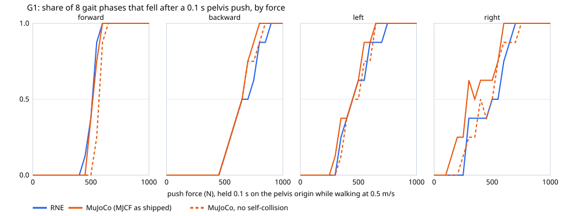
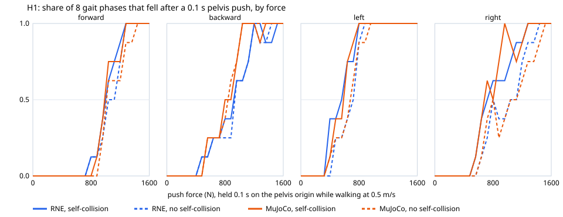

# 144 · G1 and H1 sim2sim: pretrained walking policies on RNE


[GIF](../../docs/media/g1-sim2sim.gif) · [metadata](../../docs/media/g1-sim2sim.json)

Unitree's [unitree_rl_gym](https://github.com/unitreerobotics/unitree_rl_gym)
ships a G1 walking policy trained in Isaac Gym and a script that deploys it in
MuJoCo. This example runs the same policy, unchanged, on RNE's Rapier backend
and measures how far RNE's walking lands from MuJoCo's. The same policy and
loop also run in the [browser playground](../../web/rne_web_viewer/README.md#physics-walking),
driven from the keyboard in real time.

```bash
cargo run --release -p g1_sim2sim --example 144_g1_sim2sim                  # 4 commands vs MuJoCo
cargo run --release -p g1_sim2sim --example 144_g1_sim2sim -- --timing      # solver-iteration sweep
cargo run --release -p g1_sim2sim --example 144_g1_sim2sim -- --ablation    # plant details
cargo run --release -p g1_sim2sim --example 144_g1_sim2sim -- --command 0.5,0,0 --seconds 20
cargo run --release -p g1_sim2sim --example 144_g1_sim2sim -- --robot h1     # the H1 policy
```

Reports go to `target/g1-sim2sim/g1-sim2sim-report.json`; a single
`--command` also writes every policy step to `g1-sim2sim-records.json`.

## What runs

- **Policy.** `motion.pt`'s actor (LSTM 47→64, Linear 64→32, ELU,
  Linear 32→12) evaluated by `rne_ai::LstmPolicy` from
  [`assets/policies/unitree_g1_walk`](../../assets/policies/unitree_g1_walk).
  The weights were copied byte for byte out of the TorchScript archive; nothing
  in it was unpickled or executed. On MuJoCo's recorded observations the Rust
  policy reproduces MuJoCo's actions within 1e-4 (`policy.rs` test).
- **Loop.** The deployment in `deploy/deploy_mujoco/configs/g1.yaml`: PD torque
  `kp (target − q) − kd q̇` recomputed every 2 ms physics step and clamped to the
  URDF effort limits, policy at 50 Hz, target = 0.25 · action + default pose,
  gait phase period 0.8 s. `rne_ai::UnitreeRlGymWalker` evaluates the same law
  on cached joint handles.
- **Observation.** Pelvis angular velocity in the pelvis frame, gravity
  projected into the pelvis frame, scaled command, joint positions and
  velocities, previous action, gait phase. RNE is Y-up; the example converts
  to the policy's Z-up frame.
- **Plant.** The 12-DoF model the policy was trained on: legs actuated,
  32.107 kg, four 5 mm foot spheres per ankle as the only colliders. The MJCF
  also collides the leg and pelvis meshes, but in an undisturbed walk only its
  feet touch anything; after a push they can matter (see
  [Robustness](#robustness)). The 18 fixed-joint links of the upper body are
  merged into the pelvis, as the MJCF does; `prepare_model.py` checks the merged
  mass, centre of mass and inertia against the MJCF's pelvis. MJCF joint
  `armature` (0.01 kg·m²), `damping` and `frictionloss`, and MuJoCo's default
  friction of 1 are reproduced; see `PlantConfig`.

## Results

Ten seconds per command, second-half averages, same weights and loop on both
engines (MuJoCo 3.9.0, `fixtures/mujoco_reference.json`):

| Command (vx, yaw) | Forward speed RNE / MuJoCo (m/s) | Yaw rate RNE / MuJoCo (rad/s) | Mean pelvis height RNE / MuJoCo (m) |
| --- | --- | --- | --- |
| 0.5, 0 | 0.463 / 0.476 | −0.011 / −0.017 | 0.770 / 0.770 |
| 0, 0 | 0.010 / 0.014 | −0.010 / −0.010 | 0.777 / 0.778 |
| 0.3, 0.5 | 0.278 / 0.280 | 0.455 / 0.452 | 0.771 / 0.772 |
| 0.8, 0 | 0.741 / 0.758 | −0.024 / −0.020 | 0.764 / 0.765 |

No run falls on either engine. The mean leg posture at 0.5 m/s matches within
0.004 rad (knee 0.342 / 0.338 rad from the default pose). Removing armature or
joint friction, or halving floor friction, changes forward speed by under
0.01 m/s; the policy is robust to those details.

**The gap that mattered was mass.** The upstream URDF has four sensor frames
(two IMUs, the D435 and the MID-360) without `<inertial>`. URDF gives them no
mass, but RNE's importer gives such links 1 kg each, so the first port weighed
36.1 kg with the extra mass high on the torso. The policy compensated by
crouching: at 0.5 m/s the knee bent 0.510 rad instead of 0.338 and the pelvis
rode 19 mm low (0.751 m vs 0.770 m). The derived model now merges those frames
into the pelvis with no mass, and a test pins the plant at 32.107 kg.
`unitree_g1_backflip_probe` and
`unitree_g1_29dof_dex3_fixed`, which also import declared masses, still carry
the 1 kg frames.

## H1

`--robot h1` runs unitree_rl_gym's H1 policy, which has the same network with
ten leg actions, on the H1 the same way. Its model merges the 11 fixed-joint
links into the pelvis (51.650 kg, matching the MJCF's pelvis inertial to
5.8e-7 kg·m²). Every link collides with the floor through the convex hull of
its mesh, as the MJCF's mesh geoms do, so the feet are hulls of the ankle
meshes rather than spheres. Unlike in the MJCF, links do not collide with each
other. Same metrics and engines as above (MuJoCo reference in
`fixtures/h1_mujoco_reference.json`):

| Command (vx, yaw) | Forward speed RNE / MuJoCo (m/s) | Yaw rate RNE / MuJoCo (rad/s) | Mean pelvis height RNE / MuJoCo (m) |
| --- | --- | --- | --- |
| 0.5, 0 | 0.458 / 0.431 | −0.015 / −0.010 | 1.030 / 1.030 |
| 0, 0 | −0.054 / −0.078 | −0.023 / −0.018 | 1.033 / 1.032 |
| 0.3, 0.5 | 0.236 / 0.213 | 0.433 / 0.433 | 1.024 / 1.026 |
| 0.8, 0 | 0.751 / 0.731 | 0.020 / 0.015 | 1.024 / 1.024 |

No run falls on either engine and the pelvis height matches within 2 mm. RNE
walks 0.02–0.03 m/s faster than MuJoCo at every command, about twice the G1's
gap. Armature, joint friction and floor friction each move it by under
0.01 m/s, which leaves the contact model as the likely cause: the same hull
feet are rigid in Rapier and soft in MuJoCo. One H1 runs at 5.1–5.4× real time
with four solver iterations (3.7–4.6× before the speedups below, measured in
the same session); every H1 link collides, so contacts take a larger share.

## Robustness

`--robustness` pushes the walking robot and lowers the floor friction to find
where the walk fails. `mujoco_robustness.py` repeats every trial in MuJoCo
from the protocol recorded in RNE's report.

- **Pushes.** After 4 s of walking at 0.5 m/s, a horizontal force acts on the
  pelvis origin for 0.1 s: forward, backward, left or right. It starts at one
  of eight points 0.1 s apart in the 0.8 s gait cycle, at 20 forces (G1
  50–1000 N, H1 80–1600 N, in proportion to mass), for 640 trials per robot
  and engine. A trial falls if the pelvis drops below 0.55 m within 4 s after
  the push.
- **Friction.** Ten-second walks with the floor's and the robot's friction
  set to each coefficient from 1.0 down to 0.1.





The force at which half the gait phases fall, interpolated between the grid
forces, and the share of the 640 trials that end as they do in RNE:

| Robot and engine | Forward (N) | Backward (N) | Left (N) | Right (N) | Same outcome as RNE |
| --- | --- | --- | --- | --- | --- |
| G1, RNE | 513 | 650 | 450 | 500 | — |
| G1, MuJoCo, MJCF as shipped | 517 | 650 | 450 | 283 | 94.7% |
| G1, MuJoCo, no self-collision | 570 | 650 | 450 | 400 | 95.0% |
| H1, RNE | 1040 | 933 | 720 | 800 | — |
| H1, MuJoCo, MJCF as shipped | 987 | 800 | 587 | 680 | 91.1% |
| H1, MuJoCo, no self-collision | 1013 | 840 | 680 | 800 | 94.4% |

- **The G1 agrees in three directions.** Forward, backward and left, the
  fall forces differ by at most 1%.
- **Most disagreements are MuJoCo's legs colliding with each other.** The
  MJCF lets every leg mesh collide with the other leg's and with the pelvis
  (MuJoCo skips only parent and child); RNE's G1 collides only its feet, and
  the H1's links collide only with the floor. In an undisturbed walk no robot
  body touches another on either engine, but a hard push can swing one leg
  into the other. In all 31 G1 trials where only MuJoCo fell, its legs touched
  before the fall, mostly knee against knee; so did 46 of the H1's 52, mostly
  ankle against ankle. With MuJoCo's self-collision off (`--no-self-collision`;
  the robot still collides with the floor), 32 of its G1 falls and 44 of its H1
  falls do not happen and 3 H1 falls appear. The G1's right push moves from
  283 to 400 N, and the H1's left and right pushes from 587 and 680 N to 680 and
  800 N.
- **What is left goes both ways.** Without self-collision, 18 G1 trials fall
  only in RNE and 14 only in MuJoCo (H1: 15 and 21). The G1's forward and
  right pushes (513 vs 570 N, 500 vs 400 N) and the H1's backward push (933 vs
  840 N) still differ by 11–25%. Contact (rigid in Rapier, soft in MuJoCo) and RNE's
  smoothed joint friction are the known modelling differences left; neither
  has been isolated as the cause.

Second-half forward speed (m/s, command 0.5) on lowered friction; the rows are
the same with MuJoCo's self-collision off:

| Friction | 1.0 | 0.5 | 0.3 | 0.25 | 0.2 | 0.15 | 0.1 |
| --- | --- | --- | --- | --- | --- | --- | --- |
| G1, RNE | 0.464 | 0.463 | 0.462 | 0.462 | 0.459 | 0.418 | fell |
| G1, MuJoCo | 0.476 | 0.470 | 0.469 | 0.470 | 0.465 | 0.347 | fell |
| H1, RNE | 0.458 | 0.456 | 0.451 | 0.445 | fell | fell | fell |
| H1, MuJoCo | 0.431 | 0.464 | 0.459 | fell | fell | fell | fell |

Both G1s walk down to 0.15 and fall at 0.1; at 0.15 RNE's keeps more speed.
The H1 still walks at 0.25 in RNE but falls in MuJoCo.

```bash
cargo run --release -p g1_sim2sim --example 144_g1_sim2sim -- --robustness   # target/g1-sim2sim/g1-robustness.json
python3 examples/144_g1_sim2sim/mujoco_robustness.py UNITREE_RL_GYM \
  target/g1-sim2sim/g1-robustness.json target/g1-sim2sim/g1-robustness-mujoco.json
python3 examples/144_g1_sim2sim/mujoco_robustness.py UNITREE_RL_GYM \
  target/g1-sim2sim/g1-robustness.json target/g1-sim2sim/g1-robustness-mujoco-noself.json \
  --no-self-collision
python3 examples/144_g1_sim2sim/robustness_compare.py target/g1-sim2sim/g1-robustness.json \
  target/g1-sim2sim/g1-robustness-mujoco.json docs/media/g1-sim2sim-robustness.json \
  docs/media/g1-sim2sim-robustness.svg \
  --variant target/g1-sim2sim/g1-robustness-mujoco-noself.json "MuJoCo, no self-collision"
# The H1: --robot h1, and h1- in every file name.
```

The summaries ([G1](../../docs/media/g1-sim2sim-robustness.json),
[H1](../../docs/media/h1-sim2sim-robustness.json)) hold the protocol, the fall
shares per force, the full friction sweep and the self-contact pairs. Both
engines are deterministic: rerunning a sweep reproduces every outcome.

## Real time

Simulated seconds per wall second for G1 walkers at 0.5 m/s, 10 s each, in
the 4-core development container. RNE times its whole loop (physics, PD and
policy, all in Rust), one walker per thread. MuJoCo 3.9.0 runs the same loop
with PD and policy in numpy, one process per walker; its first row counts only
the time inside `mj_step`. Both count walkers times simulated seconds over the
mean loop time per walker. Medians of five rounds, each running the previous
engine ("before"), this one and MuJoCo in turn:

| Engine and setting | 1 walker | 2 | 4 | 8 |
| --- | --- | --- | --- | --- |
| MuJoCo, `mj_step` only | 24.2 | 47.4 | 95.4 | 96.7 |
| MuJoCo, loop with numpy PD and policy | 19.1 | 37.6 | 75.7 | 76.2 |
| RNE, 1 solver iteration | 22.4 | 41.1 | 82.8 | 87.7 |
| RNE, 1 solver iteration, before | 16.7 | 33.5 | 65.4 | 65.6 |
| RNE, 4 solver iterations (default) | 10.2 | 20.4 | 40.4 | 38.1 |
| RNE, 4 solver iterations, before | 6.9 | 13.2 | 25.7 | 26.4 |

- **The walk is unchanged.** The speedups reproduce every floating-point
  result, so the walk records are byte-identical before and after. Every
  setting walks: 0.457 m/s at one iteration, 0.464 m/s at four, against
  MuJoCo's 0.476 m/s.
- **One walker.** At one solver iteration RNE runs at 93% of MuJoCo's physics
  alone, and faster than MuJoCo's loop once numpy computes PD and policy. At
  four iterations it reaches 42% of MuJoCo's physics. The default step is 1.5×
  faster than before.
- **Several walkers.** Both engines scale almost linearly to the four cores:
  four walkers deliver 3.7× (one iteration) and 4.0× (four) a single walker's
  throughput, MuJoCo 3.9×. Counting the slowest walker instead of the mean
  lowers this engine's rows by at most 6% and MuJoCo's by at most 7%. The
  container is shared, and absolute speed varies by up to 40% between
  sessions, so only rows measured together compare.
- **Where the time went.** Callgrind counts the instructions for 2 s of
  walking. At four iterations they fall from 2.88 G to 1.92 G (−33%); at one
  iteration from 1.09 G to 0.83 G (−25%). Rapier rebuilds and refactorizes
  the multibody mass matrices in every solver substep. That took 61% of the
  step and now takes 50%: each leg link's Jacobian is zero outside its
  ancestors' 7–12 coordinates, and the vendored Rapier skips those columns
  while computing the rest in nalgebra's exact order
  ([`RNE_PATCH.md`](../../third_party/rapier3d/RNE_PATCH.md)). A joint's limit
  and motor constraints now share one `M⁻¹e` solve. The backend sorts the ECS
  entities once per synchronization instead of six times, and reads a joint's
  position and velocity with one decode.
- **The wrapper around Rapier.** At one iteration RNE's own synchronization was
  about 30% of a step. Each synchronization now composes every world transform
  once instead of re-walking the parent chain for each body and joint torque.
  The deformable step returns at once in a scene without deformables, instead
  of snapshotting every collider, and the walker reads the joint states the
  backend already decoded after the step. Instructions for 2 s of walking fall
  another 8% at one iteration (826 M to 760 M) and 3.4% at four (1.92 G to
  1.86 G), with byte-identical walk records.

```bash
cargo run --release -p g1_sim2sim --example 144_g1_sim2sim -- --throughput --output target/g1-sim2sim
python3 examples/144_g1_sim2sim/mujoco_throughput.py UNITREE_RL_GYM target/g1-sim2sim/mujoco-throughput.json
```

[Medians and individual runs](../../docs/media/g1-sim2sim-throughput.json).
`--timing` still sweeps 1–32 solver iterations for one walker. Before #502
merged the fixed upper body (31 links to 13) and cached joint handles, the
first port ran at 2.6× real time with four iterations.

In the browser the same code compiled to WebAssembly keeps real time: headless
Chromium in this container (WebGPU on SwiftShader, no GPU) held a real-time
factor of 0.99–1.01 over a 21 s session of standing, walking, turning and a
side push, with physics and policy using 27–32% of each simulated second.

## Reproducing the reference

The MuJoCo side needs `mujoco` and `numpy` and an unitree_rl_gym checkout
(commit `276801e`) for its MJCF scene:

```bash
python3 examples/144_g1_sim2sim/extract_policy.py UNITREE_RL_GYM assets/policies/unitree_g1_walk
python3 examples/144_g1_sim2sim/prepare_model.py UNITREE_RL_GYM
python3 examples/144_g1_sim2sim/mujoco_reference.py UNITREE_RL_GYM \
  examples/144_g1_sim2sim/fixtures/mujoco_reference.json \
  --fixture examples/144_g1_sim2sim/fixtures/mujoco_policy_io.json
# The H1: the same three scripts with --robot h1, writing
# assets/policies/unitree_h1_walk, assets/robots/h1_description/h1.rne.urdf and
# fixtures/h1_mujoco_reference.json / h1_mujoco_policy_io.json.
cargo run --release -p g1_sim2sim --example 144_g1_sim2sim -- --render target/g1-sim2sim-render
python3 examples/144_g1_sim2sim/encode.py target/g1-sim2sim-render docs/media/g1-sim2sim
```

`mujoco_reference.py` runs the policy from the same weight blob in numpy and
shares its walking metrics with Rust through `metrics.py`.

## Limits

- Rapier contact is rigid; MuJoCo's is soft. The foot spheres are 5 mm, so
  the comparison is sensitive to contact modelling, and these four commands,
  the pushes and the friction sweep on flat ground are the whole test.
- RNE's walking models do not collide the robot's links with each other, so a
  push that swings one leg into the other passes through in RNE, where
  MuJoCo's legs collide ([Robustness](#robustness)).
- RNE regularizes `frictionloss` as `0.1 · tanh(q̇ / 0.05)`; MuJoCo treats it
  as a constraint.
- Observations are ideal simulator state. There is no sensor noise, latency or
  domain randomization, and nothing here says the policy works on hardware.
