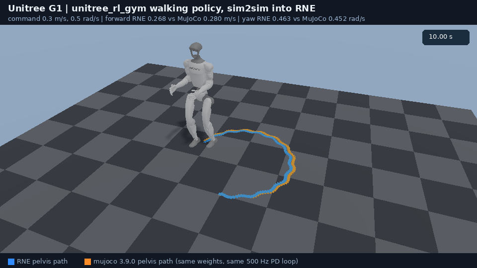
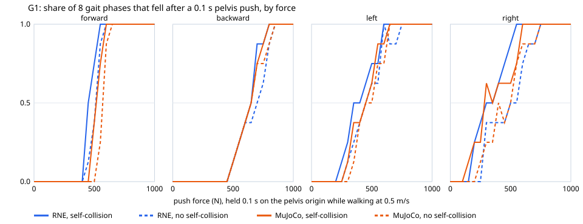
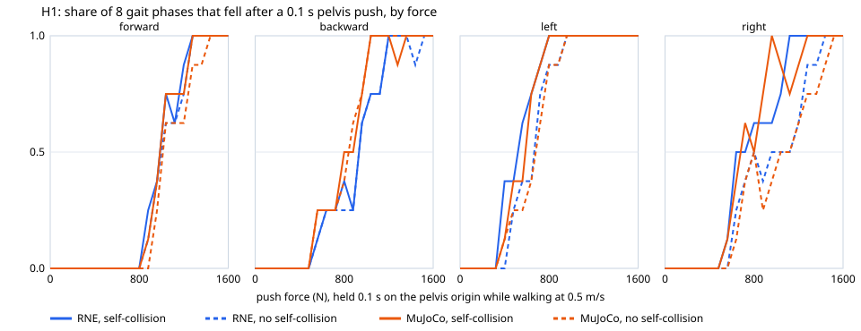

# 144 · G1 and H1 sim2sim: pretrained walking policies on RNE



[GIF](../../docs/media/g1-sim2sim.gif) · [metadata](../../docs/media/g1-sim2sim.json)

Unitree's [unitree_rl_gym](https://github.com/unitreerobotics/unitree_rl_gym)
ships a G1 walking policy trained in Isaac Gym and a script that deploys it in
MuJoCo. This example runs the same policy, unchanged, on RNE's Rapier backend
and measures how far RNE's walking lands from MuJoCo's. The same policy and
loop also run in the [browser playground](../../web/rne_web_viewer/README.md#physics-walking),
driven from the keyboard in real time.

```bash
cargo run --release -p g1_sim2sim --example 144_g1_sim2sim                  # 4 commands vs MuJoCo
cargo run --release -p g1_sim2sim --example 144_g1_sim2sim -- --timing      # solver-iteration sweep
cargo run --release -p g1_sim2sim --example 144_g1_sim2sim -- --ablation    # plant details
cargo run --release -p g1_sim2sim --example 144_g1_sim2sim -- --command 0.5,0,0 --seconds 20
cargo run --release -p g1_sim2sim --example 144_g1_sim2sim -- --robot h1     # the H1 policy
```

Reports go to `target/g1-sim2sim/g1-sim2sim-report.json`; a single
`--command` also writes every policy step to `g1-sim2sim-records.json`.

## What runs

- **Policy.** `motion.pt`'s actor (LSTM 47→64, Linear 64→32, ELU,
  Linear 32→12) evaluated by `rne_ai::LstmPolicy` from
  [`assets/policies/unitree_g1_walk`](../../assets/policies/unitree_g1_walk).
  The weights were copied byte for byte out of the TorchScript archive; nothing
  in it was unpickled or executed. On MuJoCo's recorded observations the Rust
  policy reproduces MuJoCo's actions within 1e-4 (`policy.rs` test).
- **Loop.** The deployment in `deploy/deploy_mujoco/configs/g1.yaml`: PD torque
  `kp (target − q) − kd q̇` recomputed every 2 ms physics step and clamped to the
  URDF effort limits, policy at 50 Hz, target = 0.25 · action + default pose,
  gait phase period 0.8 s. `rne_ai::UnitreeRlGymWalker` evaluates the same law
  on cached joint handles.
- **Observation.** Pelvis angular velocity in the pelvis frame, gravity
  projected into the pelvis frame, scaled command, joint positions and
  velocities, previous action, gait phase. RNE is Y-up; the example converts
  to the policy's Z-up frame.
- **Plant.** The 12-DoF model the policy was trained on: legs actuated,
  32.107 kg, four 5 mm foot spheres per ankle as the only colliders. The MJCF
  also collides the leg and pelvis meshes, but in an undisturbed walk only its
  feet touch anything; after a push they can matter (see
  [Robustness](#robustness)). The 18 fixed-joint links of the upper body are
  merged into the pelvis, as the MJCF does; `prepare_model.py` checks the merged
  mass, centre of mass and inertia against the MJCF's pelvis. MJCF joint
  `armature` (0.01 kg·m²), `damping` and `frictionloss`, and MuJoCo's default
  friction of 1 are reproduced; see `PlantConfig`.

## Results

Ten seconds per command, second-half averages, same weights and loop on both
engines (MuJoCo 3.9.0, `fixtures/mujoco_reference.json`):

| Command (vx, yaw) | Forward speed RNE / MuJoCo (m/s) | Yaw rate RNE / MuJoCo (rad/s) | Mean pelvis height RNE / MuJoCo (m) |
| --- | --- | --- | --- |
| 0.5, 0 | 0.464 / 0.476 | −0.010 / −0.017 | 0.770 / 0.770 |
| 0, 0 | 0.009 / 0.014 | −0.009 / −0.010 | 0.777 / 0.778 |
| 0.3, 0.5 | 0.268 / 0.280 | 0.463 / 0.452 | 0.770 / 0.772 |
| 0.8, 0 | 0.738 / 0.758 | −0.024 / −0.020 | 0.764 / 0.765 |

No run falls on either engine. The mean leg posture at 0.5 m/s matches within
0.004 rad (knee 0.342 / 0.338 rad from the default pose). Removing armature or
joint friction, or halving floor friction, changes forward speed by at most
0.011 m/s; the policy is robust to those details.

**The gap that mattered was mass.** The upstream URDF has four sensor frames
(two IMUs, the D435 and the MID-360) without `<inertial>`. URDF gives them no
mass, but RNE's importer gives such links 1 kg each, so the first port weighed
36.1 kg with the extra mass high on the torso. The policy compensated by
crouching: at 0.5 m/s the knee bent 0.510 rad instead of 0.338 and the pelvis
rode 19 mm low (0.751 m vs 0.770 m). The derived model now merges those frames
into the pelvis with no mass, and a test pins the plant at 32.107 kg.
`unitree_g1_backflip_probe` and
`unitree_g1_29dof_dex3_fixed`, which also import declared masses, still carry
the 1 kg frames.

## H1

`--robot h1` runs unitree_rl_gym's H1 policy, which has the same network with
ten leg actions, on the H1 the same way. Its model merges the 11 fixed-joint
links into the pelvis (51.650 kg, matching the MJCF's pelvis inertial to
5.8e-7 kg·m²). Every link collides with the floor through the convex hull of
its mesh, as the MJCF's mesh geoms do, so the feet are hulls of the ankle
meshes rather than spheres. Unlike in the MJCF, links do not collide with each
other. Same metrics and engines as above (MuJoCo reference in
`fixtures/h1_mujoco_reference.json`):

| Command (vx, yaw) | Forward speed RNE / MuJoCo (m/s) | Yaw rate RNE / MuJoCo (rad/s) | Mean pelvis height RNE / MuJoCo (m) |
| --- | --- | --- | --- |
| 0.5, 0 | 0.457 / 0.431 | −0.016 / −0.010 | 1.030 / 1.030 |
| 0, 0 | −0.049 / −0.078 | −0.025 / −0.018 | 1.033 / 1.032 |
| 0.3, 0.5 | 0.261 / 0.213 | 0.431 / 0.433 | 1.024 / 1.026 |
| 0.8, 0 | 0.750 / 0.731 | 0.018 / 0.015 | 1.024 / 1.024 |

No run falls on either engine and the pelvis height matches within 2 mm. RNE
walks 0.02–0.05 m/s faster than MuJoCo at every command, the most while
turning, about twice the G1's gap. Joint friction and floor friction each move
it by under 0.01 m/s and armature by at most 0.016 m/s, which leaves the
contact model as the likely cause: the same hull feet are rigid in Rapier and
soft in MuJoCo. One H1 runs at 13–15× real time with four solver iterations
(5.1–5.4× before the speedups in [Real time](#real-time)); every H1 link
collides through a hull of hundreds of vertices, so it gained most from the
hill-climbed bounding boxes.

## Robustness

`--robustness` pushes the walking robot and lowers the floor friction to find
where the walk fails. `mujoco_robustness.py` repeats every trial in MuJoCo
from the protocol recorded in RNE's report.

- **Pushes.** After 4 s of walking at 0.5 m/s, a horizontal force acts on the
  pelvis origin for 0.1 s: forward, backward, left or right. It starts at one
  of eight points 0.1 s apart in the 0.8 s gait cycle, at 20 forces (G1
  50–1000 N, H1 80–1600 N, in proportion to mass), for 640 trials per robot
  and engine. A trial falls if the pelvis drops below 0.55 m within 4 s after
  the push.
- **Friction.** Ten-second walks with the floor's and the robot's friction
  set to each coefficient from 1.0 down to 0.1.





Each engine runs with and without self-collision: the robot's links colliding
with each other, except a link and its parent. MuJoCo's MJCF ships with it;
RNE's walking models (above) run without it, and `--self-collision` turns it
on (below). The force at which half the gait phases fall, interpolated
between the grid forces, and the share of the 640 trials that end as they do
in MuJoCo with self-collision:

| Robot and engine | Forward (N) | Backward (N) | Left (N) | Right (N) | Same outcome as MuJoCo, self-collision |
| --- | --- | --- | --- | --- | --- |
| G1, MuJoCo, self-collision (MJCF as shipped) | 517 | 650 | 450 | 283 | — |
| G1, RNE, self-collision | 450 | 650 | 350 | 300 | 95.6% |
| G1, RNE, no self-collision | 513 | 700 | 450 | 500 | 94.5% |
| G1, MuJoCo, no self-collision | 570 | 650 | 450 | 400 | 95.0% |
| H1, MuJoCo, self-collision (MJCF as shipped) | 987 | 800 | 587 | 680 | — |
| H1, RNE, self-collision | 987 | 933 | 520 | 640 | 94.4% |
| H1, RNE, no self-collision | 1000 | 933 | 667 | 800 | 92.8% |
| H1, MuJoCo, no self-collision | 1013 | 840 | 680 | 800 | 94.4% |

- **Without self-collision, the G1 agrees forward and left.** The fall forces
  there differ by at most 1%; backward RNE holds 8% more (700 vs 650 N) and
  on the right far more (500 vs 283 N).
- **That gap is the legs colliding with each other.** In an undisturbed walk
  no robot body touches another on either engine, but a hard push can swing
  one leg into the other. In 30 of the 31 G1 trials where only MuJoCo fell, its
  legs touched before the fall, mostly knee against knee; so did 36 of the
  H1's 43, mostly ankle against ankle. With MuJoCo's self-collision off
  (`--no-self-collision`; the robot still collides with the floor), 32 of its
  G1 falls and 44 of its H1 falls do not happen and 3 H1 falls appear.
- **With self-collision in RNE, the right push matches.** The G1 falls at
  300 N against MuJoCo's 283 N and backward at 650 N like MuJoCo, the H1's
  left and right pushes move from 667 and 800 N to 520 and 640 N against 587
  and 680 N, and agreement rises to 95.6% and 94.4%. Self-collision makes 48
  G1 and 38 H1 trials fall in RNE (and saves 1 and 2); MuJoCo also falls in
  27 and 24 of them.
- **Now the G1 in RNE falls a little earlier.** With self-collision on both
  engines, 24 G1 trials fall only in RNE and 4 only in MuJoCo; its forward and
  left pushes fall at 450 and 350 N against 517 and 450 N. The H1's split
  evenly (16 and 20): RNE holds the backward push longer (933 vs 800 N) and
  gives way sideways a little earlier. In 19 of those 24 G1 trials (and 15 of
  the 16 H1 trials) MuJoCo's legs touched too and it recovered, so the two
  engines differ in what a contact between the legs does, not in whether it
  happens. Contact (rigid in Rapier, soft in MuJoCo) and RNE's smoothed joint
  friction are the known modelling differences left; neither has been
  isolated as the cause.

**Self-collision in RNE.** `parent_child_collisions = false` in a robot
asset's `[urdf]` table marks every URDF joint's child link with
`rne_physics::ParentCollisionExclusion`, and Rapier then creates that joint
with contacts between its two bodies disabled, as MuJoCo filters parent and
child; `self_collisions = true` keeps every other pair. The H1 variant
(`unitree_h1_walk_self_collision.rne.robot.toml`) only changes those two
settings. The G1 variant also gives each leg link the convex hull of its mesh
(`g1_12dof_hulls.rne.urdf`, written by `prepare_model.py --robot g1_hulls`);
its merged pelvis keeps no collision geometry, whereas the MJCF's pelvis
collides through its torso, head, arm and contour meshes; none of the contacts
in the 31 G1 trials where only MuJoCo fell involved the pelvis. An undisturbed
walk is unchanged: the H1's records are byte-identical with and without
self-collision, and the G1's agree within 0.001 in every walking
metric (its extra leg colliders change the order in which Rapier solves the
foot contacts). It costs the G1 3% more instructions per step and the H1
none.

Second-half forward speed (m/s, command 0.5) on lowered friction; the rows are
the same, to 0.001 m/s, with either engine's self-collision switched:

| Friction | 1.0 | 0.5 | 0.3 | 0.25 | 0.2 | 0.15 | 0.1 |
| --- | --- | --- | --- | --- | --- | --- | --- |
| G1, RNE | 0.464 | 0.462 | 0.462 | 0.461 | 0.458 | 0.418 | fell |
| G1, MuJoCo | 0.476 | 0.470 | 0.469 | 0.470 | 0.465 | 0.347 | fell |
| H1, RNE | 0.457 | 0.454 | 0.450 | 0.445 | fell | fell | fell |
| H1, MuJoCo | 0.431 | 0.464 | 0.459 | fell | fell | fell | fell |

Both G1s walk down to 0.15 and fall at 0.1; at 0.15 RNE's keeps more speed.
The H1 still walks at 0.25 in RNE but falls in MuJoCo.

```bash
cargo run --release -p g1_sim2sim --example 144_g1_sim2sim -- --robustness   # target/g1-sim2sim/g1-robustness.json
cargo run --release -p g1_sim2sim --example 144_g1_sim2sim -- --robustness --self-collision
python3 examples/144_g1_sim2sim/mujoco_robustness.py UNITREE_RL_GYM \
  target/g1-sim2sim/g1-robustness.json target/g1-sim2sim/g1-robustness-mujoco.json
python3 examples/144_g1_sim2sim/mujoco_robustness.py UNITREE_RL_GYM \
  target/g1-sim2sim/g1-robustness.json target/g1-sim2sim/g1-robustness-mujoco-noself.json \
  --no-self-collision
python3 examples/144_g1_sim2sim/robustness_compare.py docs/media/g1-sim2sim-robustness.json \
  docs/media/g1-sim2sim-robustness.svg target/g1-sim2sim/g1-robustness-self-collision.json \
  target/g1-sim2sim/g1-robustness.json target/g1-sim2sim/g1-robustness-mujoco.json \
  target/g1-sim2sim/g1-robustness-mujoco-noself.json
# The H1: --robot h1, and h1- in every file name.
```

The summaries ([G1](../../docs/media/g1-sim2sim-robustness.json),
[H1](../../docs/media/h1-sim2sim-robustness.json)) hold the protocol, each
report's fall shares and friction sweep, every RNE–MuJoCo comparison with
MuJoCo's self-contact pairs, and what self-collision changes within each
engine. Both engines are deterministic: rerunning a sweep reproduces every
outcome.

## Push recovery: training in RNE, testing in MuJoCo

`--train-residual` trains a correction for the pretrained policy to recover
from pushes, and `--residual FILE` sweeps with it; `mujoco_robustness.py
--residual` and `mujoco_residual.py` do the same in MuJoCo.

- **Residual.** A linear map from five entries of the policy's observation
  (scaled pelvis angular velocity and the horizontal components of projected
  gravity, all zero when upright and still) to the 12 joint targets, clamped
  to ±0.4 rad and added to the policy's targets for the next period
  (`UnitreeRlGymWalker::offset_targets_rad`). 60 parameters.
- **Training.** Evolution strategies: 16 antithetic pairs per generation,
  centred ranks, Adam, σ = 0.05, learning rate 0.02, 30 generations. Each
  candidate walks 32 pushes (four directions, two forces near where the plain
  policy falls, four gait phases) after 1 s of walking and is watched for
  1.5 s. A survived push scores 1 plus up to 0.5 for keeping the pelvis
  within 0.6 rad of upright; a fall scores half the share of the window it
  stood through; the mean squared offset is subtracted. MuJoCo's trainer
  reads the scenarios and settings from RNE's report and draws its noise
  from the same generator and seed.
- **Plant.** The G1 with self-collision and one solver iteration. One
  iteration agrees with MuJoCo on 95.5% of the push sweep's 640 trials (four
  iterations: 95.6%), and like MuJoCo and four iterations it walks down to
  μ = 0.15 and falls at 0.1.

Falls in the 640-trial push sweep, which uses 4 s of walking and 4 s of
watching rather than training's 1 s and 1.5 s:

| Residual | In RNE | In MuJoCo |
| --- | --- | --- |
| None | 366 | 345 |
| Trained in RNE | 350 | 335 |
| Trained in MuJoCo | 349 | 328 |

A residual trained in either engine helps in the other, and both engines
rank the two the same way (RNE by a single fall). The gain is small: a linear map from tilt and
spin is too weak a controller to move the fall boundary far.

**Training cost.** One generation simulates about 2,500 s (33 candidates × 32
pushes). Simulated seconds per wall second on the 4-core container, RNE with
one thread per core, MuJoCo 3.9.0 with one process per core:

| Engine and setting | Simulated s / wall s |
| --- | --- |
| RNE, four solver iterations, before this work | 24.6 |
| RNE, one solver iteration, faster convex hulls | 58.0 |
| RNE, as above, walkers reset instead of rebuilt, faster hashing | 67.1 (MuJoCo 68.9) |
| RNE, as above, leaner synchronization, Rapier owns the link poses | 72.7 (MuJoCo 62.6) |
| MuJoCo, scene compiled for every trial | 32.1 |

The rows with MuJoCo in brackets are medians of three rounds that alternate
the engines, MuJoCo compiling its scene once per process. The container's
speed drifts between sets of rounds, so only the numbers within a row
compare: in the first set the engines were level, in the latest RNE trains
16% faster. The full 30-generation run takes 984 s, 79 simulated seconds per
wall second. What changed in RNE; every step but the last leaves walk
records, sweep outcomes and training scores byte-identical:

- **Convex hulls.** The backend built every new hull twice (once to validate
  it); it now builds it once. Rapier found a hull's bounding box by
  transforming all its vertices, twice per step; the vendored copy now walks
  the hull's edge graph from last step's extreme vertices and reuses the box
  when the pose has not changed ([`RNE_PATCH.md`](../../third_party/rapier3d/RNE_PATCH.md)).
  For 2 s of walking with self-collision this cut instructions by 20% at
  four iterations and 36% at one; the H1 (hull feet, no self-collision) needs
  14% fewer.
- **Resets.** `UrdfSceneSim::reset` respawns the scene from the bundle parsed
  at construction into a fresh ECS world and empties the physics world with
  `RapierBackend::reset_world`; the backend reuses hulls it built for the same
  vertices. `UnitreeRlGymWalker::reset` reconfigures the plant and clears the
  policy. A reset walker replays a new one bit for bit, and each sweep or
  training thread now keeps one walker.
- **Hashing.** Per-step lookups in the backend and the importer's vertex
  deduplication use `rne_core::FxHasher` instead of SipHash.
- **Synchronization.** The backend composes world transforms only for
  entities with a body, keeps the sorted body and joint lists between steps,
  and updates joint states in place instead of reinserting them. The walker
  then lets Rapier own its link poses and synchronizes only the joint motors
  between policy steps; see [Real time](#real-time) for this last change,
  which moves walking results slightly.

```bash
cargo run --release -p g1_sim2sim --example 144_g1_sim2sim -- \
  --train-residual --self-collision --solver-iterations 1        # target/g1-sim2sim/g1-residual.json
cargo run --release -p g1_sim2sim --example 144_g1_sim2sim -- \
  --robustness --self-collision --solver-iterations 1 --residual target/g1-sim2sim/g1-residual.json
python3 examples/144_g1_sim2sim/mujoco_residual.py UNITREE_RL_GYM \
  target/g1-sim2sim/g1-residual.json target/g1-sim2sim/g1-residual-mujoco.json
python3 examples/144_g1_sim2sim/mujoco_robustness.py UNITREE_RL_GYM \
  target/g1-sim2sim/g1-robustness-self-collision.json OUTPUT.json --residual RESIDUAL.json
```

## Real time

Simulated seconds per wall second for G1 walkers at 0.5 m/s, 10 s each, in
the 4-core development container. RNE times its whole loop (physics, PD and
policy, all in Rust), one walker per thread. MuJoCo 3.9.0 runs the same loop
with PD and policy in numpy, one process per walker; its first row counts only
the time inside `mj_step`. Both count walkers times simulated seconds over the
mean loop time per walker. Medians of five rounds, each running RNE and then
MuJoCo:

| Engine and setting | 1 walker | 2 | 4 | 8 |
| --- | --- | --- | --- | --- |
| MuJoCo, `mj_step` only | 23.6 | 46.0 | 94.5 | 97.3 |
| MuJoCo, loop with numpy PD and policy | 18.5 | 36.3 | 75.1 | 78.8 |
| RNE, 1 solver iteration | 25.6 | 51.7 | 107.0 | 114.4 |
| RNE, 4 solver iterations (default) | 11.7 | 23.5 | 44.9 | 42.6 |

- **One walker.** At one solver iteration RNE's whole loop now runs 9% faster
  than MuJoCo's physics alone and 38% faster than MuJoCo's loop with numpy PD
  and policy. At four iterations it reaches half of MuJoCo's physics. Every
  setting walks: 0.457 m/s at one iteration, 0.464 m/s at four, against
  MuJoCo's 0.476 m/s.
- **Several walkers.** Both engines scale almost linearly to the four cores:
  four walkers deliver 4.2× (one iteration) and 3.8× (four) a single walker's
  throughput, MuJoCo 4.0×. Counting the slowest walker instead of the mean
  lowers RNE's rows by at most 10% up to four walkers (21% for eight at one
  iteration, where walkers share cores) and MuJoCo's by at most 7%; RNE at one
  iteration still leads up to four walkers. The container is shared, and
  absolute speed varies by up to 40% between sessions, so only rows measured
  together compare.
- **Before.** When the work below began, one walker ran at 16.7× real time
  with one iteration and 6.9× with four, beside MuJoCo's 24.2× in `mj_step`.
  The changes under *Where the time went* brought that to 22.4× and 10.2× in
  the same session; the later ones below and under
  [Push recovery](#push-recovery-training-in-rne-testing-in-mujoco) brought it
  to the table's 25.6× and 11.7× (MuJoCo 23.6× in this session). Every change but the last reproduces every
  floating-point result, so walk records stayed byte-identical until then.
- **Where the time went.** Callgrind counts the instructions for 2 s of
  walking. At four iterations they fall from 2.88 G to 1.92 G (−33%); at one
  iteration from 1.09 G to 0.83 G (−25%). Rapier rebuilds and refactorizes
  the multibody mass matrices in every solver substep. That took 61% of the
  step and now takes 50%: each leg link's Jacobian is zero outside its
  ancestors' 7–12 coordinates, and the vendored Rapier skips those columns
  while computing the rest in nalgebra's exact order
  ([`RNE_PATCH.md`](../../third_party/rapier3d/RNE_PATCH.md)). A joint's limit
  and motor constraints now share one `M⁻¹e` solve. The backend sorts the ECS
  entities once per synchronization instead of six times, and reads a joint's
  position and velocity with one decode.
- **The wrapper around Rapier.** At one iteration RNE's own synchronization was
  about 30% of a step. Each synchronization now composes every world transform
  once instead of re-walking the parent chain for each body and joint torque.
  The deformable step returns at once in a scene without deformables, instead
  of snapshotting every collider, and the walker reads the joint states the
  backend already decoded after the step. Instructions for 2 s of walking fall
  another 8% at one iteration (826 M to 760 M) and 3.4% at four (1.92 G to
  1.86 G), with byte-identical walk records.
- **The raycast index.** RNE rebuilt Rapier's raycast index twice every step,
  and each rebuild scans every vertex of every convex hull for its bounding
  box. The index now waits for the next raycast. Rapier's dynamics never read
  it, so walk records stay byte-identical; the H1, whose links are hulls, needs
  22% fewer instructions for 2 s of walking (2.27 G to 1.78 G), and the G1,
  whose feet are spheres, 0.4% fewer.
- **Rapier owns the walker's link poses.** Every step the backend pushed each
  link's pose from the ECS into Rapier and read it back after the step, in
  f32 world frames on one side and f64 joint frames on the other. The round
  trip rounded every pose a little and marked every body as changed. The
  walker now marks its links `rne_physics::PhysicsOwnedPose`, so the backend
  stops pushing their poses, and between policy steps it calls
  `RapierBackend::sync_joint_actuation_from_ecs`, which applies only the PD
  torques and the bookkeeping a full synchronization does for Rapier. This
  is the one change that moves results, by removing the rounding: walk
  metrics change by at most 0.010 m/s for the G1 and 0.025 m/s for the H1
  (its turning command), within the engines' gap, and every number in this
  README is measured with it. The leaner synchronization saves 9% of the
  instructions for 2 s of a self-colliding G1 walk at one iteration; the G1
  now needs 1.73 G instructions at four iterations (1.79 G with
  self-collision, 0.70 G with it at one) and the H1 1.44 G.

```bash
cargo run --release -p g1_sim2sim --example 144_g1_sim2sim -- --throughput --output target/g1-sim2sim
python3 examples/144_g1_sim2sim/mujoco_throughput.py UNITREE_RL_GYM target/g1-sim2sim/mujoco-throughput.json
```

[Medians and individual runs](../../docs/media/g1-sim2sim-throughput.json).
`--timing` still sweeps 1–32 solver iterations for one walker. Before #502
merged the fixed upper body (31 links to 13) and cached joint handles, the
first port ran at 2.6× real time with four iterations.

In the browser the same code compiled to WebAssembly keeps real time: headless
Chromium in this container (WebGPU on SwiftShader, no GPU) held a real-time
factor of 0.99–1.01 over a 21 s session of standing, walking, turning and a
side push, with physics and policy using 27–32% of each simulated second.

## Reproducing the reference

The MuJoCo side needs `mujoco` and `numpy` and an unitree_rl_gym checkout
(commit `276801e`) for its MJCF scene:

```bash
python3 examples/144_g1_sim2sim/extract_policy.py UNITREE_RL_GYM assets/policies/unitree_g1_walk
python3 examples/144_g1_sim2sim/prepare_model.py UNITREE_RL_GYM
python3 examples/144_g1_sim2sim/mujoco_reference.py UNITREE_RL_GYM \
  examples/144_g1_sim2sim/fixtures/mujoco_reference.json \
  --fixture examples/144_g1_sim2sim/fixtures/mujoco_policy_io.json
# The H1: the same three scripts with --robot h1, writing
# assets/policies/unitree_h1_walk, assets/robots/h1_description/h1.rne.urdf and
# fixtures/h1_mujoco_reference.json / h1_mujoco_policy_io.json.
cargo run --release -p g1_sim2sim --example 144_g1_sim2sim -- --render target/g1-sim2sim-render
python3 examples/144_g1_sim2sim/encode.py target/g1-sim2sim-render docs/media/g1-sim2sim
```

`mujoco_reference.py` runs the policy from the same weight blob in numpy and
shares its walking metrics with Rust through `metrics.py`.

## Limits

- Rapier contact is rigid; MuJoCo's is soft. The foot spheres are 5 mm, so
  the comparison is sensitive to contact modelling, and these four commands,
  the pushes and the friction sweep on flat ground are the whole test.
- RNE's walking models do not collide the robot's links with each other, so a
  push that swings one leg into the other passes through, where MuJoCo's legs
  collide. `--self-collision` collides them; the G1's merged pelvis still
  does not collide ([Robustness](#robustness)).
- RNE regularizes `frictionloss` as `0.1 · tanh(q̇ / 0.05)`; MuJoCo treats it
  as a constraint.
- Observations are ideal simulator state. There is no sensor noise, latency or
  domain randomization, and nothing here says the policy works on hardware.
