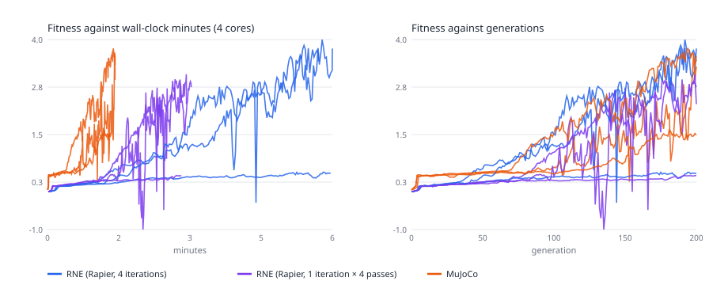
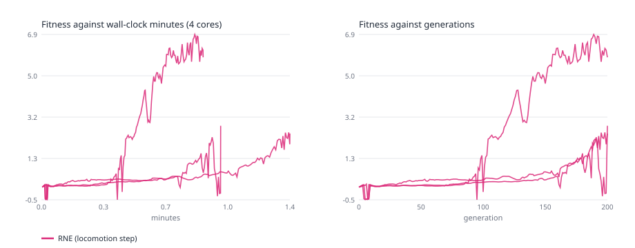
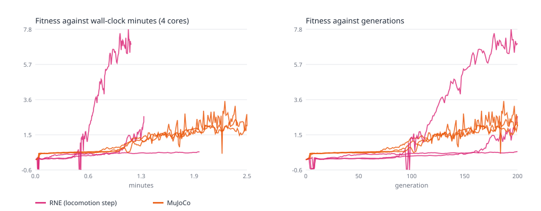
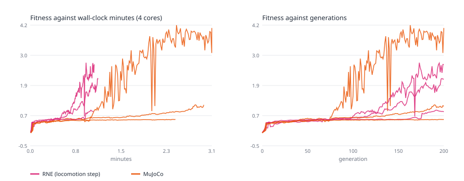

# 147 · A Go2 learns to walk from scratch in RNE and in MuJoCo

Example 144's push-recovery residuals corrected a pretrained walking policy.
This example learns a walk from nothing. Both engines train with the same
algorithm, policy, episode, fitness and seed, so only the simulator differs.
It then checks two things: how fast each engine gets a Go2 walking, and
whether a walk learned in one works in the other.

```bash
cargo run --release -p go2_learning --example 147_go2_learning -- --train --seed 2026   # target/go2-learning/go2-learning-rne-2026.json
cargo run --release -p go2_learning --example 147_go2_learning -- --train --seed 2026 \
  --solver-iterations 1 --inner-passes 4   # the cheaper solve; same output path
cargo run --release -p go2_learning --example 147_go2_learning -- --train --seed 2026 \
  --backend locomotion   # rne_locomotion's contact step; go2-learning-locomotion-2026.json
cargo run --release -p go2_learning --example 147_go2_learning -- --write-terrain terrain.json --terrain 7
cargo run --release -p go2_learning --example 147_go2_learning -- --train --seed 2026 \
  --backend locomotion --terrain 7   # go2-learning-locomotion-terrain-2026.json
cargo run --release -p go2_learning --example 147_go2_learning -- --train --seed 2026 \
  --backend locomotion --terrain 7 --random-starts --height-scan   # ...-terrain-starts-scan-2026.json
cargo run --release -p go2_learning --example 147_go2_learning -- --evaluate POLICY.json \
  --backend locomotion --terrain 7 --starts 16   # the mean over 16 held-out starts
#   --terrain-frequency 1.0 --terrain-amplitude 0.08 makes the terrain rougher (defaults 0.5, 0.04)
cargo run --release -p go2_learning --example 147_go2_learning -- --train --seed 2026 \
  --backend locomotion --learner ppo   # PPO in place of evolution strategies; ...-locomotion-ppo-2026.json
#   --iterations 400 --envs 16 --hidden 64 are PPO's defaults; --terrain-size 48 widens the terrain (default 24 m)
cargo run --release -p go2_learning --example 147_go2_learning -- --evaluate POLICY.json \
  --backend locomotion --trace TRACE.json   # every control period's state and targets; --trace-start X,Y
python3 examples/147_go2_learning/mujoco_go2_learning.py evaluate POLICY.json --trace TRACE.json
python3 examples/147_go2_learning/mujoco_go2_learning.py replay TRACE.json REPLAY.json   # MuJoCo from each RNE state
python3 examples/147_go2_learning/mujoco_go2_learning.py check-terrain terrain.json
python3 examples/147_go2_learning/mujoco_go2_learning.py train \
  target/go2-learning/go2-learning-locomotion-terrain-2026.json OUT.json --terrain terrain.json
python3 examples/147_go2_learning/mujoco_go2_learning.py train \
  target/go2-learning/go2-learning-rne-2026.json target/go2-learning/go2-learning-mujoco-2026.json
cargo run --release -p go2_learning --example 147_go2_learning -- --evaluate target/go2-learning/go2-learning-mujoco-2026.json
python3 examples/147_go2_learning/mujoco_go2_learning.py evaluate target/go2-learning/go2-learning-rne-2026.json
python3 examples/147_go2_learning/mujoco_go2_learning.py evaluate POLICY.json --terrain terrain.json --starts 16
cargo run --release -p go2_learning --example 147_go2_learning -- --stand 5   # settled stance, as JSON
python3 examples/147_go2_learning/mujoco_go2_learning.py stand 5
cargo run --release -p go2_learning --example 147_go2_learning -- --bench 8 [--solver-iterations 1] [--inner-passes 4] [--backend native|locomotion]
python3 examples/147_go2_learning/mujoco_go2_learning.py bench 8 [--cone pyramidal --impratio 1]
python3 examples/147_go2_learning/learning_compare.py SUMMARY.json FIGURE.svg \
  --training rne:2026=RNE_REPORT.json --training mujoco:2026=MUJOCO_REPORT.json \
  --evaluation mujoco/rne:2026=EVALUATION.json   # one --evaluation per engine and run
# Engines are rne (4 iterations), rne2x1 (2 iterations), rne1x4 (1 iteration, 4 inner passes), native, locomotion and mujoco.
```

## What runs

- **Robot.** The vendored Go2 URDF
  (`assets/robots/go2_description/go2_description.rne.urdf`). Its collision
  geometry is boxes, cylinders (capsules in RNE) and 22 mm foot spheres.
  - Both engines fuse the links fixed to another link into it: feet,
    lower-calf bumpers and head.
  - Links without an `<inertial>` are massless.
  - The robot totals 16.087 kg, the URDF's declared masses.
- **RNE.** `unitree_go2_fused.rne.scene.toml` runs on Rapier through
  `UrdfSceneSim` and `PdJointWalker`. Its robot asset sets
  `fuse_fixed_children` and `use_declared_inertial_masses`. Three settings:
  - four solver iterations;
  - two solver iterations (`--solver-iterations 2`, "RNE 2×1" below);
  - one solver iteration with four inner constraint passes
    (`--solver-iterations 1 --inner-passes 4`, "RNE 1×4" below; see
    [Speed](#speed)).
- **RNE locomotion step** (`--backend locomotion`, "RNE locomotion" below).
  `rne_locomotion::QuadrupedTerrainSim` steps the same fused 16.087 kg model
  with `rne_dynamics`' hard-contact step on a flat height field, without
  Rapier. Its contacts are the 22 mm foot spheres and every other collision
  shape in the URDF (`QuadrupedTerrainSim::set_body_spheres`), 106 in all:
  - the head's lower sphere as itself;
  - each cylinder (hips, the head's upper half, calves, lower-calf bumpers)
    as spheres of its radius along its axis, one radius apart;
  - each box (body, thighs) as its eight corners, where a box first meets a
    floor.

  The joints get the same explicit PD torque as the other engines. Its contact solver stops at 1e-5 N·s and 0.1 mm/s or 30 sweeps
  (see [Learning on RNE's locomotion step](#learning-on-rnes-locomotion-step)).
- **MuJoCo.** `mujoco_go2_learning.py` builds the robot from the same URDF
  with MuJoCo's importer (visuals and materials removed, `inertiafromgeom`
  off) and adds:
  - a free base;
  - a floor;
  - collisions between the robot and the floor only, as in RNE's scene;
  - no joint damping, friction or armature, as in RNE;
  - the elliptic cone and `impratio` 100, which MuJoCo Menagerie's Go2 sets.
- **Control.** unitree_rl_gym's Go2 settings:
  - PD gains of 20 N·m/rad and 0.5 N·m·s/rad;
  - its default joint angles;
  - a 5 ms physics step, four of them per 50 Hz control period.
  
  Both engines recompute `kp (target − q) − kd q̇` at every physics step and
  clamp it to the URDF effort limit. MuJoCo does this with position actuators.
- **Episode.** The robot starts at rest in its default pose, its base 0.36 m
  up (`RapierBackend::set_multibody_joint_positions` in RNE, `qpos` in
  MuJoCo). It stands for 1 s, then walks for 5 s. It has fallen if its base
  drops below 0.10 m or tilts more than 60°.
- **Policy.** A 32-unit tanh MLP maps 44 observations to 12 actions in
  [−1, 1]. The joint targets are the default angles plus 0.5 rad times the
  action. The observations are:
  - the base's angular velocity and the gravity direction in the base frame;
  - joint positions relative to the default pose, and joint velocities;
  - the previous action;
  - the sine and cosine of a 0.5 s gait clock.
  
  Its output layer starts at zero, so training starts from a robot that stands
  still.
- **Fitness.** The base's forward travel in metres, minus:
  - 0.5 per metre sideways;
  - 0.5 per radian of heading;
  - 0.02 times the mean squared change of the action per step;
  - 1 for a fall.
- **Training.** Evolution strategies with 16 antithetic pairs, so each
  generation runs 33 episodes. σ is 0.05; updates use centred ranks and Adam
  with learning rate 0.02. Training runs 200 generations. MuJoCo's trainer
  reads the settings and seed from RNE's report and draws the same SplitMix64
  deviates. RNE ran on 4 threads, MuJoCo on 4 processes, one engine after the
  other on the 4-core container.

## The first RNE plant stood on its calves

Earlier versions of this example used `unitree_go2_dynamic.rne.scene.toml` as
it then was (kept since as `unitree_go2_legacy.rne.scene.toml`; the dynamic
scene now fuses as below). Its robot asset left the URDF's fixed links as
separate free bodies and gave the eight lower-calf links, which declare no
inertial, 1 kg each.

- **Symptom.** The RNE Go2 stood on its calves among its own feet, bumpers
  and head, which lay loose on the floor. Its base settled 7 cm lower than
  MuJoCo's (0.187 m against 0.256 m).
- **How it was found.** The settled RNE pose, placed in MuJoCo's model, put
  the feet 11 cm below the floor: a geometric mismatch, not a contact one.
- **The fix.** `rne_urdf_import::fuse_urdf_fixed_children` and the fused
  scene above. MuJoCo also stopped deriving mass from geoms, which had added
  0.19 kg.
- **The stances now agree.** Settled on the default targets for 5 s, the
  two engines stand within 7 mm and 0.007 rad of each other:

  | Engine | Base height | Base x | Pitch | Front thigh / calf | Rear thigh / calf |
  | --- | ---: | ---: | ---: | --- | --- |
  | RNE | 0.254 m | −8.5 cm | 0.011 rad | 0.705 / −1.826 | 0.969 / −1.886 |
  | MuJoCo | 0.261 m | −7.9 cm | 0.011 rad | 0.711 / −1.827 | 0.973 / −1.879 |

  The robot lands from its 0.36 m start (feet 4–5 cm up) and slides back
  about 8 cm before it settles. MuJoCo's stance depends on its contact
  settings: its pyramidal cone settles at 0.220 m.

The earlier versions' learning results, speed figures and transfer failures
were all measured on the broken plant. Everything below is remeasured.

## Results

Three seeds per engine and setting:

| Seed | Trained in | Fitness 0.5 reached (generation / s) | Fitness 1 reached (generation / s) | Fitness after 200 | Forward in 5 s | In the other engine |
| --- | --- | ---: | ---: | ---: | ---: | --- |
| 2026 | RNE | 63 / 163 | 106 / 239 | 5.12 | 5.46 m | falls after 3.8 s, 2.4 m |
| 2026 | RNE 2×1 | 73 / 62 | 150 / 126 | 1.32 | 1.56 m | walks, 1.70 m |
| 2026 | RNE 1×4 | 22 / 17 | — | 0.79 | 0.87 m | walks, 0.60 m |
| 2026 | MuJoCo | 74 / 38 | 99 / 54 | 2.29 | 2.90 m | walks, 2.57 m |
| 11 | RNE | 42 / 69 | 88 / 142 | 3.62 | 4.28 m | walks, 3.87 m |
| 11 | RNE 2×1 | 42 / 35 | 90 / 75 | 2.98 | 3.20 m | walks, 2.81 m |
| 11 | RNE 1×4 | 38 / 28 | — | 0.88 | 0.96 m | walks, 0.66 m |
| 11 | MuJoCo | 67 / 34 | 94 / 50 | 2.14 | 2.49 m | walks, 1.69 m |
| 12 | RNE | 45 / 70 | 96 / 148 | 2.80 | 3.29 m | walks, 2.80 m |
| 12 | RNE 2×1 | 81 / 68 | 156 / 130 | 1.36 | 1.50 m | falls after 3.7 s, 1.4 m |
| 12 | RNE 1×4 | 39 / 28 | — | 0.72 | 0.80 m | walks, 0.62 m |
| 12 | MuJoCo | 42 / 16 | 106 / 49 | 2.05 | 2.56 m | walks, 2.84 m |

"In the other engine" is MuJoCo for RNE's policies and RNE at four
iterations for MuJoCo's. MuJoCo's three walks also hold for 5 s at 2×1
(2.72, 1.51 and 2.76 m) and at 1×4 (2.57, 1.74 and 2.81 m).



- **Per generation, RNE at four iterations learns as fast as MuJoCo, and
  further.**
  - It reached fitness 1 in 88–106 generations, MuJoCo in 94–106.
  - After 200 generations its walks scored 2.80–5.12, MuJoCo's 2.05–2.29.
  - Three seeds do not rank the engines.
- **RNE 2×1 learns it in half the wall time.** It reached fitness 1 on all
  three seeds, in 90–156 generations, and ended at 1.32–2.98.
- **RNE 1×4 does not learn this walk.** All three seeds plateau at
  0.72–0.88, a slow shuffle.
- **Per minute, MuJoCo learns about three to four times faster than RNE at
  four iterations, and 1.4–2.6 times faster than RNE 2×1.**
  - A generation took 0.58–0.60 s in MuJoCo, 1.49–1.57 s in RNE and 0.81–0.82
    s in RNE 2×1.
  - That is 330–339 simulated seconds per wall second, against 102–130 and
    237–240.
  - Reaching fitness 1 took MuJoCo 49–54 s, RNE 142–239 s and RNE 2×1 75–130 s.
- **Walks transfer.**
  - All three MuJoCo walks hold in RNE, at either setting. At four iterations
    they score 60–112% of their MuJoCo fitness.
  - Two of RNE's three walks hold in MuJoCo, at 79% and 96% of their RNE
    fitness. The third falls after 3.8 s and 2.4 m.
  - Two of RNE 2×1's three walks hold in MuJoCo; the third falls after
    3.7 s. RNE 1×4's short walks all hold.

The [summary](../../docs/media/go2-learning.json) holds each run's timing,
thresholds and final outcome, and every evaluation in both engines.

## Learning on RNE's locomotion step

The same training on `--backend locomotion`, three seeds, 4 threads, in the
development container, with builds running alongside parts of it; see
[Side by side with MuJoCo](#side-by-side-with-mujoco) for both engines on one
machine:

| Seed | Fitness 0.5 reached (generation / s) | Fitness 1 reached (generation / s) | Fitness after 200 | Forward in 5 s | In RNE (4 iterations) | In RNE 2×1 |
| --- | ---: | ---: | ---: | ---: | --- | --- |
| 2026 | 72 / 17 | 119 / 29 | 5.26 | 5.52 m | walks, 5.29 m | walks, 5.15 m |
| 11 | 46 / 10 | 87 / 22 | 2.74 | 3.42 m | walks, 3.34 m | walks, 3.42 m |
| 12 | 45 / 11 | 74 / 18 | 2.34 | 2.63 m | walks, 2.53 m | walks, 2.23 m |



- **Its walks hold on Rapier.** All three walk for 5 s at four and at two
  iterations, at 65–113% of their fitness.
- **Three settings were needed to learn walks that hold in other engines.**
  - **Every collision shape touches the floor.** The first version of this
    plant gave contacts to the feet, knees, calves and lower-calf bumpers
    only, so its thighs, hips, head and body passed through the floor.
    - MuJoCo's walks lean on the head's lower sphere: on Rapier it comes
      within 5 mm of the floor in 78–174 of an episode's 250 control steps.
      On the first plant the head sank instead, and all of MuJoCo's walks
      fell within about a second.
    - Its own walks found gaits that hold only without those contacts. On
      the CI runner, seed 12's ran 8.07 m in 5 s and fell after 0.92 s in
      MuJoCo, and seed 11's never got past a shuffle.
    - Its walks held on Rapier at 46–60% of their fitness.
    - On the current plant, seeds 11 and 12 lean on the head as MuJoCo's
      walks do (within 5 mm in 93 and 112 control steps), and seed 2026
      barely does (6).
  - **Explicit PD.** With `rne_locomotion`'s implicit joint PD in place of
    the explicit PD torque, and only foot contacts, seed 2026 found a 0.4 m
    shuffle in 200 generations.
  - **A looser solver stopping rule.** With the library's solver tolerances
    (1e-10 N·s and 1e-8 m/s, up to 200 sweeps), the first plant's seed-11
    kneeling gait averaged 72 sweeps a step and trained at 137 simulated
    seconds per wall second, and that run did not reach fitness 1. Its foot,
    knee and shin contacts on one calf are nearly redundant, so Gauss–Seidel
    converges slowly. The looser stopping rule changes the trained walks'
    fitness by less than 4%.
- **The extra contacts are free while clear of the floor.**
  `QuadrupedTerrainSim` skips the terrain query for a body sphere that cannot
  come within the contact margin this step. The untrained policy's episodes
  take 7% fewer instructions with the 106 body contacts than the first
  plant's took with 40.

The [summary](../../docs/media/go2-learning-locomotion.json) holds each run's
timing, thresholds and final outcome, and its evaluations on Rapier.

## Side by side with MuJoCo

`.github/workflows/go2-learning.yml` trains sixteen seeds (2026 and 11–25) in
RNE's locomotion step and in MuJoCo 3.9.0 on one 4-core GitHub runner per
floor, one engine after the other. It then evaluates every final policy in
both engines, and on Rapier for the flat floor. `learning_compare.py` pairs the
two engines' runs of each seed, since both start from that seed's policy and
draw the same ES noise, and counts which engine was ahead, with the two-sided
sign test's p-value over the seeds where they differ.

- **Reproducibility.** The first three seeds repeated an earlier three-seed
  run on another runner bit for bit: the same thresholds, the same final
  fitness and the same evaluations.
- **Development container.** The first three flat seeds, run there, crossed
  fitness 0.5 and 1 in the same generations and ended within 0.02 of these.
- **The first plant was different.** There the two machines' runs diverged:
  the system math library's last bits differ between them, and 200
  generations of ES amplified the difference.

Medians, with quartiles in brackets. A run that never reaches fitness 1
counts as slower than any run that does, so a quartile past the reached runs
reads "never".

| | Flat: RNE | Flat: MuJoCo | Terrain: RNE | Terrain: MuJoCo |
| --- | ---: | ---: | ---: | ---: |
| Runs that reach fitness 1 | 14 of 16 | 13 of 16 | 12 of 16 | 10 of 16 |
| Generations to fitness 1 | 134 (91–166) | 106 (94–167) | 142 (122–never) | 156 (128–never) |
| Seconds to fitness 1 | 42 (27–54) | 49 (46–83) | 47 (39–never) | 130 (104–never) |
| Fitness after 200 generations | 2.07 (1.40–2.71) | 1.58 (1.23–2.15) | 1.62 (0.88–3.48) | 1.06 (0.81–1.72) |
| Simulated s per wall s, 4 cores | 621 (588–641) | 373 (350–393) | 591 (562–610) | 222 (214–234) |
| Simulated s per wall s, one thread | 342–343 | 263–264 | 331–334 | 172–177 |

Per seed, RNE against MuJoCo: seeds RNE was ahead on, against seeds MuJoCo was
ahead on, with ties and the sign test's p-value:

| Ahead on | Flat | Terrain |
| --- | --- | --- |
| Fitness 0.5 in fewer generations | 6 against 10 (p 0.45) | 11 against 4, 1 tie (p 0.12) |
| Fitness 0.5 sooner | 15 against 1 (p 0.0005) | 16 against 0 (p 0.00003) |
| Fitness 1 in fewer generations | 8 against 7, 1 tie (p 1.0) | 8 against 6, 2 ties (p 0.79) |
| Fitness 1 sooner | 11 against 4, 1 tie (p 0.12) | 12 against 2, 2 ties (p 0.013) |
| Fitness after 200 generations | 11 against 5 (p 0.21) | 11 against 5 (p 0.21) |





- **RNE gets there sooner, but not in fewer samples.**
  - Wall clock: RNE reached fitness 0.5 sooner on 31 of the 32 seeds over
    both floors. It reached fitness 1 sooner on 11 of 16 flat seeds and 12
    of 16 terrain seeds; the terrain result is significant (p 0.013), the
    flat one is not (p 0.12).
  - Generations: neither engine is ahead. RNE reached fitness 1 in fewer
    generations on 8 seeds against 7 flat, and 8 against 6 on terrain.
  - The lead is the cost of a generation: 0.31 s against MuJoCo's 0.51 s on
    the flat floor, and 0.33 s against 0.86 s on terrain.
- **RNE's walks end fitter, but not significantly.** RNE's final fitness was
  higher on 11 seeds of 16 on each floor (p 0.21). The medians are 2.07
  against 1.58 flat and 1.62 against 1.06 on terrain.
- **RNE trains 1.7 times as fast as MuJoCo on the flat floor and 2.7 times
  on terrain, on four cores.** On one thread it is 1.3 and 1.9 times as
  fast.
  - The two floors ran on different runners, so compare speeds within a
    floor, not across floors.
- **Transfer runs both ways.** 61 of the 64 cross-engine evaluations hold
  the 5 s, and all 32 on Rapier do.
  - MuJoCo's walks hold on RNE's locomotion step for all 16 seeds on each
    floor. Their median fitness there is 1.36 flat (1.58 in MuJoCo) and
    1.03 on terrain (1.06).
  - RNE's walks hold in MuJoCo on 15 flat seeds and 14 terrain seeds. Their
    median fitness there is 1.56 flat (2.07 on RNE) and 1.26 on terrain
    (1.62).
  - The three that fall are RNE's seed 13 on the flat floor, after 2.8 s,
    and its seeds 21 and 24 on terrain, after 1.6 and 4.4 s.

Each seed, flat floor. A policy "walks" in the other engine when its fitness
there is 1 or more, and "shuffles" when it stays up but scores less:

<details>
<summary>Sixteen seeds, flat floor</summary>

| Seed | RNE: fitness 1 (generation / s) | MuJoCo: fitness 1 | RNE after 200 | MuJoCo after 200 | RNE's walk in MuJoCo | MuJoCo's walk on RNE's step |
| --- | ---: | ---: | ---: | ---: | --- | --- |
| 2026 | 119 / 35 | 99 / 48 | 5.28 | 2.29 | walks, 5.44 m | walks, 2.23 m |
| 11 | 87 / 25 | 94 / 46 | 2.74 | 2.14 | walks, 3.08 m | walks, 2.39 m |
| 12 | 74 / 22 | 106 / 48 | 2.34 | 2.05 | walks, 2.67 m | walks, 2.88 m |
| 13 | 110 / 34 | 157 / 77 | 2.49 | 1.15 | falls after 2.8 s | walks, 1.44 m |
| 14 | 166 / 52 | 91 / 46 | 1.49 | 1.71 | walks, 2.17 m | walks, 1.97 m |
| 15 | 85 / 26 | 99 / 50 | 2.69 | 1.96 | walks, 2.82 m | walks, 1.84 m |
| 16 | 156 / 50 | 164 / 82 | 1.16 | 1.39 | walks, 1.35 m | walks, 1.93 m |
| 17 | 166 / 50 | — | 2.87 | 0.58 | walks, 2.19 m | shuffles, 0.65 m |
| 18 | 91 / 27 | 71 / 34 | 1.71 | 1.46 | walks, 2.15 m | walks, 2.32 m |
| 19 | — | 159 / 76 | 0.95 | 1.26 | shuffles, 1.01 m | walks, 1.21 m |
| 20 | 90 / 26 | 65 / 31 | 4.35 | 4.00 | walks, 4.78 m | walks, 4.75 m |
| 21 | 113 / 36 | 177 / 85 | 1.92 | 1.33 | walks, 2.02 m | walks, 1.35 m |
| 22 | 177 / 63 | — | 0.82 | 0.58 | walks, 1.35 m | shuffles, 0.60 m |
| 23 | 151 / 48 | 105 / 46 | 1.90 | 5.38 | walks, 1.99 m | walks, 5.93 m |
| 24 | 148 / 60 | 94 / 46 | 2.21 | 2.16 | walks, 2.35 m | walks, 2.48 m |
| 25 | — | — | 0.51 | 0.52 | shuffles, 0.52 m | shuffles, 0.53 m |

</details>

Rough terrain (`--terrain 7`: 5 cm of fractal relief, the same height field
in both engines; `check-terrain` ray-casts MuJoCo's copy at 40 of RNE's
heights before training):

<details>
<summary>Sixteen seeds, rough terrain</summary>

| Seed | RNE: fitness 1 (generation / s) | MuJoCo: fitness 1 | RNE after 200 | MuJoCo after 200 | RNE's walk in MuJoCo | MuJoCo's walk on RNE's step |
| --- | ---: | ---: | ---: | ---: | --- | --- |
| 2026 | 146 / 49 | 85 / 71 | 2.11 | 4.11 | walks, 2.32 m | walks, 4.33 m |
| 11 | 130 / 42 | 187 / 165 | 2.67 | 1.05 | walks, 2.26 m | shuffles, 1.09 m |
| 12 | — | — | 0.83 | 0.53 | shuffles, 0.84 m | shuffles, 0.53 m |
| 13 | — | — | 0.77 | 0.86 | shuffles, 0.77 m | shuffles, 1.00 m |
| 14 | 112 / 35 | 91 / 73 | 5.48 | 1.71 | walks, 5.26 m | walks, 2.16 m |
| 15 | 125 / 40 | 92 / 76 | 1.65 | 2.35 | walks, 1.58 m | walks, 2.88 m |
| 16 | 79 / 25 | 152 / 129 | 3.35 | 1.64 | walks, 2.19 m | walks, 1.78 m |
| 17 | — | 118 / 92 | 0.89 | 3.83 | shuffles, 0.92 m | walks, 4.02 m |
| 18 | 171 / 59 | — | 1.05 | 0.49 | shuffles, 1.02 m | shuffles, 0.53 m |
| 19 | 42 / 12 | — | 6.64 | 0.59 | walks, 4.85 m | shuffles, 0.63 m |
| 20 | 188 / 65 | — | 0.86 | 0.80 | shuffles, 0.98 m | shuffles, 0.80 m |
| 21 | 125 / 41 | 159 / 122 | 3.88 | 1.07 | falls after 1.6 s | walks, 1.62 m |
| 22 | — | 131 / 107 | 0.52 | 1.73 | shuffles, 0.54 m | walks, 1.97 m |
| 23 | 173 / 60 | 146 / 115 | 1.32 | 1.00 | walks, 1.73 m | shuffles, 1.02 m |
| 24 | 74 / 23 | — | 5.16 | 0.81 | falls after 4.4 s | shuffles, 0.86 m |
| 25 | 138 / 44 | 153 / 131 | 1.59 | 1.27 | walks, 1.80 m | walks, 1.79 m |

</details>

The summaries ([flat](../../docs/media/go2-learning-compare-flat.json),
[terrain](../../docs/media/go2-learning-compare-terrain.json)) hold each
run's timing, thresholds and final outcome, every evaluation, and the
`aggregate` statistics above.

## Seeing the ground

Can a policy that sees the terrain walk it better than one that does not?
Three options set up the test:

- **Random starts** (`--random-starts`, terrain only).
  - The problem: from the origin, every episode walks the same path over the
    one fixed terrain, so a blind policy can learn that path by heart.
  - Each generation's episodes instead start at a point drawn uniformly from
    x in [-8, 2] m and y in [-8, 8] m. All of a generation's candidates start
    on the same point.
  - `--evaluate POLICY.json --starts 16` walks a policy from 16 held-out
    points and reports the mean. A fall from any of them counts as a fall.
  - An episode also ends as a fall when the base comes within 1 m of the
    floor's edge.
- **A height scan** (`--height-scan`) appends 15 readings to the 44
  proprioceptive inputs.
  - Each reading is a vertical ray at one of 5 × 3 points: from 0.2 m behind
    to 0.6 m ahead of the base, and up to 0.15 m to either side, in the
    base's heading frame.
  - The reading is the base's height above the ray's hit, less 0.3 m, times
    5, clipped to [-1, 1].
  - RNE reads its height field. MuJoCo casts `mj_ray` against the floor's
    geom group alone.
  - `check-terrain` compares the two engines' readings at ten poses. They
    differ by 0.0017 at most on the default terrain, within the bound set by
    MuJoCo's triangulated cells (a quarter of a cell's twist, times the
    gain).
- **A rougher terrain** (`--terrain-frequency 1.0 --terrain-amplitude 0.08`):
  10 cm of relief over 1 m wavelengths, against the default's 5 cm over 2 m.

Both engines draw the same starts and the same initial policy; the Python
and Rust copies are bit-identical. The workflow's `tasks` input runs
`starts` (blind) and `starts-scan` side by side, sixteen seeds each.

Fitness from the 16 held-out starts, per policy, median and quartiles:

| Terrain | Trained in, walking in | Blind | Blind falls of 256 | With the scan | Scan falls of 256 | Seeds the scan did better on |
| --- | --- | ---: | ---: | ---: | ---: | --- |
| default | RNE, RNE | 0.76 (0.60–1.49) | 8 | 0.89 (0.81–1.00) | 3 | 9 of 16 (p 0.80) |
| default | RNE, MuJoCo | 0.68 (0.53–0.94) | 12 | 0.80 (0.73–0.91) | 15 | 9 of 16 (p 0.80) |
| default | MuJoCo, MuJoCo | 1.11 (0.75–2.57) | 3 | 0.77 (0.71–1.63) | 5 | 7 of 16 (p 0.80) |
| default | MuJoCo, RNE | 0.99 (0.72–3.09) | 1 | 0.82 (0.72–1.48) | 1 | 8 of 16 (p 1.0) |
| rougher | RNE, RNE | 1.44 (0.62–2.79) | 14 | 0.59 (0.48–2.44) | 13 | 7 of 16 (p 0.80) |
| rougher | RNE, MuJoCo | 1.26 (0.53–1.87) | 19 | 0.45 (0.41–1.05) | 37 | 5 of 16 (p 0.21) |
| rougher | MuJoCo, MuJoCo | 0.91 (0.52–1.69) | 16 | 0.62 (0.51–2.42) | 16 | 9 of 16 (p 0.80) |
| rougher | MuJoCo, RNE | 0.96 (0.52–1.89) | 16 | 0.60 (0.48–2.61) | 17 | 8 of 16 (p 1.0) |

- **The scan does not help this learner.** On neither terrain did either
  engine's scan policies beat its blind ones on more than 9 seeds of 16. On
  the rougher terrain the medians even fall with the scan.
  - What is being tested is evolution strategies with 16 antithetic pairs
    and a 32-unit MLP over 200 generations. With the scan that MLP has 480
    more weights to tune, and the search does not turn the extra inputs into
    better steps.
  - Blind policies generalise to unseen starts: on the default terrain RNE's
    fall in 8 of 256 episodes and MuJoCo's in 3.
- **Learning against MuJoCo, per seed.**
  - Default terrain, blind: MuJoCo reached fitness 1 in fewer generations on
    9 seeds against RNE's 2, with 5 ties (p 0.065). RNE reached it sooner in
    wall time on 7 seeds against 4 (p 0.55).
  - Rougher terrain, blind: RNE reached fitness 1 sooner on 12 seeds against
    2 (p 0.013), and in fewer generations on 10 against 4 (p 0.18).
  - In every case RNE reached fitness 0.5 sooner on all 16 seeds.
- **Speed on four cores**, simulated seconds per wall second:

  | | Blind: RNE | Blind: MuJoCo | With the scan: RNE | With the scan: MuJoCo |
  | --- | ---: | ---: | ---: | ---: |
  | Default terrain | 571 | 208 | 405 | 144 |
  | Rougher terrain | 716 | 298 | 400 | 139 |

  - RNE is 2.4–2.9 times as fast.
  - Each job ran on its own runner, so compare speeds within a row only.
  - MuJoCo's scan is 15 `mj_ray` calls from Python each control period.

The summaries
([default blind](../../docs/media/go2-learning-compare-terrain-starts.json),
[default scan](../../docs/media/go2-learning-compare-terrain-starts-scan.json),
[rougher blind](../../docs/media/go2-learning-compare-terrain-f1.0-a0.08-starts.json),
[rougher scan](../../docs/media/go2-learning-compare-terrain-f1.0-a0.08-starts-scan.json))
hold every run and every held-out evaluation, with an `.svg` figure each.

## Learning with PPO

Evolution strategies did not use the height scan. To tell the scan's worth
from that learner's limits, `--learner ppo` trains the same task with
proximal policy optimization, in both engines.

- **The learner.**
  - A Gaussian policy around the same one-hidden-layer MLP, 64 units by
    default, with a state-independent standard deviation that starts at 0.3.
  - A critic with two tanh layers, generalized advantage estimation
    (γ 0.99, λ 0.95), the clipped surrogate (0.2), and Adam at 3e-4 with
    the gradient's norm clipped at 1.
  - 400 iterations of 16 episodes, about the evolution strategies' budget,
    with 5 epochs of 4 minibatches each.
  - An episode's rewards sum to its evolution-strategies fitness, so the two
    learners' numbers compare directly.
  - The running observation statistics are folded into the exported
    policy's first layer, so `--evaluate` and MuJoCo run it unchanged.
  - A minibatch's gradient is summed over eight fixed slices, so a run does
    not depend on the thread count.
- **MuJoCo's copy** in `mujoco_go2_learning.py` is the same algorithm with
  the same settings and random streams, vectorized with numpy. It trains
  with PPO when RNE's report says so.
- **A wider terrain.** PPO's walks cover over 10 m in an episode, so the
  random-start runs use `--terrain-size 48`: the same relief on a 48 m
  floor, where a fast walk does not reach the edge.

Sixteen seeds per configuration, on four cores. On the flat floor, from the
origin:

| Trained in | Walking in | Fitness, median (quartiles) | Falls |
| --- | --- | ---: | ---: |
| RNE | RNE | 12.25 (10.48–12.64) | 0 of 16 |
| RNE | RNE on Rapier | 11.35 (9.95–12.56) | 0 of 16 |
| RNE | MuJoCo | 6.91 (5.68–10.12) | 0 of 16 |
| MuJoCo | MuJoCo | 10.73 (9.19–11.88) | 0 of 16 |
| MuJoCo | RNE | 9.83 (8.71–11.89) | 0 of 16 |
| MuJoCo | RNE on Rapier | 10.52 (9.12–12.31) | 0 of 16 |

On the terrain, from 16 held-out starts per policy:

| Terrain | Trained in, walking in | Blind | Blind falls of 256 | With the scan | Scan falls of 256 | Seeds the scan did better on |
| --- | --- | ---: | ---: | ---: | ---: | --- |
| default | RNE, RNE | 10.76 (9.76–12.58) | 1 | 10.60 (9.79–11.57) | 0 | 9 of 16 (p 0.80) |
| default | RNE, MuJoCo | 0.68 (0.42–3.31) | 6 | 0.44 (0.07–0.69) | 5 | 5 of 16 (p 0.21) |
| default | MuJoCo, MuJoCo | 8.36 (7.37–8.96) | 0 | 7.91 (6.85–8.50) | 0 | 5 of 16 (p 0.21) |
| default | MuJoCo, RNE | 7.30 (6.25–9.59) | 0 | 7.20 (5.75–7.96) | 0 | 6 of 16 (p 0.45) |
| rougher | RNE, RNE | 9.75 (8.39–10.73) | 0 | 8.62 (7.43–9.63) | 0 | 7 of 16 (p 0.80) |
| rougher | RNE, MuJoCo | 0.93 (0.43–1.76) | 10 | 0.49 (-0.10–0.81) | 5 | 4 of 16 (p 0.077) |
| rougher | MuJoCo, MuJoCo | 6.02 (5.15–7.05) | 0 | 5.98 (5.17–7.37) | 0 | 10 of 16 (p 0.45) |
| rougher | MuJoCo, RNE | 6.19 (4.68–7.59) | 0 | 6.47 (5.07–7.46) | 0 | 8 of 16 (p 1.0) |

- **PPO scores several times what evolution strategies did.** On the
  default terrain RNE's blind policies score 10.76 against 0.76, and
  MuJoCo's 8.36 against 1.11. On the flat floor RNE's score 12.25 against
  2.07 and MuJoCo's 10.73 against 1.58, and every one of the 32 policies
  scores at least 5.85 in its own engine.
- **The scan still does not help.** With a learner that plainly works,
  blind and scan policies score the same in both engines on both terrains.
  No sign test comes near significance, and the one that leans (p 0.077)
  leans against the scan.
  - Blind policies almost never fall here: once in 512 held-out episodes
    for RNE, never for MuJoCo.
  - So 10 cm of relief does not require sight. The test needs a terrain a
    blind robot cannot walk, such as steps or gaps.
- **RNE's PPO walks do not carry over to MuJoCo; MuJoCo's carry over to
  RNE.** In MuJoCo their fast footfalls bury a foot in the soft contact,
  and on the terrain the height field's cells clamp it (see
  [Why RNE's PPO walks stall in MuJoCo](#why-rnes-ppo-walks-stall-in-mujoco)).
  - On the terrain, RNE-trained policies score 0.4–0.9 in MuJoCo against
    8.6–10.8 at home, and 3 to 6 of 16 fall from some start.
  - On the flat floor they keep 6.91 of 12.25. On RNE's own Rapier backend
    they keep 11.35.
  - MuJoCo-trained policies lose little in RNE: 7.30 against 8.36 on the
    default terrain.
  - The evolution-strategies walks, at a tenth of the speed, carried over
    both ways. RNE's higher scores below are scores in RNE.
- **Learning against MuJoCo, per seed.**
  - In wall time RNE reached fitness 1 sooner on 16 seeds of 16 in four of
    the five configurations, and on 15 in the fifth (rougher terrain,
    blind).
  - In iterations neither engine leads: no sign test falls below p 0.077.
  - After training, RNE's policies were fitter at home than MuJoCo's on
    13–16 seeds of 16 on the terrain (p 0.021 or lower), and on 9 of 16
    on the flat floor (p 0.80).
- **Speed on four cores**, simulated seconds per wall second, training
  included:

  | | RNE | MuJoCo | Ratio |
  | --- | ---: | ---: | ---: |
  | Flat floor | 263 | 143 | 1.8 |
  | Default terrain, blind | 214 | 120 | 1.8 |
  | Default terrain, with the scan | 314 | 174 | 1.8 |
  | Rougher terrain, blind | 226 | 136 | 1.7 |
  | Rougher terrain, with the scan | 182 | 84 | 2.2 |

  - Each row ran on its own runner, so compare speeds within a row only.

The summaries
([flat](../../docs/media/go2-learning-compare-flat-ppo.json),
[default blind](../../docs/media/go2-learning-compare-terrain-s48-starts-ppo.json),
[default scan](../../docs/media/go2-learning-compare-terrain-s48-starts-scan-ppo.json),
[rougher blind](../../docs/media/go2-learning-compare-terrain-f1.0-a0.08-s48-starts-ppo.json),
[rougher scan](../../docs/media/go2-learning-compare-terrain-f1.0-a0.08-s48-starts-scan-ppo.json))
hold every run and every evaluation, with an `.svg` figure each.

## Tracing a walk

To find where the engines part on a walk, each can record one:

- `--evaluate POLICY --trace TRACE.json` (locomotion and Rapier backends)
  and `mujoco_go2_learning.py evaluate POLICY --trace TRACE.json` walk the
  policy once and record, before every control period, settling included:
  the base's position, orientation and world-frame velocities, the joints'
  positions and velocities, and the targets then applied. MuJoCo's trace
  also holds every floor contact after each period: body, geom type,
  penetration, normal and normal force.
- `mujoco_go2_learning.py evaluate --substeps N --solref SECONDS` walks a
  policy with N MuJoCo steps to each of RNE's and with a contact time
  constant other than MuJoCo's 0.02 s: diagnostics, not the comparison's
  settings.
- `mujoco_go2_learning.py replay TRACE.json REPLAY.json` puts MuJoCo in each
  of an RNE trace's states, steps one control period with RNE's targets, and
  records the difference from RNE's next state and the normal force on each
  body touching the floor.
- On the locomotion backend, `--evaluate` also reports each link's share of
  the ground's normal impulse (`contact_load`), settling included.

The `go2-trace` workflow runs all three for every seed of the PPO
comparison runs, on the flat floor and on the default terrain. It also walks
every policy in MuJoCo with five physics steps to each of RNE's, and with
those and a 4 ms contact time constant.

### Why RNE's PPO walks stall in MuJoCo

On the terrain, an RNE-trained PPO walk in MuJoCo takes a few strides and
then stands still for the rest of the episode, still stepping. Run
42802068449 shows why:

- **A foot is buried in the height field.**
  - MuJoCo's contacts are soft: at its default 20 ms time constant and RNE's
    5 ms step, a foot lands up to a few centimetres deep.
  - RNE-trained walks swing their feet fast and land them hard. Their
    deepest foot penetrates a median 23.7 mm each control period, more than
    the foot's 22 mm radius. MuJoCo-trained walks' deepest foot penetrates
    3.7 mm.
  - Buried in the height field, the foot sphere meets the sides of its cell
    prisms. In 65% of the RNE-trained walks' periods a contact of over 100 N
    has a normal within 30° of horizontal, against 5% for MuJoCo-trained
    walks.
  - The sides then clamp the foot: one front leg carries 1,000–2,000 N,
    six to twelve times the robot's weight, while the base does not move.
- **Stiffer contacts free it.** From the origin, the median fitness of each
  set of 16 policies in MuJoCo:

  | Floor | Trained in | MuJoCo as configured | 1 ms steps | 1 ms steps, 4 ms time constant | In RNE |
  | --- | --- | ---: | ---: | ---: | ---: |
  | default terrain | RNE | 0.49 | 0.48 | 8.15 | 10.28 |
  | default terrain | MuJoCo | 8.01 | 9.03 | 8.33 | 7.91 |
  | flat | RNE | 6.91 | 9.40 | 9.35 | 12.25 |
  | flat | MuJoCo | 10.73 | 11.34 | 10.11 | 9.83 |

  - With stiffer contacts, all 16 RNE-trained terrain policies score higher
    in MuJoCo (p 3e-5), and none falls.
  - Finer steps alone do not help on the terrain. The foot still sinks, and
    the time constant sets how far.
  - MuJoCo-trained policies score about the same either way: they learned
    footfalls that do not bury the foot.
- **On the flat floor** a plane has no sides to clamp a foot, but stiffer or
  finer-stepped contacts still lift the RNE-trained walks from 6.91 to 9.4,
  better on 13 seeds of 16 (p 0.021).

So most of the transfer loss is MuJoCo's soft contact model at these
settings, not something RNE's walks exploit in RNE. Some loss remains: on the
flat floor RNE-trained walks score 9.4 in stiffer MuJoCo against 12.25 at
home. The comparison itself keeps MuJoCo's defaults.

## Speed

Simulated seconds per wall second on one thread, for the untrained policy's
episodes (medians of three runs):

| Engine and setting | Simulated s / wall s |
| --- | ---: |
| RNE, Rapier, 4 solver iterations | 36 |
| RNE, Rapier, 2 solver iterations | 58 |
| RNE, Rapier, 1 solver iteration | 76 |
| RNE, Rapier, 1 solver iteration, 4 inner passes (`--inner-passes 4`) | 74 |
| RNE, native backend (`--backend native`) | 13 |
| RNE, locomotion step (`--backend locomotion`) | 308 (296–401) |
| MuJoCo, elliptic cone, `impratio` 100 | 231 (185–243) |
| MuJoCo, its defaults | 236 |

- **The gap.**
  - On one thread MuJoCo is 6.4 times as fast as RNE at four iterations and
    4 times as fast at two.
  - On four cores the gap narrows to 2.5–3.3 times: four RNE threads ran
    2.8–3.6 times as fast as one, four MuJoCo processes 1.4 times.
- **Where RNE's time goes.** For a trained walk at four iterations, Rapier's
  step is over 90%.
  - Rapier runs one substep per solver iteration, and in each it rebuilds and
    factors the multibody's two mass matrices: 57%, with 7% in the LU
    factorizations.
  - Forward kinematics takes 11%, contact handling about 10% and ECS
    synchronization 6%.
- **Inner passes.**
  - `RapierBackend::set_inner_solver_passes` re-solves the constraints within
    an iteration without rebuilding the mass matrix.
  - One iteration with four passes runs at one iteration's speed, twice as
    fast as four iterations. It still does not learn this walk.
  - At one iteration without inner passes, an earlier run on the broken plant
    reached only 0.35.
- **Fusing, not welding.** `weld_fixed_children` makes each fixed link a
  zero-DoF multibody link with its own share of every mass-matrix rebuild. A
  welded Go2 trained 1.6–1.9 times slower than the fused one.
- **What did not help.** Factoring the mass matrices along the kinematic tree
  without fill cuts the flops to a third at 18 DoF. Each solve still took
  about 2,950 instructions, against 2,160 for nalgebra's vectorized dense LU.
- **The locomotion step outruns MuJoCo on one thread.** In this container it
  ran 308 simulated seconds per wall second against MuJoCo's 231, measured in
  different sessions. On one CI runner it ran 342–343 against 263–264 (see
  [Side by side with MuJoCo](#side-by-side-with-mujoco)). On four threads the
  lead widens.
  - It is `rne_dynamics::contact_step`. On a trained walk the contact solve
    takes about 27% of it and the Cholesky solves of the contact columns 18%.
  - It runs one forward-kinematics pass a step:
    `contact_step_with_kinematics` reuses the pass that places the contacts.
    With the tree factor's solves walking flattened ancestor chains, that
    cut a walking episode's instructions by 12%, with bit-identical results.
- **The native backend is slower still.**
  - It spends 85% of its time in `rne_dynamics`' coupled contact solve.
  - It has no compound colliders, so its Go2 still welds the fixed links and
    gives the eight lower-calf links 1 kg each. Its stance differs (0.19 m),
    and its speed is indicative only.

## Limits

- One robot, one task on a flat floor and on one terrain at two reliefs.
  The only randomization is the random starts. Sixteen seeds side by side
  with MuJoCo, three in the development container.
- Two learners, evolution strategies and PPO, each with one set of
  hyperparameters. Neither used the height scan, on terrains a blind robot
  walks without falling.
- RNE's PPO walks lose most of their fitness in MuJoCo, mostly to its soft
  contacts at the comparison's settings
  ([Why RNE's PPO walks stall in MuJoCo](#why-rnes-ppo-walks-stall-in-mujoco)).
  Neither engine's contact model has been checked against a real Go2's
  footfalls.
  The policies make no claim about transfer to hardware.
- MuJoCo's episode loop and policy run in Python, one call per 20 ms control
  period; RNE's run in Rust.
- Both engines ran on the same container, one after the other. The
  container's speed drifts between runs, so timings within a row compare
  better than timings across rows. Low-priority builds ran alongside parts of
  the RNE four-iteration and two-iteration runs.
- The locomotion-step runs in its own section came from a later session in
  the development container. [Side by side with MuJoCo](#side-by-side-with-mujoco)
  reruns them beside MuJoCo on one CI runner.
- The locomotion step's plant is a simplification:
  - its contacts are hard;
  - a box touches only at its corners;
  - a cylinder is a chain of spheres;
  - its contact solver stops early.
