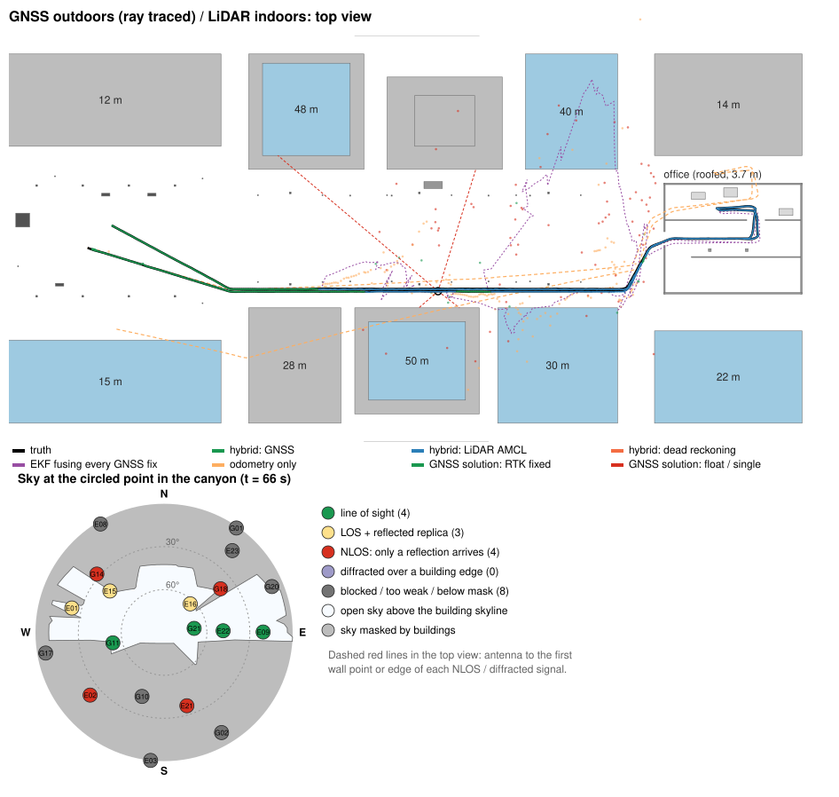

# Example 149: GNSS outdoors, LiDAR indoors

```bash
cargo run --release -p gnss_lidar_navigation --example 149_gnss_lidar_navigation
```

A differential-drive robot drives a 320 m round trip: an open plaza, a 30 m
wide street between 25–40 m glass, concrete and metal towers, and a roofed
single-storey office with a corridor, a north room, pillars and desks. Pure
pursuit steers on the *estimated* pose, so localization errors become driving
errors. The run takes about 2.5 s in release mode and writes
`target/149_gnss_lidar_navigation.svg` (`--svg <path>` to choose).



* **GNSS** — `rne_gnss` ray traces 48 GPS + Galileo satellites through the
  buildings at 5 Hz: line of sight, wall reflections (multipath), NLOS
  receptions, and blocked signals, then solves single-point positions with
  RAIM. Dashed red lines in the top view run from the antenna to the wall
  points the NLOS signals reflected off; the sky plot shows the building
  skyline from that point.
* **LiDAR** — a 360-beam scan at 0.3 m height, ray cast against the same
  geometry at 10 Hz with 2 cm noise, matched against a prior occupancy map of
  the office rasterized from the scene.
* **Odometry** — wheel speed with a 1 % scale error and a gyro with a
  0.06 °/s bias.
* **Arbiter** — `rne_slam::HybridLocalizer` fuses healthy, gated GNSS fixes
  outdoors, falls back to dead reckoning when they are not, relocalizes with
  a wide scan match when the estimate enters the map, and then tracks with
  AMCL refined by a local scan match.

## Results

Position RMSE / max in meters (from the run above; it is deterministic):

| Zone | Hybrid | EKF fusing every fix | Odometry only |
|------|--------|----------------------|---------------|
| Open plaza | 0.68 / 1.22 | 0.75 / 2.69 | 13.50 / 21.87 |
| Urban canyon | 1.88 / 4.89 | 10.03 / 24.47 | 5.58 / 13.68 |
| Office forecourt | 0.18 / 0.96 | 8.69 / 12.97 | 5.69 / 6.76 |
| Indoor office | 0.04 / 0.11 | 8.91 / 9.88 | 8.36 / 9.33 |

Ray-traced sky, mean satellites per epoch:

| Zone | Tracked | LOS | LOS + wall multipath | NLOS | Blocked | Fix RMSE (m) | NLOS in fix | RAIM excluded |
|------|---------|-----|----------------------|------|---------|--------------|-------------|---------------|
| Open plaza | 11.7 | 9.1 | 2.0 | 0.7 | 1.8 | 2.74 | 0.24 | 0.70 |
| Urban canyon | 11.5 | 6.8 | 0.7 | 4.0 | 1.9 | 16.43 | 2.92 | 2.39 |
| Office forecourt | 9.2 | 5.3 | 0.4 | 3.5 | 3.8 | 12.23 | 2.97 | 0.81 |
| Indoor office | 0.3 | 0.0 | 0.0 | 0.2 | 12.7 | 33.83 (4 % of epochs) | 3.53 | 0.00 |

The robot keeps at least 1.43 m from every wall. It spends 89 s on GNSS,
96 s on LiDAR and 124 s on dead reckoning, mostly through the canyon, where
NLOS-contaminated fixes fail the quality checks. Near the door a few signals
leak in at low elevation; the rare indoor fixes they make are 34 m off and are
rejected.

See [GNSS](../../docs/GNSS.md) for the models and their limits.
