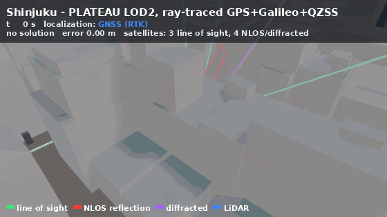

# Example 152: GNSS and LiDAR navigation in real Tokyo streets (PLATEAU)

```bash
python3 scripts/fetch_plateau_tokyo.py            # once: ~450 MB of CityGML
scripts/build_gnsspp.sh                           # once: libgnss++ for RTK
cargo run --release -p plateau_gnss_navigation --example 152_plateau_gnss_navigation
```

The same delivery robot as [example 151](../151_gnss_lidar_navigation/README.md),
but in real streets: around **Shibuya Station** and the **Nishi-Shinjuku**
tower district, built from Project PLATEAU's LOD2 city model. The full run
(both areas, five configurations each) takes about 40 minutes;
`--quick` runs only the main configuration, `--config "factor graph"` the
configurations whose label contains the text, `--area shibuya` one area, and
`--survey` only the sky survey (seconds); `--conditions` runs crowds, rain and
glass canyons instead, `--seeds N` each N times with different noise.




## What is simulated

* **City** — `scripts/fetch_plateau_tokyo.py` reads the 5.3 GB PLATEAU
  Tokyo 23-ward CityGML archive with HTTP range requests and extracts only
  the 1 km meshes around the two stations. `rne_plateau::parse_building_triangles`
  triangulates each building's LOD2 roof, wall and ground surfaces; the
  example converts them to a local ENU frame (PLATEAU heights are Tokyo
  Peil; the geoid, 36.7 m, makes them ellipsoidal) and keeps the buildings
  within 450 m: 944 buildings and 134 k triangles around Shibuya, 507 and
  93 k in Nishi-Shinjuku. PLATEAU's 2020 Tokyo model has no facade
  material, so walls of buildings at least 45 m tall are treated as glass
  curtain walls and the rest as concrete.
* **GNSS** — `rne_gnss` ray traces the triangle mesh through its BVH:
  direct paths, reflections off wall and roof triangles larger than 4 m²
  (smaller detail scatters rather than mirrors), two-bounce paths among the
  48 nearest facets, and diffraction over roof outlines and building
  corners (the mesh's convex creases). GPS, Galileo and **QZSS**
  (Michibiki: three quasi-zenith satellites with apogee over Japan and one
  geostationary, on L1 C/A and L2C) at 5 Hz for two antennas on the robot
  and an RTK reference station on a 2 m pole in a park 1.3 km away (Yoyogi
  Park for Shibuya, Shinjuku Gyoen for Shinjuku), solved by libgnss++ as in
  example 151, with satellites the city model predicts are hidden withheld
  before RTK.
* **LiDAR** — a 3D LiDAR reduced to a planar scan the usual way (ground
  removed, the nearest return per azimuth in a band 0.3 m above the local
  terrain), 360 beams, 40 m, 10 Hz, matched against a prior map of the same
  slice along the route. The terrain comes from the bases of the PLATEAU
  buildings (Shibuya's streets climb toward Dogenzaka and Yoyogi).
* **Street furniture** — LOD2 facades are flat, so at LiDAR height a street
  is a featureless corridor; real Tokyo sidewalks are lined with utility
  poles, signposts and vending machines. The example places them along the
  route (every 6–14 m, irregularly, near the facades); they are part of the
  world, the prior map and the GNSS scene.
* **Localization** — `rne_slam::HybridLocalizer` as in example 151 (or the
  sliding-window `FactorGraphLocalizer`, below), with `lidar_anisotropic` on: each scan match is fused with a covariance from
  the curvature of its score, so a match along a corridor constrains only
  the cross-track position, and the particle filter's own match (over a
  wider window) can re-anchor the EKF when it explains the scans better.
* **Route** — waypoints on the streets, joined by A* over the open street
  cells keeping clear of facades: Shibuya from the scramble crossing west
  toward Dogenzaka, north up Koen-dori and back (750 m); Shinjuku from near
  the station's west side among the towers and back (960 m).

## Results

### Sky along the streets (`--survey`)

Satellites in line of sight at 1.5 m above every street point within 300 m
of the centre (one epoch):

| Area | Constellation | In line of sight | ≥ 8 visible | < 4 visible |
|------|---------------|------------------|-------------|-------------|
| Shibuya | GPS + Galileo | 4.0 of 13 | 7 % | 41 % |
| Shibuya | GPS + Galileo + QZSS | 5.7 of 16 | 29 % | 23 % |
| Nishi-Shinjuku | GPS + Galileo | 4.6 of 13 | 9 % | 30 % |
| Nishi-Shinjuku | GPS + Galileo + QZSS | 6.5 of 16 | 34 % | 11 % |

QZSS's near-zenith satellites are what a canyon can still see.


### Navigation

| Area | Configuration | Goal | Position RMSE / max | RTK fixed | GNSS / LiDAR time | Longest dead reckoning |
|------|---------------|------|---------------------|-----------|-------------------|------------------------|
| Shibuya | map-aided GNSS + QZSS | reached, 797 s | 0.29 / 2.83 m | 56 % | 415 / 382 s | 0.1 s |
| Shibuya | no map aid | reached, 797 s | 0.23 / 1.83 m | 33 % | 290 / 506 s | 0.1 s |
| Shibuya | no QZSS | reached, 785 s | 0.23 / 2.04 m | 28 % | 164 / 621 s | 0.1 s |
| Shibuya | **factor graph** | reached, 776 s | 0.30 / 3.31 m | 61 % | — | 0.1 s |
| Shibuya | factor graph, no map aid | reached, 787 s | 0.27 / 3.52 m | 48 % | — | 0.1 s |
| Nishi-Shinjuku | map-aided GNSS + QZSS | reached, 1436 s, after a 256 s safety stop | 10.39 / 40.19 m | 26 % | 174 / 917 s | 256 s |
| Nishi-Shinjuku | no map aid | reached, 1050 s | 1.98 / 10.67 m | 15 % | 69 / 957 s | 20 s |
| Nishi-Shinjuku | no QZSS | **not reached** (stopped) | 9.73 / 12.67 m | 11 % | 36 / 711 s | 1052 s |
| Nishi-Shinjuku | **factor graph** | reached, 986 s | 0.45 / 2.39 m | 35 % | — | 0.1 s |
| Nishi-Shinjuku | factor graph, no map aid | reached, 995 s | 1.18 / 35.64 m | 12 % | — | 0.1 s |

The LiDAR map carries the robot through Shibuya with or without the
GNSS aids. Among the Nishi-Shinjuku towers the hybrid arbiter is fragile:
without QZSS too few satellites remain and the robot stops for good, and
even with everything on, whether it gets through depends on the noise
realization (`--seeds`, below): in this run (seed 0) a stretch of scan
matches on a featureless street drifts, the GNSS gate refuses the RTK fixes
that disagree, and the robot stops for 256 s before RTK takes it back.

The **factor graph** (`rne_slam::FactorGraphLocalizer`, `--config "factor
graph"`) weighs the last few seconds of odometry, GNSS and LiDAR together
instead of switching: GNSS fixes go in under a Cauchy kernel, so a wrong
RTK fix that disagrees with the odometry and the scans loses its weight
rather than being gated by one threshold. It reaches the goal everywhere
without a stop, even without the NLOS exclusion, though then with one 36 m
excursion before RTK re-anchors it. Its "GNSS / LiDAR time" is not
comparable (it does not switch), so the table leaves it out.

### Crowds, rain and glass canyons (`--conditions --seeds 3`)

Does the robot keep driving when the street is less tidy? `--conditions`
runs the map-aided GNSS + QZSS configuration with both localizers under:

* **crowd** — 60 pedestrians walking the sidewalks along the route (1.2–3 m
  either side, 0.9–1.6 m/s, back and forth over 30–90 m stretches). They
  are LiDAR returns (0.28 m bodies, not in the prior map) and GNSS
  occluders, and step around the robot rather than walk through it; the
  robot's safety gate waits when one is in its path.
* **crowd + rain** — also rain: 15 % of LiDAR beams drop out, the range
  noise triples, 2 % of beams return off drops at 0.3–4 m, and wet facades
  and roads reflect GNSS more strongly (concrete 6 dB, asphalt 9 dB, glass
  3.5 dB reflection loss instead of 8, 12 and 4 dB).
* **glass from 20 m** — every facade of a building at least 20 m tall is a
  glass curtain wall (instead of from 45 m): stronger multipath everywhere.

`--seeds N` repeats each with N different noise realizations (receiver
noise, satellite errors, LiDAR noise, pedestrians); seed 0 is the run
above. Summary over 3 seeds:

| Area | Condition | Hybrid: goal | RMSE median / worst | Max | Factor graph: goal | RMSE median / worst | Max |
|------|-----------|--------------|---------------------|-----|--------------------|---------------------|-----|
| Shibuya | clear | 3/3 | 0.28 / 0.29 m | 2.8 m | 3/3 | 0.12 / 0.30 m | 3.3 m |
| Shibuya | crowd | 3/3 | 0.98 / 2.12 m | 11.2 m | 3/3 | 0.53 / 0.84 m | 5.7 m |
| Shibuya | crowd + rain | 2/3 | 15.08 / 19.58 m | 59.6 m | 3/3 | 1.24 / 1.56 m | 7.3 m |
| Shibuya | glass from 20 m | 3/3 | 0.19 / 0.28 m | 2.5 m | 3/3 | 0.08 / 0.16 m | 3.9 m |
| Nishi-Shinjuku | clear | 2/3 | 8.26 / 10.39 m | 40.2 m | 3/3 | 0.82 / 1.23 m | 10.4 m |
| Nishi-Shinjuku | crowd | **0/3** | 25.90 / 34.02 m | 77.1 m | 3/3 | 1.56 / 3.47 m | 13.4 m |
| Nishi-Shinjuku | crowd + rain | **0/3** | 38.73 / 142.66 m | 258.1 m | 3/3 | 2.10 / 2.41 m | 18.3 m |
| Nishi-Shinjuku | glass from 20 m | 3/3 | 2.19 / 6.24 m | 20.8 m | 3/3 | 0.61 / 0.85 m | 4.4 m |

The factor graph reaches the goal in all 24 runs and never dead-reckons
for more than 0.4 s; the crowd and the rain roughly double or triple its
error, and its worst moments (up to 18 m in the Nishi-Shinjuku rain) are
short and corrected by the next good RTK fix. The hybrid does well in
Shibuya until it rains, but in Nishi-Shinjuku the crowd defeats it in every
run: on the long straight streets between the towers the street furniture
is the only thing the scan matcher can lock onto along the street, the
pedestrians hide it, the matches slide, and once the estimate is tens of
metres off the GNSS gate rejects the correct RTK fixes as outliers. Its
dead reckoning stretches (up to 1062 s) are safety stops, not driving
blind. The glass canyon matters less than expected: more multipath, but
the NLOS exclusion and the robust kernels take most of it.

## Limits

* LOD2 buildings are prisms with roofs: no balconies, signs, glass detail or
  ground-floor arcades, and the facade material is guessed from the height.
* The street furniture and the pedestrians are synthetic; there are no
  vehicles, and pedestrians do not obstruct one another or cross the street.
* Rain does not attenuate GNSS (well under 0.1 dB at L-band) and does not
  change the LiDAR's maximum range.
* The terrain is interpolated from building bases, not a road surface model.
* The constellation is nominal (24 GPS, 24 Galileo, 4 QZSS); a real receiver
  in Tokyo also tracks GLONASS and BeiDou and sees more satellites.

Data: 3D City Model (Tokyo 23 wards) 2020, Project PLATEAU / MLIT, used
under the PLATEAU site policy (compatible with CC BY 4.0). The model is
fetched at run time and not stored in this repository; the media in
`docs/media` are derived from it.

To regenerate the GIFs (any GPU, or Mesa's lavapipe; Pillow for the HUD):

```bash
cargo run --release -p plateau_gnss_navigation --features capture \
    --example 152_plateau_gnss_navigation -- --quick --render target/152_render
python3 examples/152_plateau_gnss_navigation/encode.py target/152_render/shibuya docs/media/plateau-gnss-shibuya.gif
python3 examples/152_plateau_gnss_navigation/encode.py target/152_render/shinjuku docs/media/plateau-gnss-shinjuku.gif
```
