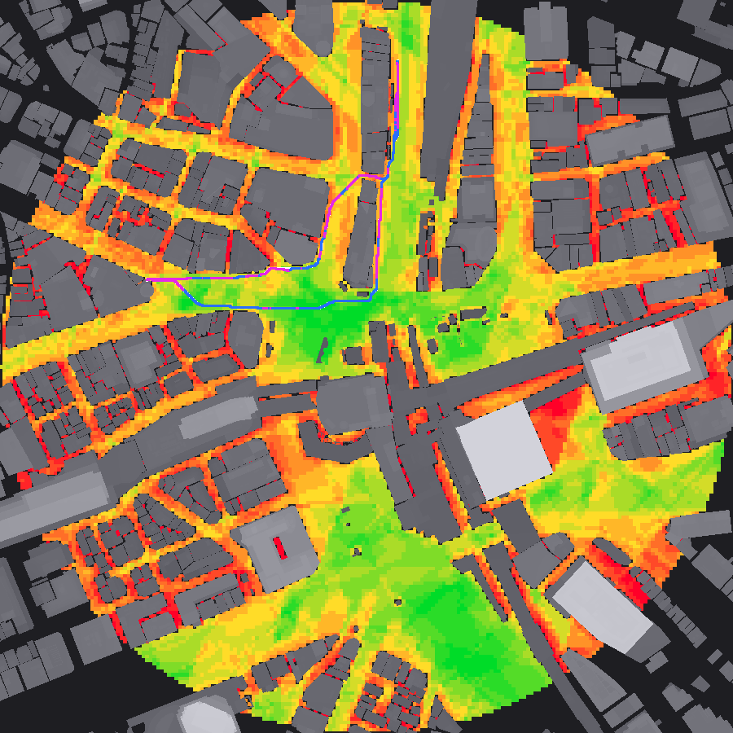

# Example 152: GNSS and LiDAR navigation in real Tokyo streets (PLATEAU)

```bash
python3 scripts/fetch_plateau_tokyo.py            # once: ~450 MB of CityGML
scripts/build_gnsspp.sh                           # once: libgnss++ for RTK
cargo run --release -p plateau_gnss_navigation --example 152_plateau_gnss_navigation
```

The same delivery robot as [example 151](../151_gnss_lidar_navigation/README.md),
but in real streets: around **Shibuya Station** and the **Nishi-Shinjuku**
tower district, built from Project PLATEAU's LOD2 city model. The full run
(both areas, five configurations each) takes about 40 minutes;
`--quick` runs only the main configuration, `--config "factor graph"` the
configurations whose label contains the text, `--area shibuya` one area, and
`--survey` only the sky survey (seconds); `--conditions` runs crowds, rain and
glass canyons instead, `--seeds N` each N times with different noise.


The renders overlay the simulation on the city: the ray-traced satellite
signals at the rear antenna (each NLOS ray through its reflection points),
the LiDAR scan (every fourth beam and every return), the pedestrians and
the rain. Shibuya is shown in the crowd + rain condition below.

## What is simulated

* **City** — `scripts/fetch_plateau_tokyo.py` reads the 5.3 GB PLATEAU
  Tokyo 23-ward CityGML archive with HTTP range requests and extracts only
  the 1 km meshes around the two stations. `rne_plateau::parse_building_triangles`
  triangulates each building's LOD2 roof, wall and ground surfaces; the
  example converts them to a local ENU frame (PLATEAU heights are Tokyo
  Peil; the geoid, 36.7 m, makes them ellipsoidal) and keeps the buildings
  within 450 m: 944 buildings and 134 k triangles around Shibuya, 507 and
  93 k in Nishi-Shinjuku. PLATEAU's 2020 Tokyo model has no facade
  material, so walls of buildings at least 45 m tall are treated as glass
  curtain walls and the rest as concrete.
* **GNSS** — `rne_gnss` ray traces the triangle mesh through its BVH:
  direct paths, reflections off wall and roof triangles larger than 4 m²
  (smaller detail scatters rather than mirrors), two-bounce paths among the
  48 nearest facets, and diffraction over roof outlines and building
  corners (the mesh's convex creases). GPS, Galileo and **QZSS**
  (Michibiki: three quasi-zenith satellites with apogee over Japan and one
  geostationary, on L1 C/A and L2C) at 5 Hz for two antennas on the robot
  and an RTK reference station on a 2 m pole in a park 1.3 km away (Yoyogi
  Park for Shibuya, Shinjuku Gyoen for Shinjuku), solved by libgnss++ as in
  example 151, with satellites the city model predicts are hidden withheld
  before RTK.
* **LiDAR** — a 3D LiDAR reduced to a planar scan the usual way (ground
  removed, the nearest return per azimuth in a band 0.3 m above the local
  terrain), 360 beams, 40 m, 10 Hz, matched against a prior map of the same
  slice along the route. The terrain comes from the bases of the PLATEAU
  buildings (Shibuya's streets climb toward Dogenzaka and Yoyogi).
* **Street furniture** — LOD2 facades are flat, so at LiDAR height a street
  is a featureless corridor; real Tokyo sidewalks are lined with utility
  poles, signposts and vending machines. The example places them along the
  route (every 6–14 m, irregularly, near the facades); they are part of the
  world, the prior map and the GNSS scene.
* **Localization** — `rne_slam::HybridLocalizer` as in example 151 (or the
  sliding-window `FactorGraphLocalizer`, below), with `lidar_anisotropic` on: each scan match is fused with a covariance from
  the curvature of its score, so a match along a corridor constrains only
  the cross-track position, and the particle filter's own match (over a
  wider window) can re-anchor the EKF when it explains the scans better.
* **Route** — waypoints on the streets, joined by A* over the open street
  cells keeping clear of facades: Shibuya from the scramble crossing west
  toward Dogenzaka, north up Koen-dori and back (750 m); Shinjuku from near
  the station's west side among the towers and back (960 m).

## Results

### Sky along the streets (`--survey`)

Satellites in line of sight at 1.5 m above every street point within 300 m
of the centre (one epoch):

| Area | Constellation | In line of sight | ≥ 8 visible | < 4 visible |
|------|---------------|------------------|-------------|-------------|
| Shibuya | GPS + Galileo | 4.0 of 13 | 7 % | 41 % |
| Shibuya | GPS + Galileo + QZSS | 5.7 of 16 | 29 % | 23 % |
| Nishi-Shinjuku | GPS + Galileo | 4.6 of 13 | 9 % | 30 % |
| Nishi-Shinjuku | GPS + Galileo + QZSS | 6.5 of 16 | 34 % | 11 % |

QZSS's near-zenith satellites are what a canyon can still see.



### Navigation

| Area | Configuration | Goal | Position RMSE / max | RTK fixed | GNSS / LiDAR time | Longest dead reckoning |
|------|---------------|------|---------------------|-----------|-------------------|------------------------|
| Shibuya | map-aided GNSS + QZSS | reached, 802 s | 0.18 / 1.51 m | 53 % | 393 / 408 s | 0.1 s |
| Shibuya | no map aid | reached, 788 s | 0.19 / 1.47 m | 40 % | 317 / 471 s | 0.1 s |
| Shibuya | no QZSS | reached, 782 s | 0.41 / 2.40 m | 24 % | 157 / 626 s | 0.1 s |
| Shibuya | **factor graph** | reached, 776 s | 0.30 / 3.31 m | 61 % | — | 0.1 s |
| Shibuya | factor graph, no map aid | reached, 787 s | 0.27 / 3.52 m | 48 % | — | 0.1 s |
| Nishi-Shinjuku | map-aided GNSS + QZSS | reached, 1059 s | 1.27 / 6.79 m | 31 % | 217 / 835 s | 5.7 s |
| Nishi-Shinjuku | no map aid | **not reached** (lost) | 35.26 / 75.35 m | 13 % | 98 / 1481 s | 93 s |
| Nishi-Shinjuku | no QZSS | reached, 1171 s, after a 96 s safety stop | 3.45 / 8.96 m | 18 % | 60 / 1013 s | 96 s |
| Nishi-Shinjuku | **factor graph** | reached, 986 s | 0.45 / 2.39 m | 35 % | — | 0.1 s |
| Nishi-Shinjuku | factor graph, no map aid | reached, 995 s | 1.18 / 35.64 m | 12 % | — | 0.1 s |

The LiDAR map carries the robot through Shibuya with or without the
GNSS aids. Among the Nishi-Shinjuku towers the hybrid arbiter needs both
aids: without QZSS it has to stop for 96 s, and without the NLOS exclusion
it gets lost: wrong RTK fixes that slip through move the estimate, and the
LiDAR gate below then keeps the scans from pulling it back (with the gate
off, that run reaches the goal with 6.4 m RMSE).

The hybrid here runs with three options for streets like these (all off
by default in `HybridLocalizerConfig`):

* `lidar_drop_unmapped_returns` — returns in the map's free space, a metre
  or more from any mapped structure, are pedestrians (or anything else
  that moves) and are left out of tracking. A person walking beside the
  robot otherwise looks like a pole keeping pace with it.
* `lidar_gate_chi_square` (16) — a scan match far outside the EKF's
  uncertainty is not fused: on a featureless street the matches slide
  along it, and one slide used to carry the estimate tens of metres off.
  It presumes GNSS fixes rarely mislead, which the NLOS exclusion
  provides.
* `gnss_reanchor_fixes` (15) — the gate's price is that a wrong estimate
  rejects correct fixes too. When 15 gate-rejected RTK fixed solutions in
  a row agree to within 0.5 m relative to the wheel odometry, the
  estimate, not the receiver, is wrong: the EKF is re-anchored there and
  LiDAR tracking restarts. (While dead reckoning, float solutions count.)

Without them the hybrid reached the Nishi-Shinjuku goal in 2 of 3 noise
realizations even on a clear day, in 0 of 3 in a crowd.

The **factor graph** (`rne_slam::FactorGraphLocalizer`, `--config "factor
graph"`) weighs the last few seconds of odometry, GNSS and LiDAR together
instead of switching: GNSS fixes go in under a Cauchy kernel, so a wrong
RTK fix that disagrees with the odometry and the scans loses its weight
rather than being gated by one threshold. It reaches the goal everywhere
without a stop, even without the NLOS exclusion, though then with one 36 m
excursion before RTK re-anchors it. Its "GNSS / LiDAR time" is not
comparable (it does not switch), so the table leaves it out.

### Crowds, rain and glass canyons (`--conditions --seeds 3`)

Does the robot keep driving when the street is less tidy? `--conditions`
runs the map-aided GNSS + QZSS configuration with both localizers under:

* **crowd** — 60 pedestrians walking the sidewalks along the route (1.2–3 m
  either side, 0.9–1.6 m/s, back and forth over 30–90 m stretches). They
  are LiDAR returns (0.28 m bodies, not in the prior map) and GNSS
  occluders, and step around the robot rather than walk through it; the
  robot's safety gate waits when one is in its path.
* **crowd + rain** — also rain: 15 % of LiDAR beams drop out, the range
  noise triples, 2 % of beams return off drops at 0.3–4 m, and wet facades
  and roads reflect GNSS more strongly (concrete 6 dB, asphalt 9 dB, glass
  3.5 dB reflection loss instead of 8, 12 and 4 dB).
* **glass from 20 m** — every facade of a building at least 20 m tall is a
  glass curtain wall (instead of from 45 m): stronger multipath everywhere.

`--seeds N` repeats each with N different noise realizations (receiver
noise, satellite errors, LiDAR noise, pedestrians); seed 0 is the run
above. Summary over 3 seeds:

| Area | Condition | Hybrid: goal | RMSE median / worst | Max | Factor graph: goal | RMSE median / worst | Max |
|------|-----------|--------------|---------------------|-----|--------------------|---------------------|-----|
| Shibuya | clear | 3/3 | 0.18 / 0.39 m | 2.8 m | 3/3 | 0.12 / 0.30 m | 3.3 m |
| Shibuya | crowd | 3/3 | 0.44 / 1.02 m | 5.9 m | 3/3 | 0.53 / 0.84 m | 5.7 m |
| Shibuya | crowd + rain | 3/3 | 0.83 / 0.91 m | 7.3 m | 3/3 | 1.24 / 1.56 m | 7.3 m |
| Shibuya | glass from 20 m | 3/3 | 0.24 / 0.30 m | 2.4 m | 3/3 | 0.08 / 0.16 m | 3.9 m |
| Nishi-Shinjuku | clear | 3/3 | 1.27 / 3.81 m | 9.3 m | 3/3 | 0.82 / 1.23 m | 10.4 m |
| Nishi-Shinjuku | crowd | **2/3** | 1.93 / 42.61 m | 60.2 m | 3/3 | 1.56 / 3.47 m | 13.4 m |
| Nishi-Shinjuku | crowd + rain | 3/3 | 1.81 / 13.37 m | 47.8 m | 3/3 | 2.10 / 2.41 m | 18.3 m |
| Nishi-Shinjuku | glass from 20 m | 3/3 | 1.19 / 1.36 m | 11.6 m | 3/3 | 0.61 / 0.85 m | 4.4 m |

Before the three options above, the hybrid reached the goal in 2/3
Shibuya crowd + rain runs (RMSE median 15 m) and in 0/3 Nishi-Shinjuku
crowd and crowd + rain runs.

Both localizers keep the robot going through crowds, rain and glass in
47 of 48 runs. The factor graph reaches the goal in all 24 and never
dead-reckons for more than 0.4 s; the crowd and the rain roughly double or
triple its error, and its worst moments (up to 18 m in the Nishi-Shinjuku
rain) are short and corrected by the next good RTK fix. The hybrid is now
as accurate in Shibuya, a little less so in Nishi-Shinjuku, and has the
one failure. Approaching a corner west of the station (about (−20, −45) m)
along a street that constrains the scan only across it, the estimate
stops while the robot walks on: for over a second both scan matches pull
it back to the same spot with high scores (0.92–0.96) and a tight
covariance, while the robot swerves and briefly waits for a pedestrian
beside it. A person walking within a metre of a facade or pole is not
dropped as unmapped, and one who keeps pace with the robot looks like a
fixed feature. The particle filter's estimate is right along the street
at that moment, but 1.5 m off across it, so it is re-seeded onto the
EKF's match rather than the other way round. The estimate leaves the
corner 2–4 m off, the robot drifts into a deep canyon and stops there for
613 s, where the receiver tracks 5–6 satellites and its float solutions
wander by metres, so nothing trustworthy can re-anchor it. Dropping
returns from 0.5 m of mapped structure (`lidar_unmapped_distance_m`)
instead of 1 m gets this run through and improves the rain runs (worst
RMSE 4.2 m instead of 13.4 m), but loses another crowd run, so the
example keeps 1 m.

`lidar_motion_check_scans` targets the lock itself: when the matched
positions stay put while the wheels move, the matches are not fused until
one agrees with the estimate again. It gets the stuck run through too,
but over the 24 runs the hybrid still reaches the goal in 23, with the
failure elsewhere (RMSE median, m):

| Hybrid | Shibuya clear / crowd / rain / glass | Nishi-Shinjuku clear / crowd / rain / glass | Failed run |
|--------|--------------------------------------|---------------------------------------------|------------|
| as above | 0.18 / 0.44 / 0.83 / 0.24 | 1.27 / 1.93 / 1.81 / 1.19 | Nishi-Shinjuku crowd (lost) |
| + motion check (10 scans) | 0.23 / 0.57 / 0.25 / 0.21 | 1.61 / 1.29 / 4.07 / 2.38 | Nishi-Shinjuku crowd + rain (lost) |

Every fix for one run moves the failure to another: a switching arbiter
that trusts one source at a time stays brittle among these towers,
which the factor graph, weighing a few seconds of all of them together,
is not. The example leaves the motion check off. Its other dead reckoning stretches (up to
183 s) are also safety stops, not driving blind. The glass canyon matters
less than expected: more multipath, but the NLOS exclusion and the robust
kernels take most of it.

## Limits

* LOD2 buildings are prisms with roofs: no balconies, signs, glass detail or
  ground-floor arcades, and the facade material is guessed from the height.
* The street furniture and the pedestrians are synthetic; there are no
  vehicles, and pedestrians do not obstruct one another or cross the street.
* Rain does not attenuate GNSS (well under 0.1 dB at L-band) and does not
  change the LiDAR's maximum range.
* The terrain is interpolated from building bases, not a road surface model.
* The constellation is nominal (24 GPS, 24 Galileo, 4 QZSS); a real receiver
  in Tokyo also tracks GLONASS and BeiDou and sees more satellites.

Data: 3D City Model (Tokyo 23 wards) 2020, Project PLATEAU / MLIT, used
under the PLATEAU site policy (compatible with CC BY 4.0). The model is
fetched at run time and not stored in this repository; the media in
`docs/media` are derived from it.

To regenerate the GIFs (any GPU, or Mesa's lavapipe; Pillow for the HUD):

```bash
cargo run --release -p plateau_gnss_navigation --features capture \
    --example 152_plateau_gnss_navigation -- --quick --area shibuya --render-weather --render target/152_render
cargo run --release -p plateau_gnss_navigation --features capture \
    --example 152_plateau_gnss_navigation -- --quick --area shinjuku --render target/152_render
python3 examples/152_plateau_gnss_navigation/encode.py target/152_render/shibuya docs/media/plateau-gnss-shibuya.gif --stride 4
python3 examples/152_plateau_gnss_navigation/encode.py target/152_render/shinjuku docs/media/plateau-gnss-shinjuku.gif --stride 4
```
