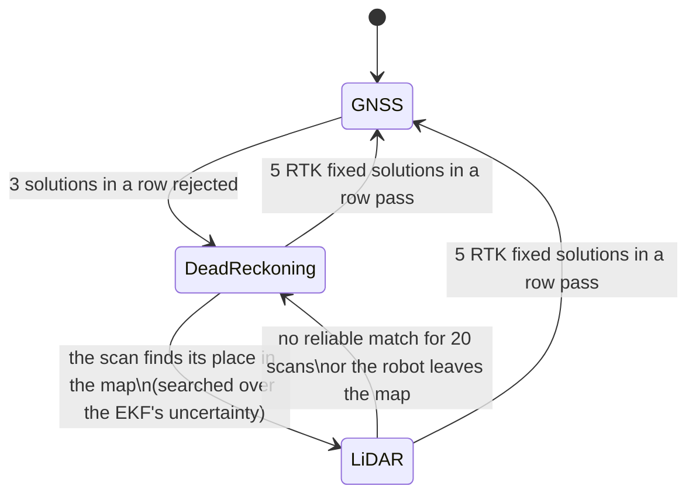
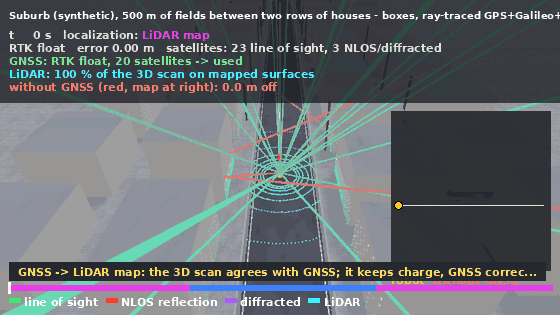
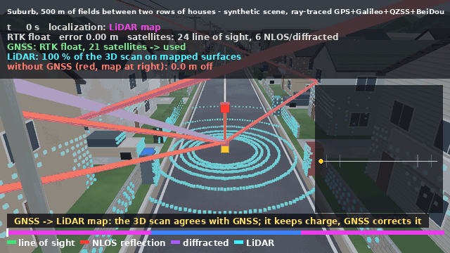
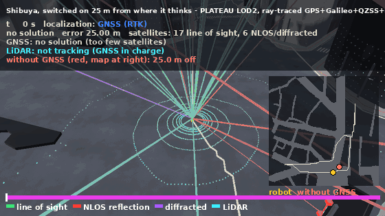
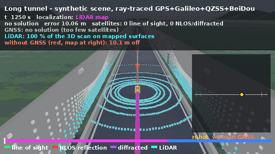
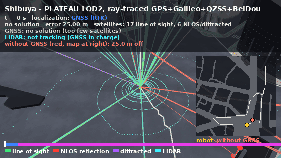

# Example 152: GNSS and LiDAR navigation in real Tokyo streets (PLATEAU)

```bash
python3 scripts/fetch_plateau_tokyo.py            # once: ~450 MB of CityGML
scripts/build_gnsspp.sh                           # once: libgnss++ for RTK
cargo run --release -p plateau_gnss_navigation --example 152_plateau_gnss_navigation
```

The same delivery robot as [example 151](../151_gnss_lidar_navigation/README.md),
but in real streets: around **Shibuya Station** and the **Nishi-Shinjuku**
tower district, built from Project PLATEAU's LOD2 city model. The full run
(both areas, five configurations each) takes about 40 minutes;
`--quick` runs only the main configuration, `--config "factor graph"` the
configurations whose label contains the text, `--area shibuya` one area, and
`--survey` only the sky survey (seconds); `--conditions` runs crowds, rain,
glass canyons and rush hour instead, `--seeds N` each N times with
different noise, `--lidar3d` localizes with a 3D LiDAR, `--avoid` walks
around people and `--urbannav` checks the ray tracer against a real drive
(below).


The renders overlay the simulation on the city: the ray-traced satellite
signals at the rear antenna (each NLOS ray through its reflection points),
the 3D LiDAR's returns (cyan near the ground, white up the facades), the
pedestrians, the vehicles and the rain. Shibuya is shown at rush hour in
the rain, localizing with the 3D LiDAR (below), and both track BeiDou as
well (`--beidou`); without `--lidar3d` the render draws the planar scan's
beams instead.

The city in the renders is PLATEAU's own: the buildings carry their
photo textures (`app:ParameterizedTexture`, fetched with
`fetch_plateau_tokyo.py --textures` and shrunk to 256 px, packed into
4096 px atlases), the streets are PLATEAU's road surfaces (`tran`) draped
over the terrain, and the railway viaducts and pedestrian decks around the
stations are its bridges (`brid`). PLATEAU's LOD1 roads run from building
line to building line, sidewalks included, so the render places those
itself (`streets.rs`): it rasterizes the roads at 0.5 m, and every road at
least 10 m wide gets a 3 m sidewalk along its building lines, raised 15 cm
behind a curb and paved in 30 cm tiles with a line of yellow tactile
paving; marching squares over the distance from the building line give
smooth curbs and the white edge lines. The road polygons without a section
type (`uro:sectionType`) are PLATEAU's intersections, and every wide road
gets a zebra crossing where it enters one. The asphalt and the tiles are
generated textures. `--render-preview DIR` renders the city alone at eight
points along the route, without running the robot.

## What is simulated

* **City** — `scripts/fetch_plateau_tokyo.py` reads the 5.3 GB PLATEAU
  Tokyo 23-ward CityGML archive with HTTP range requests and extracts only
  the 1 km meshes around the two stations. `rne_plateau::parse_building_triangles`
  triangulates each building's LOD2 roof, wall and ground surfaces; the
  example converts them to a local ENU frame (PLATEAU heights are Tokyo
  Peil; the geoid, 36.7 m, makes them ellipsoidal) and keeps the buildings
  within 450 m: 944 buildings and 134 k triangles around Shibuya, 507 and
  93 k in Nishi-Shinjuku. PLATEAU's 2020 Tokyo model has no facade
  material, so walls of buildings at least 45 m tall are treated as glass
  curtain walls and the rest as concrete.
* **GNSS** — `rne_gnss` ray traces the triangle mesh through its BVH:
  direct paths, reflections off wall and roof triangles larger than 4 m²
  (smaller detail scatters rather than mirrors), two-bounce paths among the
  48 nearest facets, and diffraction over roof outlines and building
  corners (the mesh's convex creases). GPS, Galileo and **QZSS**
  (Michibiki: three quasi-zenith satellites with apogee over Japan and one
  geostationary, on L1 C/A and L2C) at 5 Hz for two antennas on the robot
  and an RTK reference station on a 2 m pole in a park 1.3 km away (Yoyogi
  Park for Shibuya, Shinjuku Gyoen for Shinjuku), solved by libgnss++ as in
  example 151, with satellites the city model predicts are hidden withheld
  before RTK.
* **LiDAR** — a 3D LiDAR reduced to a planar scan the usual way (ground
  removed, the nearest return per azimuth in a band 0.3 m above the local
  terrain), 360 beams, 40 m, 10 Hz, matched against a prior map of the same
  slice along the route. The terrain comes from the bases of the PLATEAU
  buildings (Shibuya's streets climb toward Dogenzaka and Yoyogi).
* **Street furniture** — LOD2 facades are flat, so at LiDAR height a street
  is a featureless corridor; real Tokyo sidewalks are lined with utility
  poles, signposts and vending machines. The example places them along the
  route (every 6–14 m, irregularly, near the facades); they are part of the
  world, the prior map and the GNSS scene.
* **Localization** — `rne_slam::HybridLocalizer` as in example 151 (or the
  sliding-window `FactorGraphLocalizer`, below), with `lidar_anisotropic` on: each scan match is fused with a covariance from
  the curvature of its score, so a match along a corridor constrains only
  the cross-track position, and the particle filter's own match (over a
  wider window) can re-anchor the EKF when it explains the scans better.
* **Route** — waypoints on the streets, joined by A* over the open street
  cells keeping clear of facades: Shibuya from the scramble crossing west
  toward Dogenzaka, north up Koen-dori and back (750 m); Shinjuku from near
  the station's west side among the towers and back (960 m).

### How the hybrid switches

`rne_slam::HybridLocalizer` keeps one EKF on the wheel odometry and lets
one absolute source at a time correct it. The render's HUD shows the
verdict on every GNSS solution, the LiDAR match, and each switch with its
reason; the bar at the bottom is the source over the whole run.



A GNSS solution passes when it uses at least 6 satellites, its HDOP is at
most 2.5, its reported sigma at most 4 m, the receiver's consistency check
excluded at most 2 satellites, and it lies within the EKF's 99 % gate. It
is fused only while GNSS is in charge; outside, passing solutions only
count toward taking over. Two escapes keep a wrong estimate from locking
GNSS out: 15 gate-rejected RTK fixed solutions that agree with each other
relative to the odometry re-anchor the estimate on them, and a solution
that has failed only the gate for 30 s is taken anyway if it is RTK fixed
or the EKF's own uncertainty has grown past 3 m. After 3 s of dead reckoning the robot stops until GNSS or the
LiDAR has it again. The factor graph does not switch: it weighs the last
seconds of all sources together, and its HUD lines report the inputs
instead of verdicts.

## Results

### Sky along the streets (`--survey`)

Satellites in line of sight at 1.5 m above every street point within 300 m
of the centre (one epoch):

| Area | Constellation | In line of sight | ≥ 8 visible | < 4 visible |
|------|---------------|------------------|-------------|-------------|
| Shibuya | GPS + Galileo | 4.0 of 13 | 7 % | 41 % |
| Shibuya | GPS + Galileo + QZSS | 5.7 of 16 | 29 % | 23 % |
| Shibuya | + BeiDou | 9.3 of 30 | 63 % | 14 % |
| Nishi-Shinjuku | GPS + Galileo | 4.6 of 13 | 9 % | 30 % |
| Nishi-Shinjuku | GPS + Galileo + QZSS | 6.5 of 16 | 34 % | 11 % |
| Nishi-Shinjuku | + BeiDou | 10.8 of 30 | 79 % | 4 % |

QZSS's near-zenith satellites are what a canyon can still see, and
BeiDou, whose IGSO and geostationary satellites stand high over Japan,
nearly doubles the count (`--beidou`; the results below are without it
unless noted).


### Navigation

| Area | Configuration | Goal | Position RMSE / max | RTK fixed | GNSS / LiDAR time | Longest dead reckoning |
|------|---------------|------|---------------------|-----------|-------------------|------------------------|
| Shibuya | map-aided GNSS + QZSS | reached, 802 s | 0.18 / 1.51 m | 53 % | 393 / 408 s | 0.1 s |
| Shibuya | no map aid | reached, 788 s | 0.19 / 1.47 m | 40 % | 317 / 471 s | 0.1 s |
| Shibuya | no QZSS | reached, 782 s | 0.41 / 2.40 m | 24 % | 157 / 626 s | 0.1 s |
| Shibuya | **factor graph** | reached, 776 s | 0.30 / 3.31 m | 61 % | — | 0.1 s |
| Shibuya | factor graph, no map aid | reached, 787 s | 0.27 / 3.52 m | 48 % | — | 0.1 s |
| Nishi-Shinjuku | map-aided GNSS + QZSS | reached, 1059 s | 1.27 / 6.79 m | 31 % | 217 / 835 s | 5.7 s |
| Nishi-Shinjuku | no map aid | **not reached** (lost) | 35.26 / 75.35 m | 13 % | 98 / 1481 s | 93 s |
| Nishi-Shinjuku | no QZSS | reached, 1171 s, after a 96 s safety stop | 3.45 / 8.96 m | 18 % | 60 / 1013 s | 96 s |
| Nishi-Shinjuku | **factor graph** | reached, 986 s | 0.45 / 2.39 m | 35 % | — | 0.1 s |
| Nishi-Shinjuku | factor graph, no map aid | reached, 995 s | 1.18 / 35.64 m | 12 % | — | 0.1 s |

The LiDAR map carries the robot through Shibuya with or without the
GNSS aids. Among the Nishi-Shinjuku towers the hybrid arbiter needs both
aids: without QZSS it has to stop for 96 s, and without the NLOS exclusion
it gets lost: wrong RTK fixes that slip through move the estimate, and the
LiDAR gate below then keeps the scans from pulling it back (with the gate
off, that run reaches the goal with 6.4 m RMSE).

The hybrid here runs with three options for streets like these (all off
by default in `HybridLocalizerConfig`):

* `lidar_drop_unmapped_returns` — returns in the map's free space, a metre
  or more from any mapped structure, are pedestrians (or anything else
  that moves) and are left out of tracking. A person walking beside the
  robot otherwise looks like a pole keeping pace with it.
* `lidar_gate_chi_square` (16) — a scan match far outside the EKF's
  uncertainty is not fused: on a featureless street the matches slide
  along it, and one slide used to carry the estimate tens of metres off.
  It presumes GNSS fixes rarely mislead, which the NLOS exclusion
  provides.
* `gnss_reanchor_fixes` (15) — the gate's price is that a wrong estimate
  rejects correct fixes too. When 15 gate-rejected RTK fixed solutions in
  a row agree to within 0.5 m relative to the wheel odometry, the
  estimate, not the receiver, is wrong: the EKF is re-anchored there and
  LiDAR tracking restarts. (While dead reckoning, float solutions count.)

Without them the hybrid reached the Nishi-Shinjuku goal in 2 of 3 noise
realizations even on a clear day, in 0 of 3 in a crowd.

The **factor graph** (`rne_slam::FactorGraphLocalizer`, `--config "factor
graph"`) weighs the last few seconds of odometry, GNSS and LiDAR together
instead of switching: GNSS fixes go in under a Cauchy kernel, so a wrong
RTK fix that disagrees with the odometry and the scans loses its weight
rather than being gated by one threshold. It reaches the goal everywhere
without a stop, even without the NLOS exclusion, though then with one 36 m
excursion before RTK re-anchors it. Its "GNSS / LiDAR time" is not
comparable (it does not switch), so the table leaves it out.

### Crowds, rain and glass canyons (`--conditions --seeds 3`)

Does the robot keep driving when the street is less tidy? `--conditions`
runs the map-aided GNSS + QZSS configuration with both localizers under:

* **crowd** — 60 pedestrians walking the sidewalks along the route (1.2–3 m
  either side, 0.9–1.6 m/s, back and forth over 30–90 m stretches). They
  are LiDAR returns (0.28 m bodies, not in the prior map) and GNSS
  occluders, and step around the robot rather than walk through it; the
  robot's safety gate waits when one is in its path.
* **crowd + rain** — also rain: 15 % of LiDAR beams drop out, the range
  noise triples, 2 % of beams return off drops at 0.3–4 m, and wet facades
  and roads reflect GNSS more strongly (concrete 6 dB, asphalt 9 dB, glass
  3.5 dB reflection loss instead of 8, 12 and 4 dB).
* **glass from 20 m** — every facade of a building at least 20 m tall is a
  glass curtain wall (instead of from 45 m): stronger multipath everywhere.

`--seeds N` repeats each with N different noise realizations (receiver
noise, satellite errors, LiDAR noise, pedestrians); seed 0 is the run
above. Summary over 3 seeds:

| Area | Condition | Hybrid: goal | RMSE median / worst | Max | Factor graph: goal | RMSE median / worst | Max |
|------|-----------|--------------|---------------------|-----|--------------------|---------------------|-----|
| Shibuya | clear | 3/3 | 0.18 / 0.39 m | 2.8 m | 3/3 | 0.12 / 0.31 m | 3.3 m |
| Shibuya | crowd | 3/3 | 0.44 / 1.02 m | 5.9 m | 3/3 | 0.48 / 0.52 m | 4.8 m |
| Shibuya | crowd + rain | 3/3 | 0.83 / 0.91 m | 7.3 m | 3/3 | 0.68 / 0.80 m | 6.3 m |
| Shibuya | glass from 20 m | 3/3 | 0.24 / 0.30 m | 2.4 m | 3/3 | 0.07 / 0.07 m | 0.8 m |
| Nishi-Shinjuku | clear | 3/3 | 1.27 / 3.81 m | 9.3 m | 3/3 | 0.61 / 1.17 m | 8.7 m |
| Nishi-Shinjuku | crowd | **2/3** | 1.93 / 42.61 m | 60.2 m | 3/3 | 1.13 / 1.83 m | 13.7 m |
| Nishi-Shinjuku | crowd + rain | 3/3 | 1.81 / 13.37 m | 47.8 m | 3/3 | 1.54 / 1.63 m | 12.6 m |
| Nishi-Shinjuku | glass from 20 m | 3/3 | 1.19 / 1.36 m | 11.6 m | 3/3 | 0.59 / 0.84 m | 5.3 m |

Before the three options above, the hybrid reached the goal in 2/3
Shibuya crowd + rain runs (RMSE median 15 m) and in 0/3 Nishi-Shinjuku
crowd and crowd + rain runs.

Both localizers keep the robot going through crowds, rain and glass in
47 of 48 runs. The factor graph reaches the goal in all 24 and never
dead-reckons for more than 0.1 s; the crowd and the rain roughly double or
triple its error, and its worst moments (up to 14 m in the Nishi-Shinjuku
crowd) are short and corrected by the next good RTK fix. The hybrid is now
as accurate in Shibuya, a little less so in Nishi-Shinjuku, and has the
one failure. Approaching a corner west of the station (about (−20, −45) m)
along a street that constrains the scan only across it, the estimate
stops while the robot walks on: for over a second both scan matches pull
it back to the same spot with high scores (0.92–0.96) and a tight
covariance, while the robot swerves and briefly waits for a pedestrian
beside it. A person walking within a metre of a facade or pole is not
dropped as unmapped, and one who keeps pace with the robot looks like a
fixed feature. The particle filter's estimate is right along the street
at that moment, but 1.5 m off across it, so it is re-seeded onto the
EKF's match rather than the other way round. The estimate leaves the
corner 2–4 m off, the robot drifts into a deep canyon and stops there for
613 s, where the receiver tracks 5–6 satellites and its float solutions
wander by metres, so nothing trustworthy can re-anchor it. Dropping
returns from 0.5 m of mapped structure (`lidar_unmapped_distance_m`)
instead of 1 m gets this run through and improves the rain runs (worst
RMSE 4.2 m instead of 13.4 m), but loses another crowd run, so the
example keeps 1 m.

`lidar_motion_check_scans` targets the lock itself: when the matched
positions stay put while the wheels move, the matches are not fused until
one agrees with the estimate again. It gets the stuck run through too,
but over the 24 runs the hybrid still reaches the goal in 23, with the
failure elsewhere (RMSE median, m):

| Hybrid | Shibuya clear / crowd / rain / glass | Nishi-Shinjuku clear / crowd / rain / glass | Failed run |
|--------|--------------------------------------|---------------------------------------------|------------|
| as above | 0.18 / 0.44 / 0.83 / 0.24 | 1.27 / 1.93 / 1.81 / 1.19 | Nishi-Shinjuku crowd (lost) |
| + motion check (10 scans) | 0.23 / 0.57 / 0.25 / 0.21 | 1.61 / 1.29 / 4.07 / 2.38 | Nishi-Shinjuku crowd + rain (lost) |

Every fix for one run moves the failure to another: a switching arbiter
that trusts one source at a time stays brittle among these towers,
which the factor graph, weighing a few seconds of all of them together,
is not. The example leaves the motion check off. Its other dead reckoning stretches (up to
183 s) are also safety stops, not driving blind. The glass canyon matters
less than expected: more multipath, but the NLOS exclusion and the robust
kernels take most of it.

### With BeiDou (`--beidou`)

BeiDou-3 puts more satellites over Japan than any other constellation (its
three IGSO satellites loop over 118° E). With `--beidou` the receiver also
tracks it; the same conditions, summary over 3 seeds (RMSE median / worst,
max error):

| Area | Condition | Hybrid: goal | RMSE | Max | Factor graph: goal | RMSE | Max |
|------|-----------|--------------|------|-----|--------------------|------|-----|
| Shibuya | clear | 3/3 | 0.31 / 0.35 m | 4.8 m | 3/3 | 0.06 / 0.13 m | 1.7 m |
| Shibuya | crowd | 3/3 | 0.10 / 0.14 m | 1.7 m | 3/3 | 0.45 / 0.67 m | 7.0 m |
| Shibuya | crowd + rain | 3/3 | 0.43 / 1.80 m | 10.0 m | 3/3 | 0.29 / 0.51 m | 5.0 m |
| Shibuya | glass from 20 m | 3/3 | 0.13 / 0.27 m | 3.0 m | 3/3 | 0.07 / 0.36 m | 3.1 m |
| Nishi-Shinjuku | clear | 3/3 | 1.58 / 1.59 m | 9.0 m | 3/3 | 0.68 / 0.75 m | 5.4 m |
| Nishi-Shinjuku | crowd | 3/3 | 1.14 / 1.35 m | 7.1 m | 3/3 | 0.76 / 1.00 m | 6.8 m |
| Nishi-Shinjuku | crowd + rain | 3/3 | 1.39 / 1.66 m | 9.1 m | 3/3 | 0.86 / 5.86 m | 26.1 m |
| Nishi-Shinjuku | glass from 20 m | 3/3 | 1.13 / 1.37 m | 9.5 m | 3/3 | 0.64 / 0.71 m | 6.1 m |

RTK fixed rises from 37–60 % to 68–89 % of the time in Shibuya and from
28–37 % to 49–59 % in Nishi-Shinjuku, and the time without any solution
drops from 7–10 % to 2–3 % and from 35–37 % to 17–20 %. Both localizers
reach the goal in all 48 runs; the hybrid's Nishi-Shinjuku crowd failure
is gone. Most medians improve; the hybrid in clear Nishi-Shinjuku does
not (1.58 m, with one 42 s dead-reckoning stretch), and one factor-graph rain run there has a 26 m excursion
before a fix pulls it back.

The first BeiDou runs found a factor-graph failure (2 of 3 Nishi-Shinjuku
crowd and crowd + rain runs, up to 590 m off). Along a street that
constrains the scan only across it, the particle filter's match slides
along the street among the people; after 10 such scans more than 2 m from
the graph, the graph re-anchors onto it. The correct RTK fixes now
disagree with the estimate by metres and are down-weighted as outliers,
and the NLOS exclusion, ray tracing from the wrong position, drops line
of sight satellites until there is no solution at all. With
`lidar_reanchor_rtk_hold_s` (5 s), a particle-filter match that is more
than 2 m from both the graph and where the last RTK fixed fix puts the
robot (its offset from the graph carried along) re-seeds the particle
filter at the graph instead of moving the graph. The fix is measured
against where it puts the robot, whether or not the graph accepted it,
since a graph that has already drifted rejects exactly the fixes that
would catch it. The tables above are with it.

### A 3D LiDAR (`--lidar3d`)

Every hybrid failure above came from the planar slice: at 0.3 m a LOD2
street is two flat walls, the poles are the only thing that pins the robot
along it, and the people on the sidewalk hide them. `--lidar3d` gives the
robot a 16-ring LiDAR instead (±15°, 1° azimuth, 60 m, 5 Hz, held level),
ray traced through the same mesh, the terrain and the people (upright
cylinders), with the same rain model. Its prior map is the mesh's surfaces
and the open terrain within 64 m of the route, up to 18 m above the ground,
sampled every 0.4 m with their exact normals (6.4 M points in
Nishi-Shinjuku, built in about a minute). `rne_slam::PointCloudMap`
matches each scan (downsampled to 0.6 m voxels) by Huber-weighted
point-to-plane Gauss–Newton over x, y, z and yaw and reports its planar
covariance from the inverse information. A match is used when 60 % of the
scan lies within 0.2 m of a mapped surface (the RMS residual would count
the people next to the walls). Both localizers take the match in place of
the planar scan match (`update_lidar_match`); while the hybrid is dead
reckoning, a search over its uncertainty, once a second, relocalizes it.

Summary over 3 seeds, RMSE median (the 2D slice's, from the table above, in
brackets):

| Area | Condition | Hybrid: goal | RMSE median | Factor graph: goal | RMSE median |
|------|-----------|--------------|-------------|--------------------|-------------|
| Shibuya | clear | 3/3 | 0.03 m (0.18) | 3/3 | 0.00 m (0.12) |
| Shibuya | crowd | 3/3 | 0.02 m (0.44) | 3/3 | 0.00 m (0.48) |
| Shibuya | crowd + rain | 3/3 | 0.03 m (0.83) | 3/3 | 0.00 m (0.68) |
| Shibuya | glass from 20 m | 3/3 | 0.03 m (0.24) | 3/3 | 0.00 m (0.07) |
| Nishi-Shinjuku | clear | 3/3 | 0.01 m (1.27) | 3/3 | 0.00 m (0.61) |
| Nishi-Shinjuku | crowd | 3/3 | 0.01 m (1.93, 2/3) | 3/3 | 0.00 m (1.13) |
| Nishi-Shinjuku | crowd + rain | 3/3 | 0.01 m (1.81) | 3/3 | 0.00 m (1.54) |
| Nishi-Shinjuku | glass from 20 m | 3/3 | 0.01 m (1.19) | 3/3 | 0.00 m (0.59) |

Both reach the goal in all 24 runs and never dead-reckon for more than
0.2 s. The scan sees over the crowd to the facades, their setbacks and the
changing heights of the buildings, which pin the robot along the street;
the corner west of Shinjuku Station that the planar hybrid could not pass
is no longer special. The factor graph's centimetre RMSE is optimistic:
the map is the same mesh the world is made of, where a real map would
differ from the street by its survey error and by everything that changed
since.

With the 3D LiDAR the hybrid keeps LiDAR in charge
(`HybridLocalizerConfig::lidar_keeps_charge`): the first scan that agrees
with GNSS takes over, and RTK fixed fixes that pass the gate are fused as
corrections instead of taking over again; GNSS is in charge again only
where the map cannot place the robot. Before, GNSS took over after every
five RTK fixed fixes in a row and handed back after three unusable epochs,
40–50 times a run in these canyons (some stretches lasting seconds); the
hybrid's RMSE was 0.05–0.32 m, most of it from its GNSS stretches. Now it
hands over once, at the start, or not at all.

### Rush hour, and walking around people (`--avoid`)

The **rush hour** condition puts 150 people on the sidewalks, a scramble
crossing at the start (and end) of the route where 120 people cross on each
45 s walk phase of a 100 s cycle, straight across and diagonally, and 40
buses, trucks and cars in two lanes beside the route. The sidewalk walkers
step aside for the robot; the people on the crossing do not. The vehicles
are metal boxes to the GNSS ray tracer (strong reflectors the NLOS
exclusion's city model does not have) and obstacles to both LiDARs. With
the planar slice the factor graph loses the robot there (RMSE 114 m in a
trial run before the vehicles were added); with `--lidar3d` both
localizers keep it:

| Area | Localizer | `--avoid` | Goal | Time | RMSE median | Waiting for obstacles | Someone within 0.5 m |
|------|-----------|-----------|------|------|-------------|-----------------------|----------------------|
| Shibuya | hybrid | – | 3/3 | 770-772 s | 0.02 m | 1 s | 0.0-1.9 s |
| Shibuya | hybrid | ✓ | 3/3 | 812-914 s | 0.04 m | 0 s | 7.2-9.2 s |
| Shibuya | factor graph | – | 3/3 | 769-770 s | 0.00 m | 1-2 s | 0.0-1.2 s |
| Shibuya | factor graph | ✓ | 3/3 | 837-912 s | 0.00 m | 0 s | 7.4-18.4 s |
| Nishi-Shinjuku | hybrid | – | 3/3 | 1034-1035 s | 0.01 m | 85-87 s | 10.4-82.3 s |
| Nishi-Shinjuku | hybrid | ✓ | 3/3 | 1046-1114 s | 0.01 m | 0 s | 8.8-11.5 s |
| Nishi-Shinjuku | factor graph | – | 3/3 | 1033-1036 s | 0.00 m | 86-89 s | 9.4-85.9 s |
| Nishi-Shinjuku | factor graph | ✓ | 3/3 | 1048-1124 s | 0.03 m | 0 s | 8.9-15.7 s |

"Someone within 0.5 m" is the time a person's body or a vehicle was closer
than 0.5 m to the robot's centre (its footprint is 0.35 m): a near miss or
worse. Without `--avoid` the robot follows the route and stops for anything
within 0.6 m ahead. In Nishi-Shinjuku the crossing at the start catches it:
it stops for about 85 s while the crowd crosses, and the people who do not
give way walk into it from the sides, for up to 86 s in a run. `--avoid`
clusters the returns the map cannot explain into people (cutting long
clusters, the sides of buses, into 1 m pieces), tracks them, and picks the
command nearest the route follower's whose rollout clears them, for 2 s or,
in a crowd where nothing does, for 1 or 0.5 s (standing still among people
who do not give way is not safer than moving on). It never waits there and
keeps the near misses under 16 s in every run. In Shibuya, where the robot
starts in the middle of the crossing just as the walk phase begins, the
plain follower walks straight out ahead of the crowd; `--avoid` slows down
to weave and is caught by it, with more near misses (5-18 s) and one to
two minutes longer to the goal. A planner that avoids people reactively helps where the
robot would otherwise stand in their way, and hurts where pressing on was
the safer choice; deciding which is the open problem.

### The ray tracer against a real drive (`--urbannav`)

How close is the simulated sky to the real one in these streets? The
[UrbanNav](https://github.com/IPNL-POLYU/UrbanNavDataset) Tokyo dataset
(IPNL, PolyU; MIT licence) has a 35-minute drive through Nishi-Shinjuku on
19 December 2018 with a u-blox F9P receiver and an Applanix POS LV620
reference. `urbannav.py` reads its rover RINEX, the broadcast ephemerides
and the reference, and lists once a second every GPS, Galileo, QZSS and
BeiDou satellite above 5° with its direction at the true position and the
C/N0 the receiver measured (BeiDou in BeiDou time, with its own Earth
constants and the geostationary satellites' tilted-frame orbit formula).
Satellites the receiver never tracked anywhere on the drive are left out:
its 2018 firmware decoded neither BeiDou's geostationary satellites (C01–C04,
although they stood 19–47° above Tokyo) nor the then-new BDS-3. `--urbannav` traces each direction through PLATEAU
(six 1 km tiles around the drive, 14 280 buildings) and sorts them into line
of sight, NLOS (only a reflected or diffracted path) and blocked:

```bash
python3 scripts/fetch_plateau_tokyo.py 53394514 53394515 53394524 53394534
# Tokyo_Data/Shinjuku/{reference.csv, base.nav, rover_ublox.obs} from the dataset
python3 examples/152_plateau_gnss_navigation/urbannav.py target/urbannav/Shinjuku target/urbannav/shinjuku_sky.csv
cargo run --release -p plateau_gnss_navigation --example 152_plateau_gnss_navigation -- --urbannav target/urbannav/shinjuku_sky.csv
```

| Predicted | Share of 58 913 satellite-epochs | Tracked by the receiver | C/N0 median | ≥ 40 dB-Hz |
|-----------|-------|---------|------|------|
| line of sight | 58.3 % | 92.8 % | 44 dB-Hz | 66.0 % |
| NLOS (reflected or diffracted) | 14.9 % | 60.0 % | 31 dB-Hz | 4.6 % |
| blocked | 26.9 % | 23.6 % | 26 dB-Hz | 0.4 % |

The classes separate the way the physics says they should: what the model
calls line of sight is tracked and strong, what it calls NLOS is tracked but
about 13 dB weaker (the reflection loss), and what it calls blocked is
mostly lost. 98 % of the strong signals were predicted line of sight. As a
classifier of strong signals the model agrees with the receiver on 79 % of
the satellite-epochs, about as often as the best elevation mask (53°,
chosen after the fact); between 20 and 60° elevation, where the street
rather than the elevation decides, 75 % against 72 %. By system it agrees
on 84 % of the GPS and Galileo satellite-epochs and on 74 % of the QZSS
and BeiDou ones (without BeiDou: 82 % overall, against 79 % for the best
mask, and 78.5 % against 71 % between 20 and 60°). Over the drive it predicts 16.4 satellites in line of
sight per second (10.9 without BeiDou); the receiver tracked 11.0 at 40
dB-Hz or more (7.7). Its misses: 34 %
of the predicted line-of-sight signals were weaker than 40 dB-Hz (trees,
overpasses and pedestrian decks are not in LOD2, and the reference point is
the vehicle's IMU, 2.8 m above the terrain, not the antenna), and 24 % of
the predicted blocked ones were still tracked (diffraction the model
underestimates, and buildings whose LOD2 outline is larger than the real
one).

### What GNSS adds (`--ghost`)

With the map the world is made of, a known start and a route the map
covers, the 3D LiDAR holds the robot on its own: the renders above are
magenta (LiDAR) from start to goal, and GNSS seems to add nothing. It adds
the cases where a LiDAR map cannot hold the robot. `--ghost` runs a second
localizer beside the real one, on the same LiDAR and wheels but without
GNSS. The render draws where it thinks the robot is (a red robot under a
tall red pole, its track in red, a red line to the real one), and the HUD
adds a top-down map of the route with the robot's track in yellow and the
ghost's in red, since the ghost is often out of the camera's view.

```bash
cargo run --release -p plateau_gnss_navigation --features capture --example 152_plateau_gnss_navigation -- \
  --quick --area suburb --lidar3d --beidou --ghost --render target/152_render_suburb
cargo run --release -p plateau_gnss_navigation --features capture --example 152_plateau_gnss_navigation -- \
  --quick --area shibuya --lidar3d --beidou --ghost --unknown-start --render target/152_render_unknown
```

| Case (3D LiDAR, BeiDou) | With GNSS: RMSE (max) | Without GNSS: RMSE (max) |
|------|-----------------------|--------------------------|
| **Open ground** (`--area suburb`): a synthetic 1.2 km straight road, houses at both ends and 500 m of rice paddies and fields between them | 0.00 m (0.05 m) | 87 m (235 m) |
| **Unknown start** (`--area shibuya --unknown-start`): both start 25 m from the truth with a 30 m sigma | 0.60 m (25 m, the first second) | 61 m (109 m) |
| **Park** (`--area park`): through Shinjuku Central Park and back | 0.17 m (3.0 m) | 2.1 m (10.5 m) |
| **Off the map** (`--area shibuya --map-gap 430:570`): the spur north of the route's turn, 140 m there and back, is not in the LiDAR map | 0.10 m (1.6 m) | 1.06 m (5.4 m) |
| **Construction** (`--area shibuya --map-shift 430:570:2.5:0`): the spur's buildings stand 2.5 m east of where the map has them | 0.02 m (0.22 m) | 1.09 m (2.5 m) |

* **Open ground.** The suburb is made up, not PLATEAU: two-storey gabled
  houses with eaves, balconies and air conditioners behind block walls or
  hedges, cars in the drives, garden trees, concrete utility poles with
  their wires, side lanes with curve mirrors and vending machines; then
  rice paddies and vegetable fields, with woods, farmhouses and
  greenhouses only beyond the LiDAR's 60 m and hills on the horizon. In the fields the scan holds only the ground, which
  fits the map anywhere: such a match pins no horizontal direction and is
  not used (the HUD says only open ground is in reach). GNSS, RTK fixed
  under the open sky, takes charge and hands back to LiDAR among the houses
  at the far end. Without GNSS the robot dead reckons across the fields,
  its heading drifting, and reaches the far houses too far off for the
  matcher to find itself again.
* **Unknown start.** The first RTK fixed solution, a second in, puts the
  robot where it is; LiDAR takes over from there. Without GNSS the scan
  matcher searches a few metres around a start 25 m off, fits whatever it
  finds there and never recovers.
* **Park, off the map, construction.** Small: the toilets and shelters in
  the park, and the buildings around the spur, keep something within the
  LiDAR's 60 m most of the way, and the wheels carry the robot through the
  rest.
  On the rebuilt spur the RTK fixed fixes disagree with LiDAR, consistently
  among themselves; after 15 of them the hybrid concludes the map is wrong
  there, re-anchors on GNSS and lets LiDAR back only with a match that
  agrees (`HybridLocalizerConfig::lidar_keeps_charge`).

Among tall buildings GNSS does not replace the map. With most of
Shibuya's route left out of the LiDAR map (`--map-gap 300:754`), RTK fixes
only 10–16 % of the time in the canyons, the robot dead reckons between
fixes, stops for safety and does not reach the goal (21 m RMSE; 2.1 m
without GNSS, whose LiDAR still has the first 300 m). GNSS is what carries
the robot where the sky is open and the map has nothing to hold: fields,
river banks, car parks, and a start with no idea where it is.



The same run from a low camera behind the robot (`--render-cinematic`,
encoded with `--width 640 --colors 192`):





### A tunnel (`--area tunnel`)

The suburb with a ridge across its fields and a 300 m road tunnel through
it: concrete walls, a ceiling at 6.5 m, lamps every 12 m, an emergency
telephone recess every 100 m, and an 18 m headwall at each portal. Inside,
no satellite is in view, and the walls pin the robot across the tunnel but
not along it.

```bash
cargo run --release -p plateau_gnss_navigation --example 152_plateau_gnss_navigation -- \
  --quick --area tunnel --lidar3d --beidou --ghost
```

| 3D LiDAR, BeiDou | RMSE (max) |
|------|------|
| With GNSS | 0.39 m (1.37 m) |
| Without GNSS (`--ghost`) | 0.39 m (1.37 m) |

GNSS adds nothing here, and the tunnel is not the hard case it looks:
the scan's point-to-plane covariance is narrow across the tunnel and wide
along it, so the hybrid takes the lateral position from LiDAR and the
along-track position from the wheels, and the far headwall, in reach
before the exit, takes back what they drifted. The wheels read 1 % long,
3 m over the tunnel; the hybrid calibrates their scale wherever RTK or the
LiDAR holds it (`odometry_scale_calibration`, 0.9901 by the tunnel), which
leaves 1.4 m at most (3.1 m without the calibration). The fields on
either side are only 100 m long, and a headwall or the houses are always
within the LiDAR's 60 m. GNSS (none for 26 % of the run) matters for a
longer tunnel that opens onto open ground.

### A long tunnel (`--area longtunnel`)

A 2.4 km road: the towns at both ends, and in the middle a kilometre of
the same tunnel between 350 m of fields on either side.

```bash
cargo run --release -p plateau_gnss_navigation --example 152_plateau_gnss_navigation -- \
  --quick --area longtunnel --lidar3d --beidou --ghost
```

| 3D LiDAR, BeiDou | RMSE (max) |
|------|------|
| With GNSS | 0.51 m (1.43 m) |
| Without GNSS (`--ghost`) | 42 m (187 m) |

Along a kilometre of tunnel the wheels (1 % scale error) drifted 11 m
before the hybrid calibrated their scale; at the exit the far headwall is
behind the robot and the fields ahead hold nothing to pin it, so LiDAR could
not take the 11 m back, and the first RTK fixes on leaving the tunnel did
(4.2 m RMSE, 11.5 m max). Calibrated in the town before it, the wheels now
leave the tunnel within 2 m. Without GNSS the fields are the problem, not
the tunnel: 350 m of dead reckoning with a gyro bias put the robot 25 m off
before the far town, with or without the calibration, and the LiDAR there
locks onto the wrong place; which way the wrong lock then drags it is
chance (70 m at most without the calibration, 187 m with it).

The last 200 m of the tunnel and the fields after it, from a low camera behind
the robot (`--render-cinematic --render-from 1250 --render-to 1560`):

Before the odometry calibration (11 m of drift at the exit):



### Crowds and traffic for the 3D LiDAR (`--weather`)

`--weather crowd|rain|rush` runs the main configuration in the conditions
of `--conditions` (60 pedestrians; them in rain; rush hour with 150
pedestrians, a scramble crossing and 40 vehicles), so that they can be
combined with `--lidar3d` and `--lidarloc` (results above).

### An aged map (`--aged-map`)

The LiDAR map above is the world's own surfaces, which flatters the LiDAR.
`--aged-map` builds it as a survey some time ago would have it:

* 2 cm of noise on every point, and a slow warp of up to about 8 cm across
  the area, as a SLAM map drifts;
* a third of the poles and vending machines, and a quarter of the trees and
  hedges, gone or moved since, so the map has none of them;
* cars parked at the kerb of built-up streets during the survey, every
  45–75 m, that the world no longer has.

```bash
cargo run --release -p plateau_gnss_navigation --example 152_plateau_gnss_navigation -- \
  --quick --area shibuya --lidar3d --beidou --ghost --aged-map
```

| RMSE (max), 3D LiDAR, BeiDou | exact map | aged map |
|------|------|------|
| Shibuya, with GNSS | 0.01 m (0.07 m) | 0.05 m (0.12 m) |
| Shibuya, without GNSS | 0.00 m (0.04 m) | 0.05 m (0.10 m) |
| Nishi-Shinjuku, with GNSS | 0.01 m (0.25 m) | 0.04 m (0.10 m) |
| Nishi-Shinjuku, without GNSS | 0.01 m (0.25 m) | 0.04 m (0.10 m) |
| Suburb, with GNSS | 0.00 m (0.05 m) | 0.04 m (0.16 m) |
| Suburb, without GNSS | 87 m (235 m) | 86 m (232 m) |

The survey's warp is what the LiDAR now reports, a few centimetres; the
missing furniture and the phantom cars do not break the match among
buildings, and the conclusions stand: the map holds the robot wherever
buildings are in reach, GNSS carries it across the fields.

Among Nishi-Shinjuku's towers RTK once fixes its ambiguities wrongly and
jumps 3.5 m, as consistently as a rebuilt street would make it disagree
with the map. The hybrid tells the two apart by which side left the
wheels: a rebuilt street pulls the matches, and the estimate with them,
off the odometry; a wrong fix jumps while the estimate follows the wheels
(`HybridLocalizerConfig::gnss_reanchor_min_departure_ratio`, 0.5 here).
Before that, the wrong fix took over from an exact match and held the
robot 3.7 m off (0.61 m RMSE).

### lidar_localization_ros2's registration (`--lidarloc`)

`--lidarloc` localizes the 3D scans with
[lidar_localization_ros2](https://github.com/rsasaki0109/lidar_localization_ros2)
instead of `rne_slam::PointCloudMap`, through its ROS-free core and
[`rne_adapter_lidarloc`](../../adapters/lidarloc/rne_adapter_lidarloc): the
code the ROS 2 node runs, without ROS. Every scan goes through the node's
per-scan tracking (`lidarloc_localize`), seeded with the hybrid's estimate
as the node is seeded with odometry:

* NDT_OMP at 1 m on the whole map, one thread so that runs repeat exactly;
* the node's measurement gate, which decides whether a scan is used, with
  the seed correction guards its quickstart turns on with an odometry seed
  (no scan may move the pose more than 0.5 m from the seed, nor 0.3 m in
  all over 2 s);
* the map-distance prefilter at 1 m, which leaves the people, cars and rain
  the map lacks out of the alignment;
* local re-acquisition after an outage: once two seconds of scans are
  rejected, a branch-and-bound search on an occupancy grid of the map
  around the estimate, confirmed by the gate on the next scan;
* global localization (`lidarloc_global_localize`, the node's G2 "bbs3d"
  search over the whole map) every 5 s until the robot is first placed:
  with an unknown start. Not later: the suburb's rows of similar houses
  hold other places that fit as well as the right one.

Two checks stand between NDT and the hybrid:

* **The point-to-plane fit.** Started at NDT's pose, the map's
  point-to-plane fit must settle within 0.3 m of it. On the open ground
  before the tunnel, with the headwall at the edge of range, NDT stopped
  0.5–2.6 m off (its 1 m cells pin a scan of bare ground to their lattice)
  and the gate let it through. The fit's residuals give the covariance the
  hybrid weighs the scan by.
* **Solution remapping**, lidar_localization_ros2's own
  (`enable_degeneracy_remapping`, which came out of this example): where
  NDT's Hessian is weakest along a horizontal translation with under 5 % of
  its strongest eigenvalue (along a tunnel), and along every horizontal
  direction fewer than 2 % of the scan's points face a surface that pins it
  (`degeneracy_remapping_min_horizontal_constraint`: bare ground, which the
  Hessian misses), the part of NDT's correction in that direction is
  dropped. NDT and the point-to-plane fit otherwise slid along the tunnel
  together, below the seed guards' limits, and dragged the estimate 95 m.

While the hybrid dead reckons, `rne_slam`'s search over the window runs once
a second. The NDT Hessian is also reported as a covariance
(`Alignment::planar_covariance`), but it cannot tell open ground: on the
fields it claims about 2 cm (σ) in every horizontal direction, where the
point-to-plane residuals, rightly, pin none.

```bash
sudo apt-get install libpcl-dev libeigen3-dev libomp-dev
scripts/build_lidarloc.sh
cargo run --release -p plateau_gnss_navigation --example 152_plateau_gnss_navigation -- \
  --quick --area suburb --lidar3d --beidou --ghost --lidarloc
```

| 3D LiDAR, BeiDou: RMSE (max) | `rne_slam` | lidar_localization_ros2, registration only (before) | lidar_localization_ros2, tracking |
|------|------|------|------|
| Shibuya, with GNSS | 0.01 m (0.07 m) | 0.09 m (1.06 m) | 0.03 m (0.45 m) |
| Shibuya, without GNSS | 0.00 m (0.04 m) | 0.03 m (0.11 m) | 0.03 m (0.12 m) |
| Shibuya at rush hour (`--weather rush`), with GNSS | 0.01 m (0.07 m) | | 0.03 m (0.13 m) |
| Shibuya, unknown start, with GNSS | 0.60 m (25 m) | | 0.60 m (25 m) |
| Shibuya, unknown start, without GNSS | 61 m (109 m) | | 0.64 m (25 m) |
| Suburb, with GNSS | 0.00 m (0.05 m) | 0.10 m (1.87 m) | 0.02 m (0.18 m) |
| Suburb, without GNSS | 87 m (235 m) | 90 m (242 m) | 90 m (270 m) |
| Tunnel (`--area tunnel`), with GNSS | 0.39 m (1.37 m) | | 0.04 m (0.27 m) |
| Tunnel, without GNSS | 0.39 m (1.37 m) | | 0.06 m (0.39 m) |

* **Unknown start.** lidar_localization_ros2's global search finds the robot
  in the first scan (14 s of computing), without GNSS. `rne_slam` searches
  only a few metres around a start 25 m off, and without GNSS never finds
  itself.


* **Everywhere else** the two hold the robot alike. NDT's 1 m cells are
  coarser than point-to-plane on a map sampled from the very surfaces the
  LiDAR sees, so it stays a few centimetres less exact, and the conclusions
  hold: either LiDAR holds the robot among the buildings, and only GNSS
  carries it across the fields.
* **The tunnel** depends on the wheels along it, and they read 1 % long.
  With their scale calibrated before the tunnel (0.9901, by the hybrid's
  `odometry_scale_calibration`), lidar_localization_ros2 with solution
  remapping follows them through it and stays within 0.27 m (2.82 m before
  the calibration); `rne_slam`, whose matches still pull the estimate along
  the tunnel a little, within 1.37 m (3.08 m).
* **What each check is for**, in the tunnel with GNSS (before the odometry
  calibration): without the seed
  correction guards NDT slid along the tunnel (42 m RMSE); without the
  point-to-plane check it stopped metres off on the open ground at the
  portals (12 m at most); without solution remapping it slid along the
  tunnel together with the point-to-plane fit (95 m at most).

## Limits

* LOD2 buildings are prisms with roofs: no balconies, signs, glass detail or
  ground-floor arcades, and the facade material is guessed from the height.
* The bridges, decks and road surfaces are drawn but not yet part of the
  GNSS and LiDAR models, and the photo textures do not change the facade
  material.
* The street furniture, the pedestrians and the traffic are synthetic:
  pedestrians walk fixed stretches or straight across the crossing and do
  not obstruct one another; vehicles keep to two lanes beside the route at
  constant speed (no signals, no turning; they are left out where a lane
  would run into a building or within 1.5 m of the route).
* The 3D LiDAR's map is the mesh the world is made of, so map error and
  change are absent and its accuracy is optimistic.
* Rain does not attenuate GNSS (well under 0.1 dB at L-band) and does not
  change the LiDAR's maximum range.
* The terrain is interpolated from building bases, not a road surface model.
* The constellation is nominal (24 GPS, 24 Galileo, 4 QZSS); a real receiver
  in Tokyo also tracks GLONASS and BeiDou and sees more satellites.

Data: 3D City Model (Tokyo 23 wards) 2020, Project PLATEAU / MLIT, used
under the PLATEAU site policy (compatible with CC BY 4.0). The model is
fetched at run time and not stored in this repository; the media in
`docs/media` are derived from it.

To regenerate the GIFs (any GPU, or Mesa's lavapipe; Pillow for the HUD
and the textures):

```bash
python3 scripts/fetch_plateau_tokyo.py --textures
cargo run --release -p plateau_gnss_navigation --features capture \
    --example 152_plateau_gnss_navigation -- --quick --area shibuya --lidar3d --beidou --render-weather --render target/152_render
cargo run --release -p plateau_gnss_navigation --features capture \
    --example 152_plateau_gnss_navigation -- --quick --area shinjuku --lidar3d --beidou --render target/152_render
python3 examples/152_plateau_gnss_navigation/encode.py target/152_render/shibuya docs/media/plateau-gnss-shibuya.gif --stride 4
python3 examples/152_plateau_gnss_navigation/encode.py target/152_render/shinjuku docs/media/plateau-gnss-shinjuku.gif --stride 4
```
